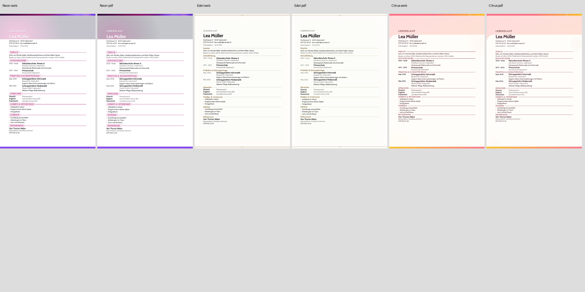

# Same-SHA Web ↔ combined PDF parity

Source: `d043698c4f5b83db097d3b502a2c40cefc3e0a9d`. 39 templates / 117 page pairs.

The galleries were generated on that original local source SHA. Its published
equivalent is `1ecb36fae415025cb737e981bede0b2523e6cd59`; the complete source tree
is identical (`faf23800d9128776157582c87ec4a9a2b997c106`). The connected GitHub API
assigned new metadata when transferring the unpublished completion commits.

RGB and grayscale/layout SSIM use the existing A4 normalization and 265 × 375 analysis grid. Scores report raster similarity; browser geometry, pagination and selection tests provide the structural guarantees.

| Page   | RGB SSIM mean | Layout SSIM mean |
| ------ | ------------: | ---------------: |
| cover  |      0.987325 |         0.988181 |
| letter |      0.991995 |         0.992846 |
| cv     |      0.953837 |         0.954503 |
| all    |      0.977719 |         0.978510 |

Lowest CV scores:

| Template  | RGB SSIM | Layout SSIM |
| --------- | -------: | ----------: |
| Neon      | 0.929941 |    0.931309 |
| Edel      | 0.936740 |    0.938271 |
| Citrus    | 0.938803 |    0.939593 |
| Verlauf   | 0.940652 |    0.940721 |
| Colorful  | 0.941523 |    0.941373 |
| Human     | 0.941331 |    0.941769 |
| Horizont  | 0.941757 |    0.942221 |
| Seriös    | 0.942612 |    0.942983 |
| Editorial | 0.942486 |    0.943293 |
| Modern    | 0.943581 |    0.943696 |

## Structural proof and interpretation

- Visible CV vs canonical combined print DOM: boxes agree within 0.02 mm for all 39 gallery CVs.
- Normalized html2canvas clone: tested main/header/section/entry/photo/sidebar boxes agree within 0.3 mm.
- The 39 final Web CV screenshots are pixel-identical to the Package 3 gallery.
- Cold combined export, simultaneous renderer isolation, real PDF selection boxes and long classic/sidebar CV marker distribution are independently tested.
- The final local verification passed 1,099 unit tests and 13 focused browser tests, including the 39-template clone proof and exact unblurred Aurora/Ledger RGB samples. Typecheck, lint, build, release formatting and changed-file formatting passed.

The pre-zoom-normalization CV mean was RGB 0.776090 / grayscale-layout 0.774098 on `0d0b816cc6c1f9b24036c966f62533d3c25c58b6`. The final mean is RGB 0.953837 / grayscale-layout 0.954503. Neon improved from layout 0.607382 to 0.931309. These are similarity scores, not percentages of correctness.

The lowest three CV pairs were inspected visually. Their content distribution and section positions agree; text antialiasing, thin rules and some decorative paint differ. Native CSS blur remains unsupported by html2canvas: a direct Neon diagnostic measured a 33-unit red-channel difference in a blurred hero sample despite matching live/print styles. Mixed filters and blurred/spread shadows were deliberately left intact rather than approximated. Pixel identity is therefore not claimed.

The generated score CSV contains all 117 pairs. The contact sheet below shows Web/PDF pairs for Neon, Edel and Citrus.

## Release checks

The required browser matrix contains 143 tests across `cv-pdf`, `cv-m9-pagination`, `templates-layout`, `fresh-dossier-templates` and `dossier-flow`. The standard regression workflow uses one worker per group and publishes the `M6 Release Candidate` status. The completion commits are published on dev. Final remote CI is running, including the additional browser groups and all ten Web gallery batches; results attach to the published commit in [GitHub Actions](https://github.com/modebrecht/cv-cover-charm/actions?query=branch%3Adev).

On the resumed `b2477e7a` checkpoint, all 25 check runs and M6 were successful. An earlier local three-worker run reported 139 passes and three timeouts; its affected 12-test set passed when rerun with one worker. Final local capture checks used one worker and passed unchanged geometry/selection tolerances.

The full repository format check still reports 156 pre-existing differences in untouched files. No modified source/test file appears in that list. Lint has zero errors and 21 existing warnings. The release format scope and all test assertions were retained.

No production QA route was added: the normal home export dialog mounts the canonical `DossierPdfCanvas`, and the tests inspect that same DOM. The render-branch visual promotion workflow remains a later gate and was not triggered by changing `render`.
