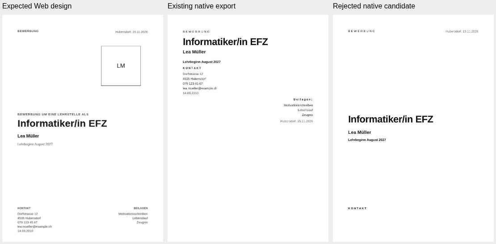

# DOCX Next Cover Fidelity — Item 37

**Verdict: BLOCKED. The defect is reproduced; no cover correction is accepted.**

This branch preserves the diagnosis, measured 39-template evidence and one rejected generic
experiment. Production source is byte-identical to fetched dev. It does not complete Item 37,
enable a new export, merge a branch, deploy a preview or reopen the Sidebar investigation.

## Provenance and boundaries

- Fetched remote dev: `8901a830a792d75e9e792345c5180827218b4e1e`, rechecked before publication.
- Working branch: `fix/docx-next-cover-bottom-zones-15okt`; clean at creation.
- Root AGENTS.md read; no subordinate instructions found.
- No open PR or existing Item 37 branch was found in the inspected branch inventory.
- Items 11/12 and their reports are present on dev. Item 13's report was read on its separate
  unmerged branch; that branch was not modified or incorporated.
- The Vercel project read confirms project `prj_Ip4lHR688tFQ4QZXCrOZ4OfXo6Im`,
  team `team_bgCMPzd6v634brLp9mvGrngl`. That read omits full Git integration settings.
  Repository deployment control already disables `*` and enables only main. This branch adds
  its exact name with false. No deployment endpoint or hook was invoked.
- The original workspace became unavailable during the run. A temporary isolated sandbox
  recovered the same dev and dependencies. No application was deployed from that sandbox.

## User evidence and identified reference

The original `app-body-photo-right.docx`, both saved DOCX files and both Word-generated PDFs
were actually materialized and inspected before the workspace failed. The original generator
is `scripts/docx-next-sidebar-body-probe.ts`: its photo-right case calls
`sidebarFixture()` → `briefFixture()`. The actual cover template is **Brief**, not Modern.

The original cover has nine native semantic fields, no cover table, and no cover decorative
image. The package's single image belongs to the CV photo. Those facts and the cover XML do
not depend on the screenshot's appearance. Sidebar geometry/cropping was not changed.

The current Web editor was opened with the reconstructed fixture's saved data and defaults;
all 39 actual editor pages were captured and measured. This is a reconstructed reference:
the originating user-authored JSON was not supplied. The current editor also restores a
default kicker and displays an initials placeholder when the fixture's photo is null.
The fixture source has an empty kicker and no semantic image. Consequently the Web capture
is not falsely described as an exact frozen snapshot of the user's original saved design.

The supplied Word PDFs have the same measured cover coordinates after both saves:

| Field / region         | Current Brief Web editor, mm |                                        Supplied Word PDFs, mm |
| ---------------------- | ---------------------------: | ------------------------------------------------------------: |
| Profession/title top   |                       134.42 | within the measured 20.13–42.38 title group (combined bounds) |
| Applicant name top     |                       155.75 |                                                         45.38 |
| Contact heading top    |                       251.26 |                                                         67.77 |
| Contact body top       |                       257.52 |                                                         75.39 |
| Attachment heading top |                       251.26 |                                                        108.71 |
| Attachment body top    |                       257.52 |                                                        116.34 |
| Location/date top      |                        19.49 |                                                        137.34 |

Web measurements are element boxes scaled from the complete 210 mm page. PDF measurements
are glyph bounds; allow approximately 1–2 mm for that distinction, not the observed
100+ mm placement error. The two Word saves have identical extracted positions, despite
different PDF byte hashes. This does not suggest that Word caused the original displacement.

The reported large grey surface is not established as printed cover artwork by the inspected
PDF and original cover package. Its precise screenshot/UI origin remains unresolved.
Do not claim a surface fix from this evidence.

## Demonstrated root cause

`cover-composition.ts` sorts source fields by `TemplateDefinition.cover.order` and converts
them to native paragraphs and growing tables. It deliberately drops text X/Y, anchorBottom,
above and follows placement. Authored lower lanes therefore become ordinary flow directly
after the hero. In Brief, the descriptor names `datum`, while the real source field is
`ortDatum`; the date receives the unknown-field sort rank and falls to the end.

This is larger than an attachment spacing defect: the current Web hero itself is around
134 mm, while the original native hero is near the top. Moving Beilagen alone cannot
restore the intended design.

Other templates consume authored fixed rectangles as growing row/cell surfaces. That is a
demonstrated architecture difference and a possible separate paint mismatch; it is not
proof that the user's grey area is one of those surfaces.

The audited source includes the requested composer, descriptors, model/builder, elements,
renderer, validation, page artwork, decoration, source/snapshot and editor layout/resolve
modules. The existing primitives represent flowing native compositions; they do not establish
accepted editable page-region ownership for this fixed cover design.

## One bounded generic experiment — rejected

The reviewable patch adds an explicitly guarded builder candidate and a bounded cover-region
property on the existing native table primitive. It has no template-ID dispatch, XML repair,
second renderer, bitmap text, large paragraph spacer or Sidebar geometry change.

The candidate resolves saved anchors with native text reservations, retains field IDs and
native text/runs, uses existing image/paint services and the single renderer, and fails
explicitly for text beyond physical A4 bounds. Default generation is unchanged. The existing
native diagnostic opt-in is still required to emit the candidate.

The first lower-only trial produced 16 existing-test failures, including lost surface
ownership and cover/whole-document table coupling. It was not retained as a fix.
The isolated full-page trial passes all seven new structural/negative tests and all existing
tests, but the actual native rendering rejects it:

- **39/39** templates preserve canonical semantic runs, Letter/CV models and JSON restoration.
- **117** actual package generations pass; candidate/restored package bytes agree for all 39.
- **170** real browser-rasterized decorative assets are exercised.
- **78** baseline/candidate DOCX files are rendered using stock LibreOffice **25.2.7.2**.
- **38/39** candidates fail first-page content or page-count checks.
- The remaining result is **UNVERIFIED**, not a visual PASS.
- Brief's same-fixture native dossier grows **4 → 5 pages**. Contact details and attachments
  leave the cover's first page. The supplied original Word dossier has three pages and a
  different CV composition; those counts are not presented as a same-engine comparison.



The image shows the first A4 page in each case. The candidate improves upper placement but
loses lower content to subsequent pages. Screenshots supplement the semantic and PDF checks;
they are not the content-preservation proof.

No engine workaround, anchor-lifetime investigation, rounding experiment or Sidebar sampler
run followed this failure. Introducing accepted fixed page regions is a separate design
decision, not a justified tiny renderer switch. The experiment was removed from production
source and retained as an unapplied patch for reproducibility.

## Verification and limits

| Check                                                     | Local result                                         |
| --------------------------------------------------------- | ---------------------------------------------------- |
| Dedicated existing DOCX suite                             | 359 PASS, 0 FAIL; 55 files; 5,720 assertions on base |
| Full suite with isolated experiment and seven new tests   | 1,179 PASS, 0 FAIL; 246 files; 23,016 assertions     |
| Unchanged production unit suite after removing experiment | See final validation record below                    |
| 39-template model/package/JSON/semantic matrix            | PASS, structural only                                |
| Native 39-template visual placement gate                  | FAIL: 38 failures; one UNVERIFIED                    |
| Actual desktop Word candidate acceptance                  | UNVERIFIED                                           |
| Required 12-case stress acceptance                        | INCOMPLETE; rejected before broad acceptance         |
| Production PDF/Legacy DOCX changes                        | None                                                 |
| Sidebar, #14, #38, protected branches                     | Unchanged                                            |

The seven new tests cover all-39 semantic/model independence, Brief's two lower lanes and top
date, manual coordinates, hidden attachments, oversized-list diagnostics, invalid/nested/
foreign region ownership and guarded export. They do not prove native visual placement.
Long localized typography, photographs, custom cover margins and decorative variants have
not achieved the requested complete acceptance. In particular, the existing snapshot contract
has Letter/CV margins but no custom Cover margin setting; this limitation was not hidden by
inventing a supported control.

The runtime-boundary tests, complete default unit suite, lint, typecheck, release formatting,
build and existing shared-state browser regressions are recorded below when complete.
Repository-wide formatting debt is separate from changed-file formatting.

The dedicated feature-branch workflow independently verifies the unchanged runtime, then
applies the rejected patch only in an ephemeral job, generates/renders the matrix and runs
the placement gate with a nonzero exit on failure. A red native-experiment job is a rejection
of the candidate, not an accepted implementation hidden behind permissive assertions.
No unrelated workflow is dispatched.

## Reproduce without changing production

In an isolated checkout of this branch:

```sh
bun install --frozen-lockfile
git apply --unidiff-zero --check docs/qa/docx-next-cover-fidelity-15okt-rejected-experiment.patch
git apply --unidiff-zero docs/qa/docx-next-cover-fidelity-15okt-rejected-experiment.patch
bun test tests/unit/docx-next-cover-regions.test.ts
bun scripts/docx-next-cover-fidelity-qa.ts artifacts/cover-37/packages
mkdir -p artifacts/cover-37/pdf
soffice --headless --convert-to pdf --outdir artifacts/cover-37/pdf artifacts/cover-37/packages/*.docx
python3 scripts/docx-next-cover-render-qa.py artifacts/cover-37/packages artifacts/cover-37/pdf --check
```

Install Playwright 1.55 and Chromium as in the workflow first. The last command must reject
missing first-page fields or changed pagination. Candidate DOCX files are explicitly rejected
diagnostic fixtures; none is presented as an acceptance-ready Word export.

For a future accepted candidate, desktop Word validation must compare the original authored
Web design, all lower regions, surfaces, text editing and two Save/Reopen cycles, followed by
the complete 39-template and stress acceptance. LibreOffice is not desktop Word acceptance.

## Senior decision and next action

Keep Item 37 open at P1. Review an explicit native cover page-region contract with content
growth/overflow and story ownership before implementing another placement strategy. Use the
actual captured editor state as the shared source, including CSS/default interpretation.
Do not merge this diagnostic branch as a cover fix or revive the Sidebar investigation.
The titleblatt goal remains valid; the attempted generic placement mechanism is rejected.

## Final validation record

- Final unchanged production suite: **1,172 PASS, 0 FAIL; 245 files; 22,801 assertions**.
- Typecheck: PASS. Lint: PASS with **0 errors and 21 inherited warnings**.
- Release formatting: PASS. Production build: PASS.
- Global source/test formatting: FAIL in **151 inherited files**; production source/tests are unchanged.
- Local shared-state browser invocation was blocked by the already running port 4173.
  It is not recorded as three passing tests. The independent CI job uses a clean server.
- Changed-file formatting, patch application and final diff are checked before publication.
- First remote CI completed: unchanged runtime SUCCESS; native placement candidate rejected. See the run and job records below.
- This is a diagnostic evidence branch. The native placement gate is deliberately strict and
  the failed candidate remains rejected; no accepted implementation is claimed.

## Remote CI evidence

Execution commit: `dae206cddacd8398a14e667594ae04e1c8d93f78`.
[Run 38737583996](https://github.com/modebrecht/cv-cover-charm/actions/runs/38737583996):

- [Unchanged runtime job 116430712795](https://github.com/modebrecht/cv-cover-charm/actions/runs/38737583996/job/116430712795): **SUCCESS**.
  359 DOCX tests / 5,720 assertions; 1,172 full-suite tests / 22,801 assertions;
  typecheck, lint, both formatting gates and build pass; **3 browser integrations PASS** in 24.7 seconds.
- [Rejected native job 116430712948](https://github.com/modebrecht/cv-cover-charm/actions/runs/38737583996/job/116430712948): **FAILURE at the visual placement gate**.
  Patch application, seven candidate tests, typecheck and all 117 package generations succeed.
  The 39-template native render independently reproduces **38 failures**, including Brief 4 → 5 pages.
  Exit code 1 is the intended rejection of this failed experiment.
- CI used **LibreOffice 24.2.7.2 420(Build:2)**; the local sandbox used **25.2.7.2**.
  Both produce the same rejection count. The initial helper's static engine label is corrected
  in the following provenance commit; the job's actual version log is authoritative.
- [Rejected diagnostic artifacts](https://github.com/modebrecht/cv-cover-charm/actions/runs/38737583996/artifacts/11974078658)
  contain both package sets, PDFs and machine measurements. They expire on 29 October 2026.
  These are failed diagnostic fixtures, not Word acceptance candidates.
- The branch-filtered Vercel deployment listing is empty after publication.
  A live project listing filtered by GitHub repository ID also returns the expected linked project.

## Exact branch files

1. `.github/workflows/docx-next-cover-fidelity.yml`
2. `scripts/docx-next-cover-fidelity-qa.ts`
3. `scripts/docx-next-cover-render-qa.py`
4. `scripts/docx-next-cover-web-reference.cjs`
5. `docs/qa/docx-next-cover-fidelity-15okt.md`
6. `docs/qa/docx-next-cover-fidelity-15okt-evidence.json`
7. `docs/qa/docx-next-cover-fidelity-15okt-comparison.jpg`
8. `docs/qa/docx-next-cover-fidelity-15okt-rejected-experiment.patch`
9. `vercel.json`

There is no production source, test, dependency, protected-branch or export-toggle change.
The patch is inert unless explicitly applied in an isolated checkout.
