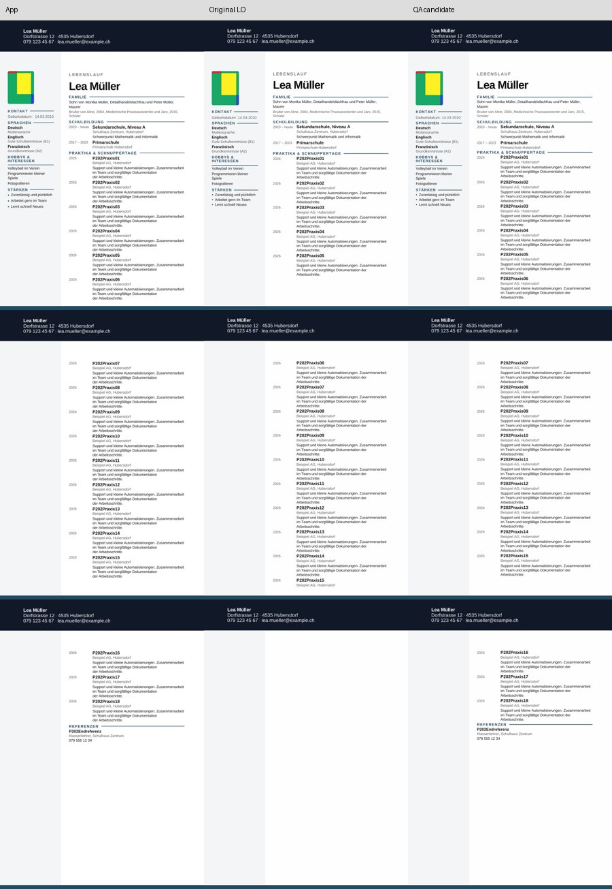
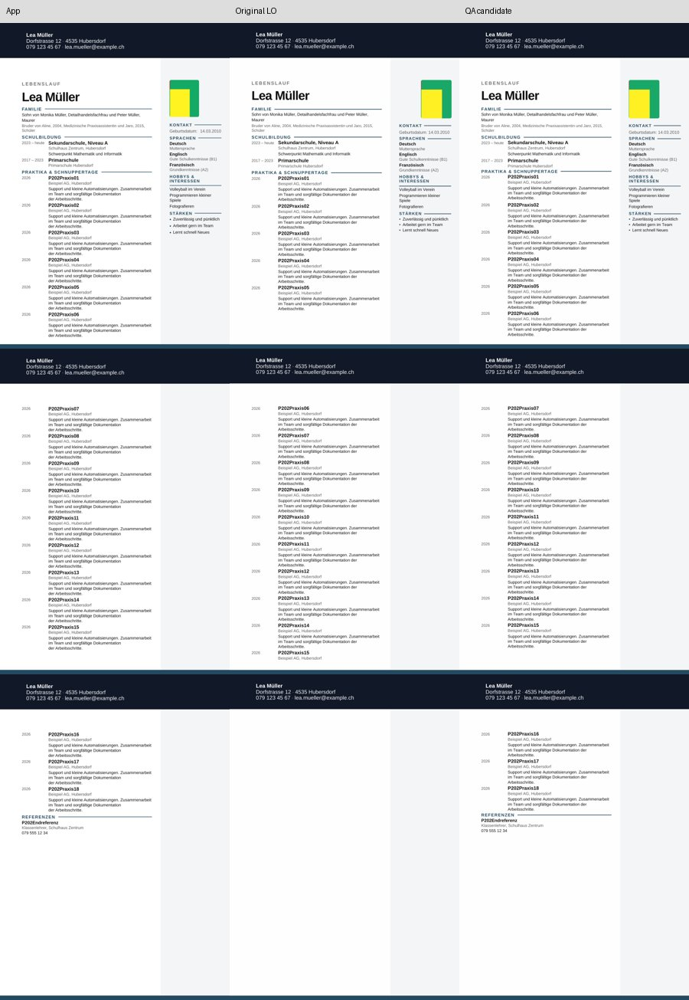
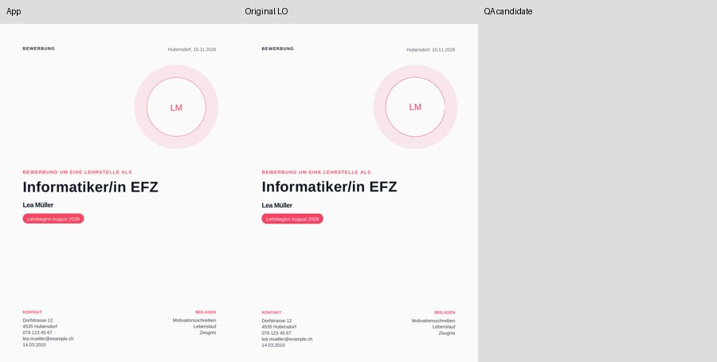
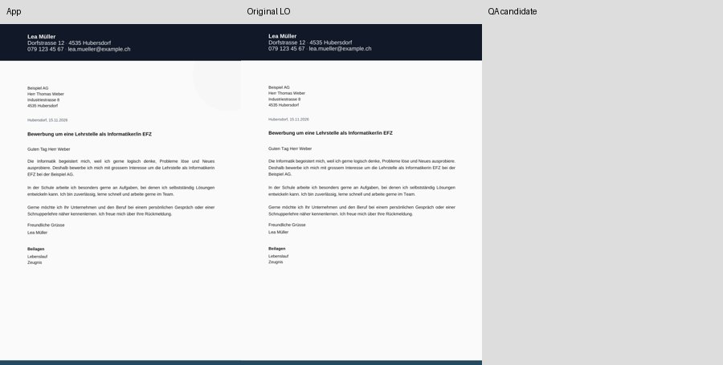

# Bounded Modern QA on dev

The regular QA path now tests synthetic source downloads through the existing
`dossier-visual-parity.yml`, retaining its two job definitions. It changes no
product source, exporter, download menu, package dependency or Next source guard.

## Running it

A relevant dev push runs one source batch: actual cover and letter downloads,
plus the long 18-entry Modern CV on both sides with the proven new crop settings.
Five browser tests include the explicit Modern-eligible/38-blocked catalogue.
Native comparison converts eight documents: cover, letter, and three variants
of each CV. The x39 browser fan-out is not run for these dev pushes. The pre-existing
`dossier-web-gallery.yml` also no longer auto-runs on dev; it remains manually
available there and automatic on its other existing branches.

Manual dispatch `qa_suite=full` exports cover/letter and the ten bounded CV cases
(17/18/19 normal entries left/right, 18 varied left/right, two fresh crops).
It makes 32 native conversions. `qa_suite=gallery` preserves the original
39-template gallery path; render retains that path. This observational gallery
is not a 39-Next export approval.

To check archived CV sources without a browser:

```bash
python scripts/dossier_qa.py --frozen --suite full --out-dir artifacts/frozen-qa
python -m unittest discover -s tests -p test_dossier_qa.py -v
```

Archived sources are ten actual synthetic UI downloads. MANIFEST.json is
SHA256-pinned in the runner, and binds each original DOCX, optional retained App
PDF, frozen App measurements, exact candidate hash, export SHA and research
report hash. App measurements for all eight ordinary/varied cases came from
P2-17; crop measurements came from P2-26. The earlier reports and complete
history remain reachable through the P2-26 archive ref. The four App PDFs for
18-entry ordinary/varied sources were not durably retained by the research;
those cases use the frozen measured references, not newly claimed downloads.

## Outcomes are deliberately separate

* `original`: unmodified exported DOCX imported by LibreOffice. Known lost
  descriptions and mirrored photo displacement remain FAIL.
* `control`: the matching native body-flow copy before the empty-footer edit;
  only its header/bottom rasters are the native frame control.
* `candidate`: guarded QA copy. Every content/layout/photo/line/frame gate must
  pass. Missing input, mixed implementation/source SHA, source hash changes,
  invalid structures or candidate regressions return a nonzero exit code.
* Suite PASS accepts this bounded QA candidate and the cover/letter checks.
  It never turns an original baseline FAIL into a product PASS.

RESULTS.json contains individual gates, original/candidate results, declared
structural changes, implementation/source identities and per-conversion time
and RSS. SUMMARY.md and App/original/candidate contact sheets are retained even
when the native suite fails. Conversion RSS does not measure total job/browser
peak memory.

## Scope and preserved rules

The private mechanics are extracted from the verified P2-26 chain into one
module, with a single public candidate recipe. They still require the exact
synthetic `P202PraxisNN`/reference markers, Modern three-column structure and
17/18/19-entry families. This is not a general CV converter.

The complete recipe preserves spacing normalization, sidebar separation, direct
main-body flow, missing leaf-row split guards, equivalent mirrored photo anchor,
four foreground lines and the verified empty-footer distance edit. All
non-document ZIP parts are preserved byte-for-byte; text, controls and graphics
are checked at each step. Text-, field- and image-bearing footers are rejected
before any copy is created; no populated footer is removed.

Gates retain full titles, description endings, varied text markers and reference
content; equal App page allocation; no split entries; title positions within
2 mm; first-page-only photo on the correct side, BBox within 2 mm and pattern
agreement >=0.90; grouped reference heading/body; reference line and all four
section lines with a dark continuous run >=0.85; matching native header/bottom
rasters. PDF text ink boxes are not Writer row boxes, and pattern agreement is
not complete App pixel identity.

Ubuntu 24.04 / repository-pinned Python raster dependencies / Cabin and
Liberation are used in CI. ONLYOFFICE investigation is closed. No Windows,
manual Word approval, product fix or 39-Next approval is implied.

## Verified integration — 2026-11-02

Native checked implementation: `2020a560e5d897285e1ee1853423dbe4a446a057`.
[Full native CI run](https://github.com/modebrecht/cv-cover-charm/actions/runs/41497645811):
both source and comparison jobs PASS. Five browser tests passed; all four fresh
UI source pairs were additionally downloaded and their PDF/DOCX SHA256 hashes
rechecked against their manifests. All pairs have the implementation SHA above.

| Case | Original LibreOffice | Guarded QA candidate |
|---|---|---|
| Cover | PASS | Not applicable |
| Letter | PASS | Not applicable |
| 18-entry crop, sidebar left | FAIL: 14/18 complete entries | PASS: 18/18 |
| 18-entry crop, sidebar right | FAIL: 14/18 complete entries; photo shifted | PASS: 18/18 |

Eight conversions produced 20 native pages on LibreOffice 24.2.7.2.
Maximum candidate title-position deviation: 1.665 mm. Both photo pattern
agreements: 1.0, with BBox deviations below the retained 2 mm gate. All reference,
line, page allocation, entry split, header and bottom gates passed for candidates.
Measured peak converter RSS: 243388 KiB (237.7 MiB); this is not total job/browser
peak memory. Original failures remain FAIL in the durable evidence.

Local validation: 12 Python test groups, including exact regeneration of all ten
research candidates, negative content/photo/line/footer/source/App-marker gates,
and a contact-sheet check excluding OCR diagnostic images. The new evaluator
also passed all ten retained native research PDFs without new conversions.
These are overlapping checks, not 22 unique native test cases. The complete
fresh ten-CV native matrix is available manually; it was not rerun in this smoke
integration check.

CI fast checks on the native checked implementation also passed: 1486 product
unit tests, release formatting, TypeScript, lint (21 warnings, 0 errors) and
production build. The larger pre-existing Dossier Regression browser suite has
its own [run](https://github.com/modebrecht/cv-cover-charm/actions/runs/41497645964).

The final display-only contact-sheet correction was tested locally and rebuilt
from the retained native CI page PNGs with zero additional conversions. It
excludes `render-N-ocr.png` from the page list; measured page counts and native
gates were already correct. The three CV/letter sheets are byte-identical to
the initially reviewed rasters; the corrected one-page cover sheet was reviewed
separately. The core transformation/measurement module is unchanged from the
native checked implementation. The complete real results, resource values,
source manifests and raster hashes are retained in
[dossier-qa-integration-proof.json](dossier-qa-integration-proof.json).

### Reviewed native raster sheets

Columns show App, original LibreOffice, and QA candidate. Cover/letter have no
candidate; their last column is intentionally empty.









### Branch outcome

[The concrete 26-ref list](p2-branch-cleanup-2026-11-02.md) records exact current
SHAs, GitHub ancestry evidence and preservation decisions. 24 refs are deletion
candidates; P2-26 and the separate P2-14 proof closure remain archive anchors.
All 26 refs still exist; no deletion was performed or authorized. No new branch
was created. render and main remain at their pre-integration SHAs.

This completes the bounded QA integration and cleanup preparation. Product
exports are unchanged, and 39-Next release remains BLOCKED.
