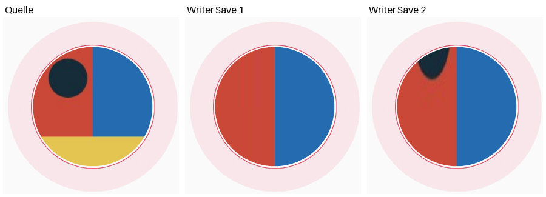

# LibreOfficeDev Save Reopen verändert Fotos und Feldbindungen

Stand 15.11.2026 · [#202](https://github.com/modebrecht/cv-cover-charm/issues/202)
· Anwendungsbasis `8aafb50b2cb4f3a2eb6735e3e18313249cbeb2b3`

Vier aktuelle DOCX-Dateien aus dem normalen Produkt-Download wurden jeweils
zweimal tatsächlich mit Writer gespeichert und erneut geöffnet/gerendert.
**Ergebnis: INCOMPATIBLE für vollständige Bild- und Feldbindungserhaltung.**
Texte und Seitenzahlen bleiben erhalten. Fotos werden jedoch zugeschnitten
neu abgelegt, native Bilder in Formfüllungen umgeschrieben und Feldbindungen
verändert. Beim Titelblatt ändert sich auch das sichtbare Motiv erheblich.
Die Anwendung und ihre Exportfreigaben werden durch diese QA nicht geändert.

## Umfang und Laufzeit

- Vier bestätigte UI-Importe und vier echte DOCX-Downloads: CV links, CV rechts,
  zweiterseitig fortgesetzter Brief und dreiteiliges Gesamtdossier.
- Modern/Sans mit der unterstützten Sidebar-Komposition; keine Umgehung der
  Produktgrenzen. Die gespeicherten Dokumentdaten bleiben beim Download gleich.
- Asymmetrisches synthetisches PNG mit 160 × 200 Pixeln. Links: Kreis, Zoom 1,35,
  Ausschnitt 30/70, Rahmen 0,3 mm. Rechts: Hochportrait, Zoom 1,65, Ausschnitt
  85/20, Rahmen 1,2 mm. Das Titelblatt erhält dieselbe Bildquelle.
- Acht erfolgreiche Writer-Speichervorgänge; zwölf Renderzustände mit insgesamt
  21 Seiten. Alle 21 Seiten wurden visuell geprüft. Ein unabhängiger vollständiger
  Wiederholungslauf liefert dieselben 21 Seitenpixel.
- LibreOfficeDev **26.8.0.0.alpha0**, Build
  `2c87e51eeaa2b413ff4ae097b2705eea1995d8e5`, bereitgestellte Runtime
  `26.8.0.0.alpha0-codex.1`. Manifest einschliesslich Patch-Revision und Hash ist
  im Nachweis enthalten. Keine Engine-Binärdatei wurde verändert.
- Die PDFs enthalten Liberation Sans und für einzelne Listen OpenSymbol.
  Windows-Schriften und Microsoft Word sind dadurch nicht geprüft.

Diese Befunde gelten für die benannte Entwicklungslaufzeit. Sie sind keine
pauschale Aussage über stabile LibreOffice-Versionen und kein Word-Befund.

## Ergebnis je Datei

«Feldbindung verändert» bedeutet: Ein Quell-Control-Vorkommen ist nicht mehr
mit gleichem Feldtext und derselben kanonischen Dokument-/Headerrolle eindeutig
zuordenbar. Das ist von weiterhin vorhandenem Klartext zu unterscheiden.

| Datei              | Seiten Quelle / Save 1 / Save 2 | Originalfoto nach Save        | Feldbindungen verändert Save 1 / Save 2 |
| ------------------ | ------------------------------- | ----------------------------- | --------------------------------------- |
| CV links           | 1 / 1 / 1                       | 160 × 200 → 119 × 119         | 49/59 · 49/59                           |
| CV rechts          | 1 / 1 / 1                       | 160 × 200 → 97 × 121          | 47/59 · 47/59                           |
| Zweiseitiger Brief | 2 / 2 / 2                       | kein Foto                     | 6/43 · 6/43                             |
| Gesamtdossier      | 3 / 3 / 3                       | Cover 160 × 160; CV 119 × 119 | 55/102 · 56/102                         |

Die ursprünglichen 160 × 200 Fotopixel sind in den zurückgespeicherten Paketen
nicht mehr enthalten, auch nicht als unbenutztes Bildasset. Die Bilder bleiben
sichtbar referenziert; es handelt sich nicht lediglich um umbenannte Dateien.
Die aktive Bildrepräsentation wechselt von `native-picture` zu
`drawing-shape-fill`. Die ursprünglichen `srcRect`-Beschnitte und spätere
nichttriviale `fillRect`-Angaben werden nicht ohne Beweis gleichgesetzt:
Die semantische Crop-Äquivalenz bleibt dort ausdrücklich unbekannt.

Alle Quell-Feldtexte finden sich weiterhin in XML und gerenderten Seiten.
Dies ist ein Textüberlebensnachweis, keine Bestätigung gleicher Feldbesitzer
oder unveränderter Controls. Zusätzlich ändert sich die Verschachtelung aller
59 CV-Control-Vorkommen, aller 43 Brief-Vorkommen und von 92/102 Vorkommen im
Dossier. Der Vergleich folgt kanonischen Tags und Story-Rollen; zufällige
Teildateinamen oder gleich lautende Texte begründen keine Zuordnung.

## Sichtbare Änderungen

Der zweiseitige Brief bleibt in beiden Speicherzyklen pixelgleich mit seiner
Quelle. Auch die Briefseite im Gesamtdossier bleibt gleich. Insgesamt sind
**6/14** Quell-/Save-Seitenpaare exakt RGB-gleich bei 96 dpi, ohne Masken und
ohne Glättung. Die CVs bleiben lesbar; die abweichenden Pixel allein werden
nicht pauschal als grosse Layoutverschiebung ausgegeben.

Beim Titelblatt ist der Unterschied dagegen eindeutig: Nach Save 1 fehlen
der dunkle Kreis und die gelbe Fläche im sichtbaren Foto. Save 2 ändert die
Darstellung erneut. Die beiden Standalone-CVs und der lange Brief sind zwischen
Save 1 und Save 2 stabil; im Dossier bleibt die Titelblattseite instabil.



Dieser Bildausschnitt dient ausschliesslich der Illustration. Die vollständigen
Seiten wurden unverändert verglichen. Die ursprünglichen Produktdownloads
bleiben während aller Office-Vorgänge bytegleich erhalten.

## Reproduzierbare Prüfung

Der neue Browserlauf besteht mit **4/4 Fällen**, ohne Retry, Skip oder instabilen
Fall. Die fünf gezielten Python-Tests bestehen: direkte Bilder ohne SDT,
Writer-Formfüllungen mit genau einer aktiven Markup-Compatibility-Repräsentation
sowie fehlende/externe Bildbeziehungen, vollständige Quellfotos und Ablehnung
alter Ausgabedateien vor dem Office-Start. App-/QA-Typen, gezieltes ESLint und
Prettier bestehen. Diese grünen Prüfungen sind keine grüne Writer-Abnahme.

Die bestehende SDT-Zuordnungsprüfung allein reicht für die heutigen direkten
Fotoanker nicht aus. Die zusätzliche Bildprüfung erfasst aktive DrawingML-/VML-
Bildreferenzen unabhängig vom Vorhandensein eines SDT, insbesondere direkte
Anker und Writer-Formfüllungen. Jeder Quellfall muss die erwarteten Fotos mit
den vollständigen importierten PNG-Pixeln enthalten, bevor Office gestartet wird.

Beim Absatz über die Briefseitengrenze wird Text innerhalb der dokumentierten
Quellseitenränder zusammengeführt. Dadurch werden wiederholte Kontakt-Header
nicht fälschlich als fehlender Absatztext gezählt. Header-/Footer-Felder werden
weiterhin am vollständigen PDF geprüft; kein Seitenbild wird dafür maskiert.

Nach Einrichtung des bereits gepinnten Browserrunners und der Python-Abhängigkeiten:

```sh
playwright test --config tests/qa/playwright.lo-product-roundtrip.config.ts
python scripts/lo_product_roundtrip_test.py
python scripts/lo_product_roundtrip.py \
  --renderer /vollstaendiger/pfad/zu/render_docx.py \
  --runtime-manifest /vollstaendiger/pfad/zum/runtime-manifest.json \
  --output artifacts/lo-product-roundtrip/neuer-lauf
```

`--renderer` bezeichnet den vorhandenen containerfähigen DOCX-/PNG-Renderer;
`--runtime-manifest` ist optional, für den vorliegenden Nachweis aber gesetzt.
Office und Python müssen zur dokumentierten Laufzeit gehören. Jeder neue Lauf
benötigt einen frischen Ausgabeordner. Vorhandene Save-Dateien werden nicht als
neue erfolgreiche Office-Ausgabe gewertet.

Der Runner schreibt Quell-/Save-Hashes, PDF-/PNG-Hashes, Bildinventare, Feldvergleiche
und Befunde. **Exitcode 2** bedeutet erkannte Inkompatibilitäten; operative Fehler
brechen die Ausführung ab. `--analyse-only` öffnet Office nicht erneut und darf
nur vollständige vorhandene Läufe mit unveränderten DOCX-/PDF-Hashes auswerten.
Dabei bleiben tatsächlicher Speicherlauf und spätere Auswertung getrennt.

## Dauerhafte Nachweise und Grenze

[Zusammenfassung mit Hashes](lo-product-roundtrip-2026-11-15/summary.json) ·
[vollständiger komprimierter Messbericht](lo-product-roundtrip-2026-11-15/report.json.gz)

Für das dreiseitige Dossier sind die tatsächlich erzeugten Pakete erhalten:
[Produktdownload](lo-product-roundtrip-2026-11-15/dossier-source.docx),
[Writer Save 1](lo-product-roundtrip-2026-11-15/dossier-save1.docx),
[Writer Save 2](lo-product-roundtrip-2026-11-15/dossier-save2.docx).
Das sind synthetische Diagnosebelege, kein neues Paket zur Benutzerabnahme.

#202 bleibt teilweise offen: Die aktuelle repräsentative Save/Reopen-Prüfung
ist ausgeführt, inkompatible Bild-/Control-Fälle sind belegt. Eine stabile
Writer-Version und Microsoft Word benötigen getrennte Nachweise. Die normale
DOCX-Ausgabe wird nicht für diesen Alpha-Renderer umgebaut; eine Erweiterung
der unterstützten Familien oder eine Word-Freigabe wird nicht abgeleitet.
Die zwei unabhängigen Web/PDF-Kreis-REVIEWs bleiben bestehen.

**Fortsetzung am 16. November:** Die
[begrenzte stabile Gegenprobe mit LibreOffice 26.8.3](lo-stable-health-2026-11-16.md)
scheitert bereits am normalen Text-zu-PDF-Gesundheitstest: Exit 1, keine PDF,
keine Diagnose. Es wurden keine stabilen Produkt-DOCX-Speichervergleiche
ausgeführt. Laufzeitdebugging hier beendet; stabile Writer- und Desktop-Word-
Nachweise bleiben offen. Alle drei CI-Läufe von `56c8f3d` sind inzwischen grün.
Eine weitere Gegenprobe benötigt eine funktionierende Office-Umgebung und
verwendet dieselben erhaltenen Produktdateien; kein neues Benutzer-Prüfpaket.
