# Native Chromium Print Benchmark - Package 2

**Latest evidence: [Package 3](#package-3--renderer-local-architecture-and-matched-source-rerun) recommends B. The Package 2 section and results below are preserved as the historical baseline.**

**Recommendation C: abandon the current native-print experiment as a complete-dossier product option; keep the automatic PDF export primary.** Its CV improvements are substantial, but incorrect Covers and two systematically scaled dossiers outweigh them. This is a decision about the measured implementation. The experiment branch and evidence are retained for review; no button, library or production branch was changed as a decision implementation.

## Scope and provenance

Starting reference `dev`: `e3a7bc18868e94813377db4261f7e3c180e0e6fa` (24 checks green). Package 1 HEAD: `0168e97c3f4bfd1a963516e6c4672877ab8c6b28`. Work branch: `dev-native-chromium-print`. On continuation, adopted `de1bb29ca40893ac2c0c8de62d179eda8ac715c3` by fast-forward; it added only the preliminary report.

The **authoritative cohort in all accompanying scores and contact sheets** uses source `76d01bddcd7478e59af6c7b92ea251f37ec3f7ef`, tree `b26b74c6a7ff8cce3ef3a995627eda4294b2592b`. It contains 39 authoritative catalog entries, 117 visible Web PNGs, 39 current combined PDFs, 39 native combined PDFs, and two additional long dossiers. Each PDF path has 117 Cover/Letter/CV SSIM comparisons: 234 pairs total. Fixtures, fonts, stored layout state, browser and source SHA are matched. Capture SHA, fixture hashes and artifact SHA256 hashes are checked before scoring. Pilot, mixed-source, modified-artifact and incomplete-catalog runs are rejected.

`dossier-gallery-shared.ts` supplies the canonical registry and fixtures. No second template list or renderer was added. Both PDFs use the production `DossierPdfCanvas`; native preparation uses the Package 1 action and CSS with `window.print()` intercepted only to let automation call Chromium's real `page.pdf()` engine. No benchmark-specific product styling is applied.

The earlier 106-line report included a separate CI capture at the same source: CV RGB/layout Current 0.953445/0.954100, Native 0.972448/0.972346; generation means 1617/458 ms. This expanded report explicitly supersedes those summary numbers with the **local paired cohort** below. It does not mix CI and local artifacts. Their small metric variation and larger timing variation are consistent with different environments. The older ~0.954/~0.955 current baseline is preserved in `cv-web-pdf-parity-report.md`; it is not edited.

## 1. Does native Chromium look better?

For **37/39 CVs, yes**. For the **complete dossier, no**.

| Document | Current RGB mean | Native RGB mean | RGB delta | Current layout mean | Native layout mean | Layout delta |
| --- | --- | --- | --- | --- | --- | --- |
| Cover | 0.987325 | 0.841451 | -0.145874 | 0.988181 | 0.853505 | -0.134676 |
| Letter | 0.991995 | 0.982721 | -0.009274 | 0.992846 | 0.983013 | -0.009833 |
| Cv | 0.953837 | 0.972494 | 0.018657 | 0.954503 | 0.972397 | 0.017894 |
| Overall | 0.977719 | 0.932222 | -0.045497 | 0.978510 | 0.936305 | -0.042205 |

SSIM is a similarity metric, not a percentage of correctness. The existing parity normalization is reused: rasterize at 96 dpi, fit without cropping to 794 x 1123, evaluate at 265 x 375 with RGB and grayscale SSIM. Small type/rule antialiasing differences remain expected. Full-scale review is necessary because the reduced analysis image can hide local defects.

| Document | Path | RGB median | RGB min | RGB max | Layout median | Layout min | Layout max |
| --- | --- | --- | --- | --- | --- | --- | --- |
| Cover | current | 0.988802 | 0.974226 | 0.994811 | 0.989674 | 0.976090 | 0.995369 |
| Cover | native | 0.852330 | 0.588867 | 0.996755 | 0.872273 | 0.628875 | 0.997089 |
| Letter | current | 0.994034 | 0.962993 | 0.995745 | 0.994631 | 0.965874 | 0.995800 |
| Letter | native | 0.995299 | 0.755322 | 0.997392 | 0.995910 | 0.746045 | 0.997374 |
| Cv | current | 0.944827 | 0.929941 | 0.988185 | 0.945458 | 0.931309 | 0.988971 |
| Cv | native | 0.990701 | 0.612030 | 0.991923 | 0.991406 | 0.593552 | 0.992956 |
| Overall | current | 0.987724 | 0.929941 | 0.995745 | 0.988971 | 0.931309 | 0.995800 |
| Overall | native | 0.991449 | 0.588867 | 0.997392 | 0.992140 | 0.593552 | 0.997374 |

Worst template by document/path (minimum layout SSIM):

| Document | Current worst | Current layout | Native worst | Native layout |
| --- | --- | --- | --- | --- |
| cover | Verlauf 2 | 0.976090 | Mono Luxe | 0.628875 |
| letter | Sonne | 0.965874 | Violet Pulse | 0.746045 |
| cv | Neon | 0.931309 | Violet Pulse | 0.593552 |

## 2. Where does it improve?

The strongest CV layout improvements are:

| CV template | Current RGB | Native RGB | Current layout | Native layout | Layout delta |
| --- | --- | --- | --- | --- | --- |
| Neon | 0.929941 | 0.990499 | 0.931309 | 0.991632 | 0.060323 |
| Citrus | 0.938803 | 0.991247 | 0.939593 | 0.992001 | 0.052407 |
| Verlauf | 0.940652 | 0.991644 | 0.940721 | 0.992133 | 0.051412 |
| Edel | 0.936740 | 0.989581 | 0.938271 | 0.989377 | 0.051107 |
| Human | 0.941331 | 0.991715 | 0.941769 | 0.992155 | 0.050387 |
| Editorial | 0.942486 | 0.991808 | 0.943293 | 0.992784 | 0.049492 |
| Horizont | 0.941757 | 0.990868 | 0.942221 | 0.991406 | 0.049186 |
| Seriös | 0.942612 | 0.991460 | 0.942983 | 0.992144 | 0.049161 |
| Studio | 0.943217 | 0.991868 | 0.943971 | 0.992956 | 0.048985 |
| Kolumne | 0.943056 | 0.990701 | 0.943889 | 0.991129 | 0.047240 |

Manual review covered all ten requested priority CVs: Neon, Edel, Citrus, Verlauf, Colorful, Human, Horizont, Seriös, Editorial and Modern; also the largest gains, both CV regressions, all 21 significant Cover regressions and both Letter regressions.

- **Neon:** native preserves the soft blurred header field and fine type/rules much closer to Web. Current retains visible html2canvas blur/compositing differences. The improvement is visible, not just numerical.
- **Edel:** native renders the thin frame, pale surface and type more faithfully.
- **Citrus / Verlauf:** native preserves soft backgrounds and rounded content boundaries; text and fine rules are sharper.
- **Human / Horizont / Seriös / Editorial / Modern:** native generally matches type and fine-rule paint more closely; page structure is unchanged in the primary DOM audit.
- **Colorful:** the overall native score improves, but the header gradient still looks gray/darker than Web in **both** PDF paths. This is a metric/manual disagreement worth keeping visible; a high score does not prove every local effect correct.
- **Studio 3:** the existing white name on a pale surface is low-contrast in all three artifacts. This is a fixture/template defect shared by the paths, not a native improvement.

Paint causes above are inferences from the paired images and known render paths, not proof of every individual CSS mechanism.

## 3. Where does it regress?

A layout delta below -0.01 is used here only to group **significant visual regressions**, not to relax structural tolerances. The full 117-row CSV retains every delta, including smaller losses.

| Document | Template | Current layout | Native layout | Layout delta |
| --- | --- | --- | --- | --- |
| cover | Mono Luxe | 0.990198 | 0.628875 | -0.361324 |
| cover | Cove | 0.991063 | 0.649016 | -0.342047 |
| cover | Ribbon | 0.991338 | 0.657610 | -0.333729 |
| cover | Ledger | 0.990833 | 0.669318 | -0.321515 |
| cover | Gallery | 0.979215 | 0.666417 | -0.312798 |
| cover | Orbit | 0.990866 | 0.686795 | -0.304072 |
| cover | Edge | 0.993811 | 0.690902 | -0.302909 |
| cover | Prism | 0.988378 | 0.686445 | -0.301933 |
| cover | Glow | 0.990642 | 0.700791 | -0.289851 |
| cover | Studio 2 | 0.987625 | 0.705436 | -0.282189 |
| cover | Studio 3 | 0.990091 | 0.714565 | -0.275526 |
| cover | Violet Pulse | 0.987227 | 0.733488 | -0.253739 |
| cover | Warm 3 | 0.990766 | 0.747097 | -0.243669 |
| cover | Diagonal | 0.993427 | 0.755469 | -0.237958 |
| cover | Horizon | 0.977691 | 0.746630 | -0.231061 |
| cover | Forest Flow | 0.992658 | 0.767380 | -0.225278 |
| cover | Verlauf 2 | 0.976090 | 0.776555 | -0.199536 |
| cover | Verlauf 3 | 0.976930 | 0.791783 | -0.185147 |
| cover | Warm 2 | 0.989674 | 0.805183 | -0.184491 |
| cover | Sunrise | 0.983267 | 0.872273 | -0.110993 |
| cover | Editorial | 0.994701 | 0.930898 | -0.063802 |
| cv | Violet Pulse | 0.964261 | 0.593552 | -0.370709 |
| cv | Glow | 0.966037 | 0.697440 | -0.268597 |
| letter | Violet Pulse | 0.993178 | 0.746045 | -0.247133 |
| letter | Glow | 0.995317 | 0.774903 | -0.220415 |

**21 Covers regress.** In the native combined canvas, many Fresh/signature Covers lose their intended header/sidebar/motif and become an incorrectly colored full-page field with default block positioning. Code inspection finds remaining `html[data-dossier-template=...]` scopes in Cover CSS, while the current html2canvas clone supplies the legacy scope through `scopeDossierTemplateForHtml2Canvas()`. The combined native document cannot depend on a per-page clone's global scope. This is an observed shared-canvas/style-scope gap, not a fair isolated test of Chromium paint alone. No Cover/template patch was made during benchmarking.

**Glow and Violet Pulse regress in all three document kinds.** Their finished native PDFs visibly shrink the document to roughly two-thirds of the intended width/height and leave a large white area. The pre-PDF print DOM geometry still passes. Therefore DOM geometry and page-count guards alone do **not** establish native PDF scaling parity. The exact Chromium shrink/overflow trigger was not isolated in this package; attributing the CV failure solely to global template scope would be speculative. This rendered scaling failure is a product blocker.

Small negative Letter layout deltas also exist for Gallery and Edel Dark (under 0.001); they are captured in CSV and do not show the gross scaling failure of Glow/Violet Pulse.

## 4. Does pagination remain identical?

**Yes for page count, document order and tested marker distribution. No blanket claim of rendered geometry parity is justified.**

All 39 native combined PDFs have the canonical physical count, order Cover -> all Letter pages -> all CV pages, and A4 dimensions within the existing PDF check tolerance. There are no blank/missing/duplicated pages or application-UI pages in this cohort. Every native physical page has nonempty text. The existing screenshot/PDF duplicate-image guard also passes.

Primary 39-template CV live -> canonical and canonical -> print DOM checks include main, header, sections, entries and names with unchanged text and computed font metrics. Maximum canonical -> print displacement is **0.000064 mm**, below the unchanged **0.02 mm** tolerance. The canonical gallery has no CV photograph, so this is not a claim about photo placement.

Long fixtures:

| Fixture | Canonical sequence | Current count | Native count |
| --- | --- | --- | --- |
| long-studio3-classic | cover -> letter -> letter -> cv -> cv -> cv | 6 | 6 |
| long-gallery-sidebar | cover -> letter -> letter -> cv -> cv -> cv -> cv -> cv | 8 | 8 |

All 14 Letter markers, 18 CV-entry markers and the reference marker occur on the same physical pages in canonical DOM, current PDF and native PDF for each long fixture. The scorer reopens actual PDF bytes to verify this distribution; it does not trust capture metadata alone.

The separate 39-template photo/sidebar fixture uses saved circular/free photo state and mirrored sidebar layout. It ran on `de1bb29c`; its `src` tree (`b79d603685972f29cd3268c31190efd439dcbba4`) and bundled-font tree are byte-identical to the primary source. It contributes **no SSIM scores** to the primary cohort.

- Canonical -> native-print geometry passes all 39, maximum **0.000071 mm**. Photo/sidebar nodes remain present, with unchanged geometry, font values and radius.
- Strict live-preview -> shared-canvas geometry **fails** for Neon, Verlauf and Citrus: a 3.000-mm content inset difference produces downstream vertical differences up to 13.281 mm (Verlauf 13.042 mm). Differences affect content, not the photo/sidebar nodes. The native renderer faithfully preserves the already differing canonical canvas. These are shared-export discrepancies, not evidence of a new native-only shift.
- The supplemental opt-in test exits nonzero for these three cases using `expect.soft` with the original 0.02-mm threshold so all 39 results can be recorded. The tolerance is not weakened, and this failure is not described as green. Details are in `native-chromium-print-photo-geometry.json`.

Combined with the actual PDF scaling failures for Glow/Violet Pulse, **full structural parity is not established**. The native option cannot be called a highest-quality complete-dossier export on this evidence.

## 5. Is native text selectable/searchable?

**Yes, real embedded text and fonts exist, with material search/copy limitations.** The audit extracts glyph-backed text and searches representative Letter recipient/body, CV name, section heading and entry in all 39 PDFs. Whitespace-normalized sample content is present for all five categories in both paths.

| Search / copy check | Current | Native |
| --- | ---: | ---: |
| Literal Letter recipient/body, CV name/entry | 39/39 each | 39/39 each |
| Literal template-specific first CV section heading | 39/39 | 34/39 |
| Letter body extracted before closing | 0/39 | 39/39 |
| CV name extracted before first entry | 39/39 | 38/39 |
| CV document title extracted before first entry | 39/39 | 1/39 |

Native fails literal section search for **Modern, Sonne, Studio, Neon and Aurora**. For example Neon extracts `FAM IL IE`; whitespace-normalizing proves the content exists but does not restore ordinary literal search or clean copy/paste. Native also yields two searchable copies of the name in Warm and Neon. Colorful places name after the first entry in extracted reading order. In most native CVs the document title is emitted after the body.

The native Letter extraction places its body before the closing, unlike the current invisible text-layer order. Accented names such as `Lea Müller` remain searchable. Native embeds Cabin font subsets; current uses its existing embedded Cabin/invisible text-layer implementation. Font family/size/weight/line-height/letter spacing in the primary DOM audit do not change. These text checks do not constitute a PDF tagging/accessibility certification or a manual test in every PDF viewer.

## 6. What happens to file size and performance?

Combined three-page PDF sizes, **bytes**:

| Path | Mean | Median | Smallest | Largest |
| --- | --- | --- | --- | --- |
| current | 1,310,826 | 1,287,830 | 1,190,179 | 1,479,255 |
| native | 221,723 | 158,043 | 99,784 | 1,342,398 |

Native is 83.1% smaller on average. The native largest file is still about 1.34 MB, so savings are not uniform; blur/filter content can require image payloads. No compression optimization was performed.

DOM-ready -> PDF produced, milliseconds:

| Path | Mean | Median | Fastest | Slowest |
| --- | --- | --- | --- | --- |
| current | 2,088 | 2,022 | 1,755 | 2,857 |
| native | 677 | 639 | 401 | 1,204 |

The timed native operation includes the product preparation/action and `page.pdf()` generation. Current includes button activation, rasterization, assembly and download bytes becoming available. In this environment native is around three times faster; human print-dialog time is excluded. This is an approximate single sequential cohort, not a device performance promise.

## 7. What is the UX cost?

Current: click -> **automatic PDF file download**.

Native: click -> **browser/system print dialog** -> choose **Save as PDF** -> confirm. The user also controls print destination, backgrounds, scale and browser headers/footers. The benchmark's zero margins/background-enabled settings cannot force equivalent choices in the interactive system dialog. Only desktop Chromium was tested; Firefox, Safari and mobile equivalence remain unverified.

## 8. Recommendation

**C - Abandon the current Native Print experiment as a complete-dossier export; current PDF remains superior overall.**

The CV mean/median and visible Neon improvements are compelling, and PDFs are smaller/faster to generate. They do not compensate for 21 incorrect Covers, two globally shrunk native dossiers, five CV heading search failures and inconsistent CV extraction order. Keeping this implementation as an option labelled “highest quality” would promise more than it delivers. The dialog cost further raises the quality bar.

No decision implementation is performed: current PDF button, html2canvas/jsPDF, metadata, filenames, searchable text layers, ICC handling and automatic-download flow remain unchanged. No merge, deployment or promotion is authorized here. Retain the branch/evidence for review; any future experiment addressing style scope and native scaling requires a new explicit task and a new matched-source benchmark.

## Configuration and reproducibility

Chromium `140.0.7339.16`, Playwright `1.55.0`, Node `v24.19.0`, Linux `6.18.44`; `AMD EPYC 9V74 80-Core Processor`, 9 logical CPUs, 9.73 GiB reported memory. Screenshot viewport 1800 x 1600, device scale 1. Fonts are the repository's bundled Cabin TTFs.

```json
{
  "format": "A4",
  "landscape": false,
  "margin": {
    "top": "0",
    "right": "0",
    "bottom": "0",
    "left": "0"
  },
  "printBackground": true,
  "preferCSSPageSize": true,
  "displayHeaderFooter": false,
  "scale": 1
}
```

Raster/metric environment: python 3.12.14, pymupdf 1.26.6, pillow 12.3.0, numpy 2.3.5, scikit_image 0.25.2. Exact Chromium arguments, source/tree, text/geometry results, long marker/page assignments, size and timing stats are in `native-chromium-print-summary.json`; artifact and fixture hashes are in `native-chromium-print-provenance.json`.

Reproduce capture/scoring from a clean experiment checkout using the pinned scorer dependencies in `.github/workflows/dossier-regression.yml`:

```bash
python3 scripts/run_native_chromium_benchmark.py --capture-dir /tmp/native-capture
python3 scripts/native_chromium_print_benchmark.py --capture-dir /tmp/native-capture --out-dir /tmp/native-report
python3 -m unittest discover -s scripts -p test_native_chromium_print_benchmark.py
```

The opt-in supplemental audit additionally runs `native-print-photo-geometry.spec.ts` with `NATIVE_PRINT_BENCHMARK_DIR` set and a Vite server on port 4173. Its three live-preview discrepancies are expected to fail at this source; they must be resolved or explicitly re-evaluated before claiming broader structural parity.

## Durable results and visual review

- `native-chromium-print-scores.csv`: 117 rows, both PDF paths, RGB/layout deltas and source/fixture identity.
- `native-chromium-print-template-deltas.csv`: 39 template means across three document kinds.
- `native-chromium-print-deltas-descending.csv`: 39 template means sorted by native layout delta.
- `native-chromium-print-cv-deltas-descending.csv`: all CV comparisons sorted by layout benefit.
- `native-chromium-print-geometry.csv`, `native-chromium-print-photo-geometry.json`: primary and supplemental geometry.
- `native-chromium-print-text-search.csv`: 390 actual literal-search/sample-content checks.
- `native-chromium-print-summary.json`, `native-chromium-print-provenance.json`: full environment, source and audit details.

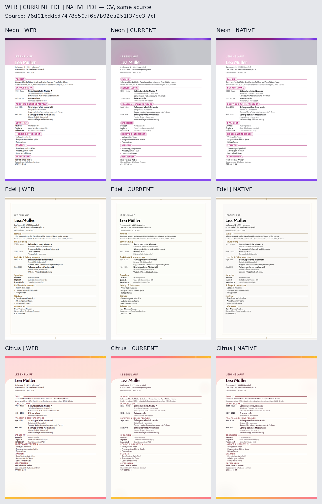

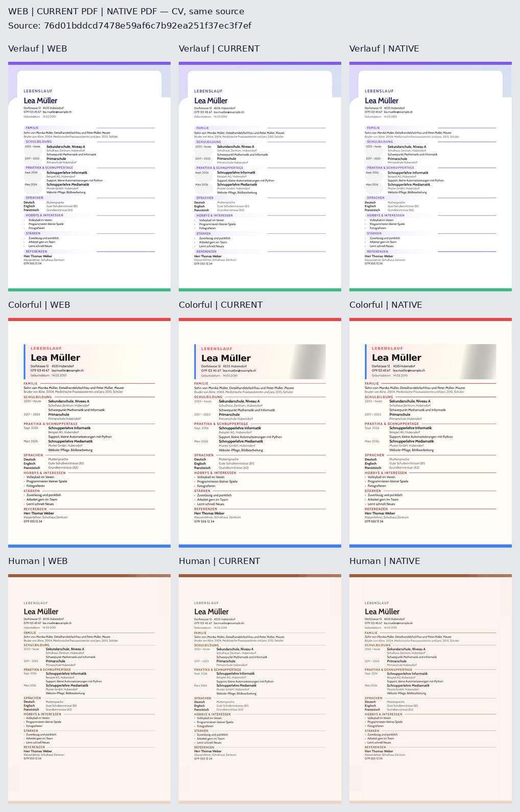

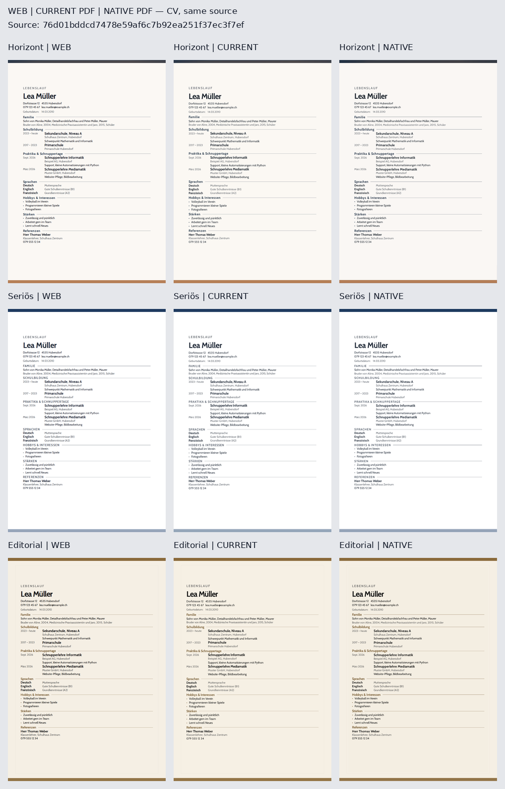

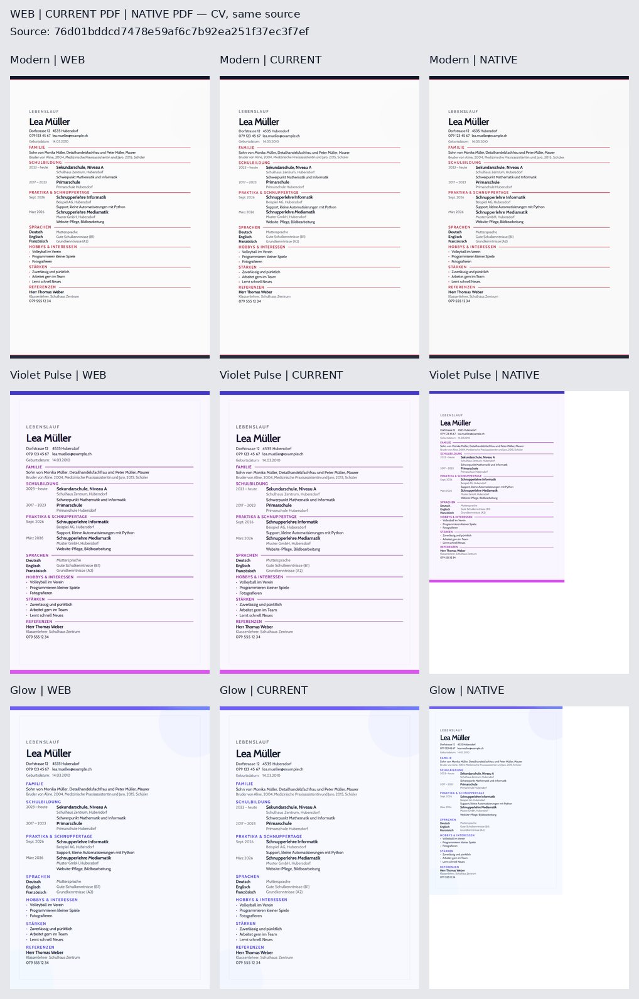

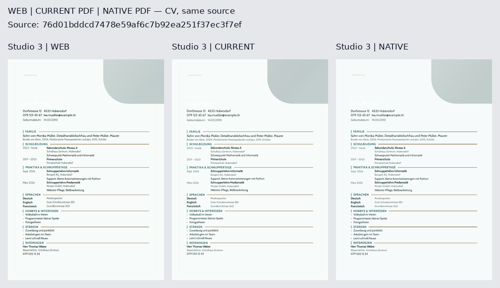

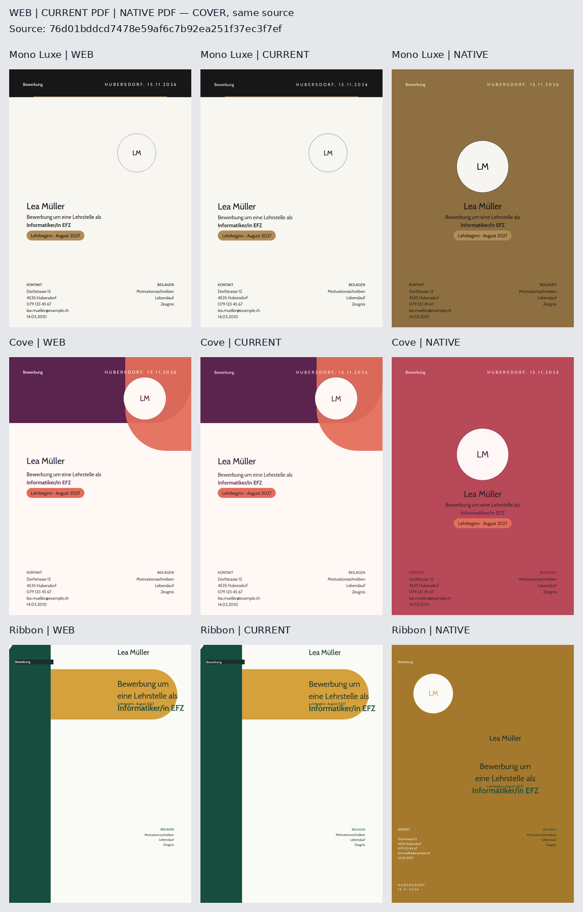

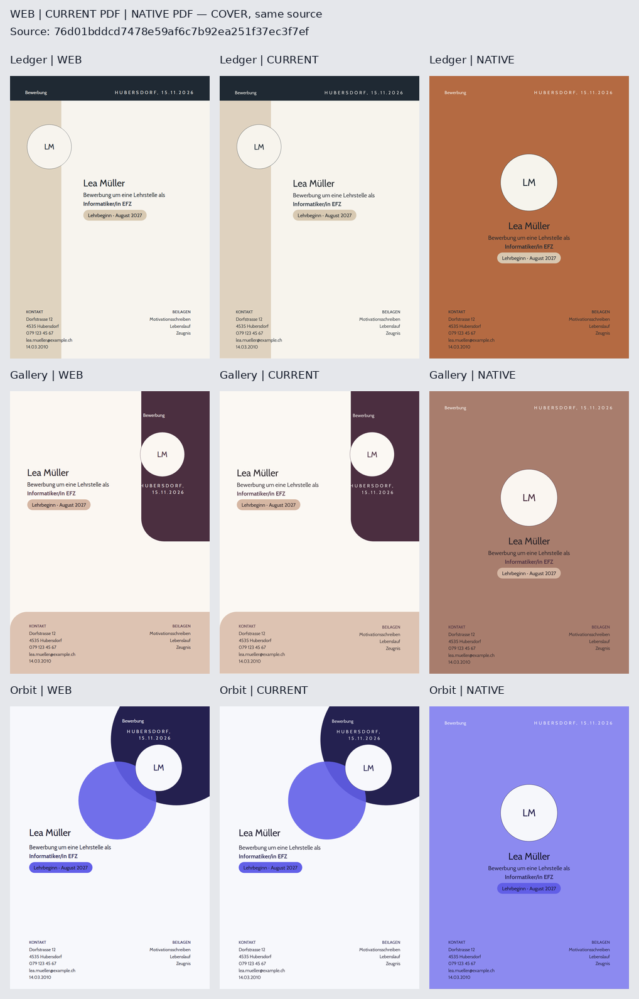

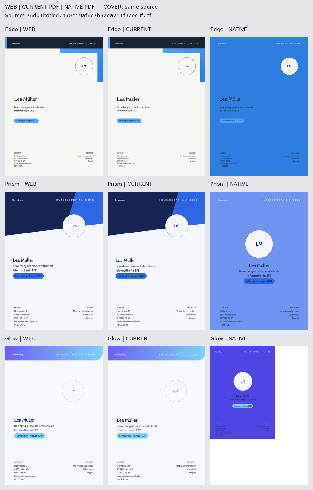

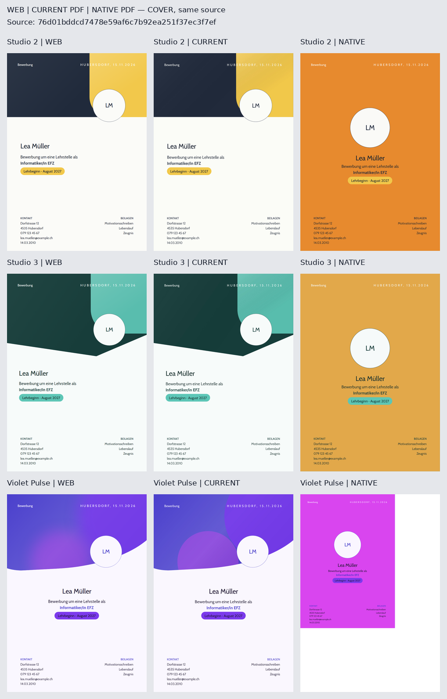

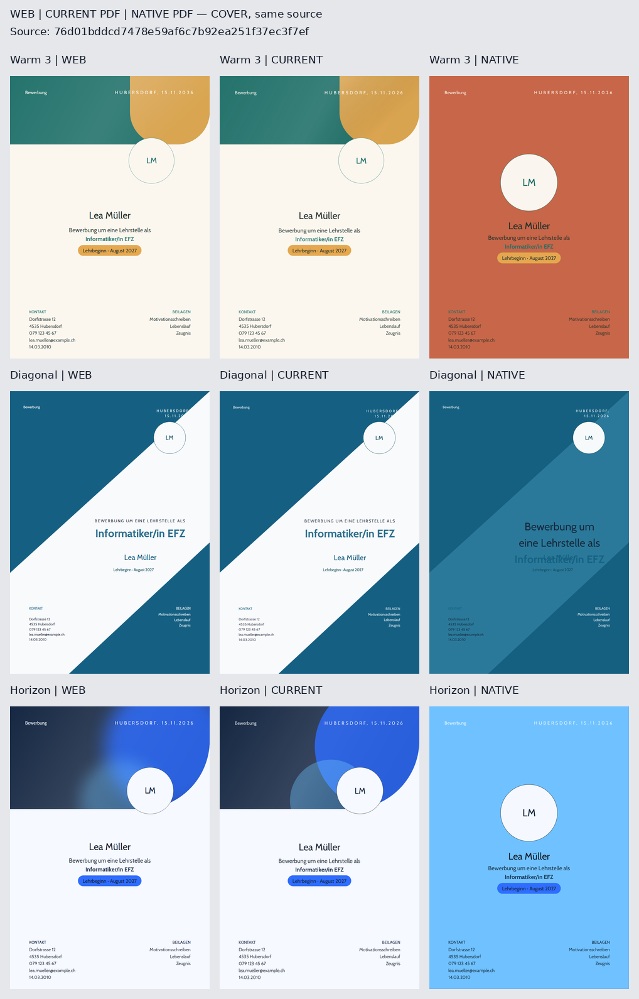

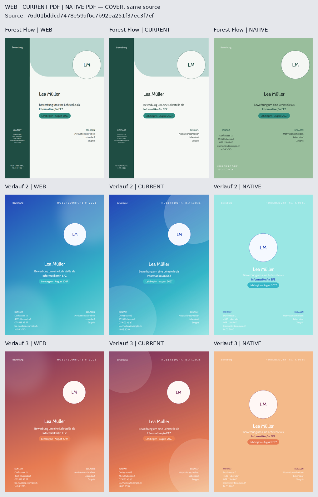

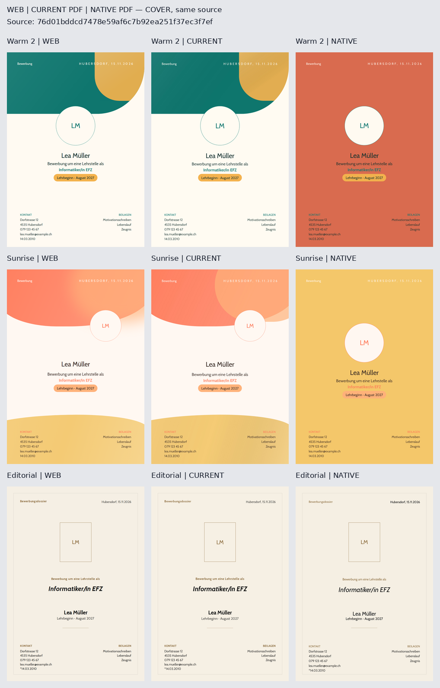

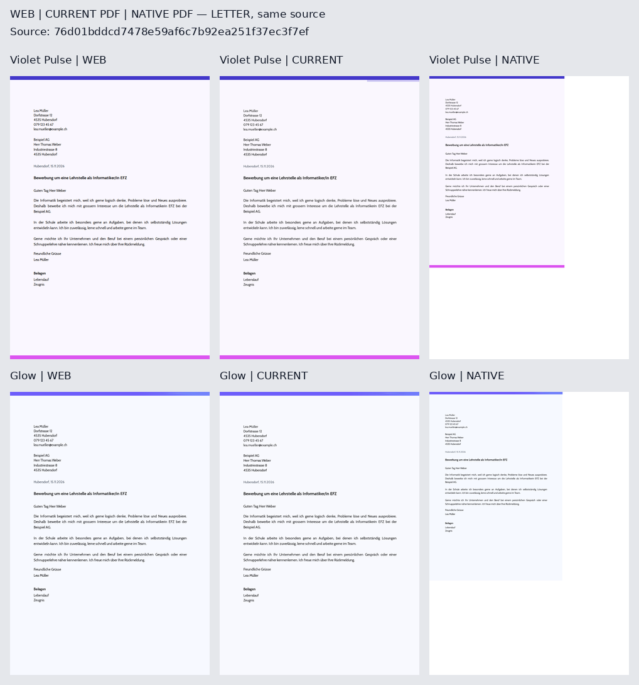

The committed contact sheets are compact review evidence (about 5 MB total), not a raw gallery. Raw PDFs/PNGs are not committed. The earlier GitHub CI benchmark is also available in [run 38155331078](https://github.com/modebrecht/cv-cover-charm/actions/runs/38155331078); the 14-day Actions retention is not used as the durable home for these results.

## Validation and branch safety

Local continuation: **1105 unit tests passed**, TypeScript typecheck passed, ESLint **0 errors / 21 existing warnings**, production build passed, supplemental test formatting passed, and **8 benchmark audit tests passed**. The scorer independently passed all source/hash/count/A4/duplicate-image/main-geometry/long-marker guards on the authoritative cohort. The supplemental live/shared-canvas guard failure is disclosed above.

At reconstruction, `de1bb29c` remote CI was **11/11 green**, including `cv-pdf` (with Package 1 native-print tests), `cv-m9-pagination`, `templates-layout`, `fresh-dossier-templates`, `dossier-flow`, other Letter/responsive groups and the full 39-template native benchmark. Results publication triggers the same required groups again; the final response records the final published commit and check status.

This continuation modifies only QA scripts/tests and documentation/evidence. No application source or template is changed. Earlier Package 2 generic print fixes are separate commits: `3d118cfb` preserves the canonical rounded-pixel geometry; `d2864eef` preserves original DOM ancestry and prevents the 16-mm Gallery child-selector regression. The invalid pre-fix cohort is excluded.

Protected remote refs remain:

- `dev`: `e3a7bc18868e94813377db4261f7e3c180e0e6fa`
- `main`: `44d7eb950b4fe972d6e890a72b6d3256ce365bc9`
- `render`: `4319c20fb85d3971ac355ae8898cdfef86ee7a8c`

No deployment, promotion, merge, force push, rebase, amend or squash of published history.

Next: decide whether Native Chromium Print should be promoted, retained as an optional high-quality export, or discarded.

---

## Package 3 — Renderer-local architecture and matched-source rerun

**Recommendation B — Keep automatic html2canvas/jsPDF primary; native Chromium is now worth retaining as an optional higher-fidelity export.** The Package 2 complete-dossier rejection is superseded by this repaired implementation and cohort. No promotion, merge or deployment is performed. The option remains confined to the experiment branch.

### Provenance and unchanged benchmark

Remote reconstruction and the continuation fetch both confirmed `dev` at `e3a7bc18868e94813377db4261f7e3c180e0e6fa`, experiment start at `a8cd824dfe1e43fbe5fa94a0afe0d5c9e66ed864`, `main` at `44d7eb950b4fe972d6e890a72b6d3256ce365bc9`, and `render` at `4319c20fb85d3971ac355ae8898cdfef86ee7a8c`. The starting tree was clean; dev had 24/24 successful checks and the experiment 11/11. `AGENTS.md` was read; published history is preserved. Recent experiment history includes Package 2 evidence (`a8cd824d`), PDF-byte/photo audits (`6bce3932`), its decision (`de1bb29c`), and the authoritative Package 2 capture checkpoint (`76d01bdd`).

The authoritative Package 3 source is **`b64054c191f068a45d6024182f0734367ef563d4`**, tree **`ff1230fe2d84dd4ecfed29933f231625d7f4d7db`**, implementation commit `fix(print): localize dossier renderers and contain physical sheet sizing`. The capture ran from a committed, clean tracked tree on `dev-native-chromium-print`. It contains 39 catalog entries, 117 Web screenshots, 39 current and 39 native combined PDFs, plus two long dossiers: **234 Web/PDF comparisons**. Documentation/evidence publication follows the identical-tree published implementation; it changes no application source. Final published HEAD and CI are reported after publication.

The existing `run_native_chromium_benchmark.py`, `native-chromium-benchmark.spec.ts`, `dossier-gallery-shared.ts` fixtures/catalog, scorer, normalization, text audit, file-size and timing methods are unchanged. No alternate renderer, pilot, weakened guard, benchmark styling or template-specific print exception was introduced. The scorer independently passed source/fixture/artifact hashes, catalog completeness, duplicate-image, A4, geometry and actual-PDF long-marker guards.

Publication used the GitHub Git Data API because the local HTTPS Git transport had no push credentials. The published implementation commit is `1c451fda82425bc3e06a59d448a9ece4caebb8c9`, with exactly the same full source tree `ff1230fe2d84dd4ecfed29933f231625d7f4d7db` as the captured local commit above. Original capture SHAs and hashes are deliberately retained in all score/provenance outputs. [publication.json](native-chromium-print-package3/publication.json) preserves the original commit metadata and the identical-tree mapping. Published history is extended by a normal fast-forward from `a8cd824d`; no published commit is rewritten.

Web screenshots were recaptured by the same production recipe at the new source SHA, as required by the same-SHA audit. This is a fresh matched cohort, not a mixture with historical PNGs. The active saved Cover, Letter, CV, chrome and layout inputs are byte-identical across all 39 cases in a separate reconstruction at `a8cd824d` and Package 3. Whole-localStorage fixture hashes differ between captures because the existing pipeline also hashes draft histories containing `Date.now()`/random IDs; hashes were never replaced or normalized. The evidence is in [fixture-state-audit.json](native-chromium-print-package3/fixture-state-audit.json).

### Scope audit and local contracts

The original audit found **254 CSS rule groups / 276 global HTML template carriers in 24 files**: 229 renderer groups (250 carriers, B), 25 retired compatibility groups (26 carriers, C), and zero template-carrier CSS groups belonging to the application shell (A). The full original selectors, declarations and classification are retained in [the scope audit](native-chromium-print-package3-scope-audit.json). Retired Frame/Warm 4/Warm 5/Sonnig/Edel-Blockig compatibility was retained with local identity; unrelated local CV selectors and UI theme behavior were retained.

Cover renderer rules now use its existing `data-dossier-document="cover"` and `data-dossier-template` root. Selector specificity is preserved, including former `:root` acceptance rules and body ancestor rules, so moving ownership does not reorder existing style precedence. No template declarations, positioning values or palettes were polished. Cover now supplies the existing family theme tokens alongside its existing local palette, effective font, block layout and footer state.

An additional global-state defect became explicit: Cover family typography tokens previously appeared only after `TemplatePicker` mounted and called `applyDossierTheme()`. A cold editor could therefore use unresolved-variable fallback typography while opening the picker changed the document without changing saved data. Package 3 emits those **existing** theme values locally. This visibly stabilizes cold-editor typography; it is not a claim of byte-identical historical Cover paint. A controlled legacy-theme activation for Brief, Modern, Blockig, Human and Sonne produces exactly the Package 3 computed fonts, paint and geometry (**0 mm** difference). No font preset numbers were changed. This explains small historical current-Cover SSIM movement; it is not dismissed as noise.

Letter pages now expose local dossier template identity and theme/palette state; `LetterDocument` also identifies its document/template. The remaining Violet Pulse cap scope and shared Human/Warm 2 document rules now belong to the Letter/Cover subtree. Existing Glow Letter rules were already local; their shared motif geometry still needed the print sizing contract below. Letter body content, font-size/line-height defaults and pagination code are unchanged.

The visible editor shell may still maintain its global identity/theme lifecycle. Hidden combined documents opt out. Renderer correctness no longer requires switching `<html>` between Cover, Letter and CV. **`scopeDossierTemplateForHtml2Canvas()` and all existing clone compatibility remain unchanged.**

### Glow and Violet Pulse: measured cause, not an SSIM inference

Package 2 actual PDF bytes were reproduced at `a8cd824d`. Before PDF generation their sheets still had the expected rounded-A4 geometry. Finished PDF glyph matrices nevertheless showed the whole dossier shrinking: CV name text was **21.481 pt for Glow / 21.817 pt for Violet Pulse**, versus **32.221 pt** with physical-sheet size containment. Cover and Letter glyphs shrank by the same factor. A4 page count alone had concealed this defect.

The Letter decoration contains positioned opacity layers with positioned primitives inside them. Existing styling can place their descendant bounds outside the clipped physical sheet: the Glow layer starts around 190 mm, while its child adds a 136 mm offset and 62 mm width. Violet Pulse also lost its intended local cap rule. Bounding the overflowing primitive, removing the Letter background, or using size containment restores actual PDF glyph scale. Disabling filters/blur does not; paint-only containment, layout containment and additional clipping did not restore Glow. These controlled interventions identify print-time fitting fed by out-of-sheet positioned geometry, rather than a pre-PDF A4 layout collapse or blur rasterization alone. The specific internal Chromium sizing calculation was not instrumented; that attribution is an inference supported by the interventions.

The generic fix is **`contain: size` on every resolved physical print page**. Width, height, clipping, ancestry, filters and the established `0.999572293` rounded-pixel-to-A4 scale remain intact. Resolved A4 sheets must not acquire intrinsic size from oversized descendants. Violet Pulse also regains its pre-existing renderer-local Letter cap rule; no Violet/Glow print transform or JavaScript branch was added.

The reproducible minimal intervention diagnosis is one unchanged Glow dossier in `native-print-physical-fitting.spec.ts`: disable only size containment, verify reduced glyph matrices; disable filters and verify the failure persists; bound only the offending primitive in the diagnostic and verify glyph metrics recover. The positive product tests for Glow and Violet Pulse verify physical glyph size/x-position and key DOM boxes at the unchanged **0.02 mm** tolerance, A4, page count, searchable markers, no UI/missing document and active unchanged filters. A small two-sheet motif smoke test also verifies the contract; the isolated synthetic motif alone did not reproduce the old full-tree fitting defect and is not presented as its negative reproducer. Raw intervention measurements are retained in [the diagnosis](native-chromium-print-package3-diagnosis.json).

### Neon / Verlauf / Citrus: Web versus canonical state

The 3 mm sidebar content inset mismatch came from `pinCvSidebarMainGeometry()`: it read physical input variables from the main element after writing its previous resolved output variables there. Those inline values shadowed updated instance inputs during hydration/layout changes. The live main retained about 19.989 mm while the canonical main resolved about 22.989 mm, producing downstream wrap/vertical differences. The generic correction reads inputs from the owning geometry scope; rail measurements and custom/mirrored margin rules remain unchanged. This is a state feedback problem with geometric consequences, not native PDF paint.

All 39 photo/sidebar cases now have **0 mm live/canonical displacement**; maximum canonical/print displacement is **0.000082803 mm**. The expanded checks compare local identity/layout/photo attributes, computed variables, font metrics, background/motif DOM, gradients, filters, shadows, opacity, radius and geometry. Wrong, empty and removed HTML identity leave the hidden CV unchanged. All original strict guards pass; no difference is converted into an expected failure.

The all-template Cover/Letter contract test compares visible and hidden documents, then poisons both with wrong/empty/removed HTML identity and unrelated global font/color variables. All 39 pass. Maximum visible/canonical geometry differences are **0.004132231 mm Cover** and **0.000314785 mm Letter**. Font/paint/variable signals and renderer identity remain stable; non-rendered nodes retain state checks but have no fabricated physical box. [Local-scope results](native-chromium-print-package3/local-scope.json) and [photo/sidebar results](native-chromium-print-package3/photo-sidebar-geometry.json) are separate regression evidence, not extra SSIM comparisons.

### Authoritative 39-template results

| Document | Current RGB | Native RGB | RGB delta | Current layout | Native layout | Layout delta |
| --- | --- | --- | --- | --- | --- | --- |
| Cover | 0.988208 | 0.993425 | +0.005218 | 0.988878 | 0.993953 | +0.005075 |
| Letter | 0.993525 | 0.995250 | +0.001725 | 0.994342 | 0.995820 | +0.001478 |
| Cv | 0.953837 | 0.989509 | +0.035672 | 0.954503 | 0.990191 | +0.035688 |
| Overall | 0.978523 | 0.992728 | +0.014205 | 0.979241 | 0.993321 | +0.014080 |

| Document | RGB wins | RGB regressions | Layout wins | Layout regressions |
| --- | --- | --- | --- | --- |
| Cover | 36 | 3 | 36 | 3 |
| Letter | 38 | 1 | 37 | 2 |
| Cv | 39 | 0 | 39 | 0 |
| Overall | 113 | 4 | 112 | 5 |

All **39/39 template means** improve in both RGB and layout. There are no ties. The 21 large Cover failures and two globally shrunk dossiers disappear. The remaining five negative layout deltas are retained below; the historical -0.01 grouping is a reporting convention, not a structural acceptance threshold.

| Template / document | Current layout | Native layout | Layout delta |
| --- | --- | --- | --- |
| Horizon / cover | 0.978627 | 0.972157 | -0.006470 |
| Violet Pulse / cover | 0.988319 | 0.984769 | -0.003549 |
| Warm 3 / cover | 0.991798 | 0.988806 | -0.002992 |
| Gallery / letter | 0.995783 | 0.995198 | -0.000585 |
| Edel Dark / letter | 0.993345 | 0.993069 | -0.000276 |

Worst five native results by absolute layout score:

| Template / document | Native RGB | Native layout | Layout delta |
| --- | --- | --- | --- |
| Horizon / cover | 0.969207 | 0.972157 | -0.006470 |
| Colorful / cv | 0.975907 | 0.976269 | +0.034895 |
| Blockig / cv | 0.981056 | 0.982844 | +0.018713 |
| Verlauf 3 / cv | 0.984206 | 0.983558 | +0.002853 |
| Horizon / cv | 0.983318 | 0.983935 | +0.027054 |

Priority cases (layout, current → native):

| Template | Cover | Letter | CV | CV native in Package 2 |
| --- | --- | --- | --- | --- |
| Glow | 0.992182 → 0.996521 | 0.995290 → 0.996217 | 0.966037 → 0.993914 | 0.697440 |
| Violet Pulse | 0.988319 → 0.984769 | 0.994730 → 0.995405 | 0.964261 → 0.991024 | 0.593552 |
| Neon | 0.988082 → 0.994348 | 0.990372 → 0.995568 | 0.931309 → 0.991632 | 0.991632 |
| Citrus | 0.988460 → 0.995978 | 0.993945 → 0.994987 | 0.939593 → 0.992001 | 0.992001 |
| Verlauf | 0.988735 → 0.993961 | 0.994578 → 0.995723 | 0.940721 → 0.992133 | 0.992133 |

All 39 per-template means across three document kinds:

| Template | Current RGB | Native RGB | RGB delta | Current layout | Native layout | Layout delta |
| --- | --- | --- | --- | --- | --- | --- |
| Brief | 0.982041 | 0.992808 | +0.010767 | 0.982364 | 0.993217 | +0.010854 |
| Editorial | 0.976767 | 0.994346 | +0.017579 | 0.977397 | 0.994936 | +0.017540 |
| Modern | 0.975106 | 0.993222 | +0.018116 | 0.975098 | 0.993426 | +0.018327 |
| Warm | 0.977932 | 0.993965 | +0.016032 | 0.979232 | 0.994534 | +0.015302 |
| Edel | 0.970078 | 0.992887 | +0.022809 | 0.970904 | 0.993052 | +0.022148 |
| Colorful | 0.973846 | 0.988938 | +0.015092 | 0.973760 | 0.989211 | +0.015451 |
| Blockig | 0.982791 | 0.990831 | +0.008040 | 0.983477 | 0.991896 | +0.008419 |
| Seriös | 0.975438 | 0.993865 | +0.018426 | 0.975649 | 0.994234 | +0.018585 |
| Human | 0.974824 | 0.994388 | +0.019564 | 0.975177 | 0.994654 | +0.019477 |
| Horizont | 0.974495 | 0.993624 | +0.019129 | 0.975000 | 0.994094 | +0.019094 |
| Kolumne | 0.976018 | 0.994146 | +0.018128 | 0.976757 | 0.994682 | +0.017924 |
| Rahmen | 0.975337 | 0.994132 | +0.018795 | 0.975876 | 0.994558 | +0.018682 |
| Sonne | 0.976352 | 0.993400 | +0.017048 | 0.976226 | 0.993571 | +0.017345 |
| Studio | 0.975645 | 0.994676 | +0.019031 | 0.976269 | 0.995448 | +0.019179 |
| Neon | 0.967577 | 0.992592 | +0.025014 | 0.969921 | 0.993850 | +0.023929 |
| Aurora | 0.974467 | 0.992976 | +0.018509 | 0.974534 | 0.993187 | +0.018653 |
| Verlauf | 0.973166 | 0.993494 | +0.020327 | 0.974678 | 0.993939 | +0.019261 |
| Citrus | 0.972947 | 0.993428 | +0.020481 | 0.973999 | 0.994322 | +0.020323 |
| Edge | 0.980732 | 0.993934 | +0.013202 | 0.981483 | 0.994569 | +0.013086 |
| Glow | 0.984488 | 0.995345 | +0.010858 | 0.984503 | 0.995551 | +0.011047 |
| Mono Luxe | 0.981029 | 0.994863 | +0.013834 | 0.981252 | 0.995230 | +0.013978 |
| Horizon | 0.975542 | 0.982680 | +0.007138 | 0.976907 | 0.984157 | +0.007251 |
| Sunrise | 0.979670 | 0.988369 | +0.008699 | 0.980207 | 0.990684 | +0.010477 |
| Forest Flow | 0.981195 | 0.994515 | +0.013320 | 0.981772 | 0.994997 | +0.013224 |
| Violet Pulse | 0.980245 | 0.990037 | +0.009791 | 0.982436 | 0.990400 | +0.007963 |
| Studio 2 | 0.990147 | 0.992048 | +0.001901 | 0.991069 | 0.992882 | +0.001813 |
| Studio 3 | 0.990708 | 0.992280 | +0.001572 | 0.991580 | 0.993159 | +0.001579 |
| Warm 2 | 0.976116 | 0.993659 | +0.017544 | 0.977576 | 0.994440 | +0.016864 |
| Warm 3 | 0.976542 | 0.989992 | +0.013450 | 0.977380 | 0.992159 | +0.014779 |
| Verlauf 2 | 0.983612 | 0.990862 | +0.007251 | 0.985280 | 0.991276 | +0.005996 |
| Verlauf 3 | 0.983487 | 0.990660 | +0.007173 | 0.984779 | 0.990685 | +0.005906 |
| Ledger | 0.976496 | 0.994063 | +0.017567 | 0.976947 | 0.994429 | +0.017482 |
| Prism | 0.975840 | 0.994324 | +0.018484 | 0.976295 | 0.994696 | +0.018401 |
| Gallery | 0.982827 | 0.993846 | +0.011018 | 0.983002 | 0.994043 | +0.011041 |
| Orbit | 0.976902 | 0.994056 | +0.017154 | 0.977246 | 0.994403 | +0.017156 |
| Ribbon | 0.978128 | 0.994649 | +0.016521 | 0.978672 | 0.995153 | +0.016482 |
| Cove | 0.976273 | 0.992626 | +0.016353 | 0.976975 | 0.993177 | +0.016202 |
| Diagonal | 0.991661 | 0.994800 | +0.003139 | 0.992378 | 0.995341 | +0.002963 |
| Edel Dark | 0.985938 | 0.991062 | +0.005124 | 0.986336 | 0.991288 | +0.004953 |

### Current PDF control and visual limits

The automatic PDF product flow remains primary and passed the browser regression selection, existing PDF/Letter/ICC/photo checks, filenames/metadata/download behavior and text-layer checks. Its CV scores are byte-for-byte the same numeric values as the historical cohort. Mean current Cover/Letter layout scores improve to 0.988878/0.994342. No missing/clipped content, page move or current searchable-text regression was observed. Export libraries, clone behavior, filenames, metadata and automatic-download implementation were not changed.

Historical current-Cover score drops are disclosed rather than hidden: the largest are Modern -0.002589 and Blockig -0.002489. The Web reference itself now receives the previously picker-dependent existing theme tokens. The selected cold-editor versus activated-theme diagnostic above proves this state correction and exact legacy-preset parity. Consequently these historical deltas are not a comparison against identical unresolved Web paint. The new matched-source current-versus-Web comparison and manual review of Modern, Blockig and Brief show retained composition/content. All 117 historical changes are retained in [package2-package3-changes.json](native-chromium-print-package3/package2-package3-changes.json).

Manual review covered all three documents for Glow, Violet Pulse, Neon, Citrus and Verlauf, the weakest native results and current Cover declines. Native is not universally perfect: Horizon/Warm 3/Violet Pulse Cover paint remains slightly less similar than current; Gallery/Edel Dark Letters have small losses. Colorful still has a gray/darker header gradient in both PDFs relative to Web. Blockig native shows an orange rail patch absent from Web/current; Verlauf 3 retains small background differences. These localized paint discrepancies were not corrected with template exceptions and are not excused by a high aggregate SSIM. The low-ranking CV paint differences already existed in the Package 2 native artifacts; they are not new current-PDF regressions. Exact primitive causes of those residual differences are not claimed proven here.

### Pagination, physical geometry and searchable text

All 39 combined PDFs in both paths have the canonical physical count/order and A4 size. Primary CV live/canonical displacement is **0 mm**, and maximum canonical/print displacement **0.000063796 mm**. The original **≤0.02 mm** tolerance is unchanged. The additional actual-glyph checks are essential because a correct print DOM had not detected the Package 2 shrink.

| Long fixture | Canonical order | Current pages | Native pages |
| --- | --- | --- | --- |
| long-studio3-classic | cover → letter → letter → cv → cv → cv | 6 | 6 |
| long-gallery-sidebar | cover → letter → letter → cv → cv → cv → cv → cv | 8 | 8 |

All 14 Letter markers, 18 CV markers and the reference marker match canonical DOM/current/native physical page assignment. Their complete assignment maps are also **identical to Package 2**; no content was moved between pages to improve SSIM. The scorer reopened PDF bytes independently.

| Search / order check | Current | Native |
| --- | --- | --- |
| Literal recipient/body/name/entry | 39/39 each | 39/39 each |
| Literal first CV section heading | 39/39 | 34/39 |
| Body before closing in extracted Letter text | 0/39 | 39/39 |
| CV name before first entry | 39/39 | 38/39 |
| CV title before first entry | 39/39 | 1/39 |

Every normalized sample is present in all PDFs. Native still splits literal headings in Modern, Sonne, Studio, Neon and Aurora, duplicates the searchable name in Warm/Neon, and has imperfect CV extraction order. These existing limitations persist; they were not relabeled as perfect searchability. Native uses actual embedded glyph text; current keeps its existing searchable layers and Cabin fonts.

### File size and timing

| Measure / path | Mean | Median | Minimum | Maximum |
| --- | --- | --- | --- | --- |
| Bytes / current | 1,308,621 | 1,288,012 | 1,181,305 | 1,474,332 |
| Bytes / native | 303,537 | 180,851 | 125,640 | 1,366,683 |
| Milliseconds / current | 1,796 | 1,746 | 1,600 | 2,228 |
| Milliseconds / native | 639 | 565 | 488 | 1,319 |

Native files are **76.8% smaller on average**, and headless generation is **2.81× faster** in this cohort. Correctly painted Covers increase native mean size relative to the incomplete Package 2 output. Native maximum size remains about 1.37 MB; savings are not uniform. Timing is the unchanged DOM-ready/action/preparation → produced PDF method, excludes human print-dialog time, and was captured without concurrent local QA.

### Failure classification and product decision

| Failure | Classification | Package 3 result |
| --- | --- | --- |
| 21 missing Cover styles | Global template scope | Renderer-local selectors restore the intended Cover subtree styling |
| Cold editor / picker-dependent Cover type | Global theme state | Existing preset variables emitted locally; activated legacy preset parity proven |
| Violet cap / Human / Warm 2 Letter styling | Global document scope/state | Local Letter identity, palette/theme and existing cap rule |
| Neon / Verlauf / Citrus 3 mm inset | DOM/state divergence → geometry | Instance inputs no longer shadowed by previous main output |
| Glow / Violet whole-PDF shrink | Chromium print fitting / paint-stage sizing | Generic fixed-sheet size containment; physical glyph scale proved |
| Small residual gradient/rail differences | Paint discrepancy | Disclosed; no template hacks or geometry changes added |

**B is the product recommendation.** Native now offers material CV and overall visual gains, with the major Package 2 structural/style failures removed and current export controls green. Automatic download remains the safer default: native still requires browser/system print choices, has five literal heading-search limitations and some localized paint discrepancies. Keep the repaired architecture available for a future optional export review, without advertising universal highest-quality fidelity. No production option was promoted by this package.

### Validation and durable evidence

Local validation: 1,105 unit tests passed; TypeScript passed; ESLint 0 errors / 21 existing warnings; release formatting and production build passed; 8 benchmark audit tests passed. The 154-case browser selection covering `cv-pdf`, `cv-m9-pagination`, `templates-layout`, `fresh-dossier-templates`, `dossier-flow` and the opt-in photo guard exited successfully. Both 39-template scope/photo output sets contain all 39 passing cases. The final three physical-fitting tests passed. Additional controlled fixture/preset diagnosis passed against both historical and new source. CI re-runs the existing required groups plus the unchanged full benchmark; final status is reported after push.

Environment: Chromium `140.0.7339.16`, Playwright `1.55.0`, Node `v24.19.0`; the recorded raster environment exactly matches the Package 2 local cohort. All detailed versions, command line, PDF options, geometry, text, timings and long assignments are in [summary](native-chromium-print-package3/native-chromium-print-summary.json); hashes are in [provenance](native-chromium-print-package3/native-chromium-print-provenance.json). [117 paired score rows](native-chromium-print-package3/native-chromium-print-scores.csv), [39 template deltas](native-chromium-print-package3/native-chromium-print-template-deltas.csv), [390 text checks](native-chromium-print-package3/native-chromium-print-text-search.csv), and [geometry](native-chromium-print-package3/native-chromium-print-geometry.csv) remain machine-readable. Historical root-level Package 2 outputs are untouched.

Reproduce from a clean committed experiment checkout with the existing commands above. Use `native-print-physical-fitting.spec.ts` for the focused positive/counterfactual diagnosis and `dossier-local-template-scope.spec.ts` for all Cover/Letter templates. The opt-in `native-print-photo-geometry.spec.ts` now passes the original strict guard. No threshold or benchmark code was changed.

Compact visual evidence:

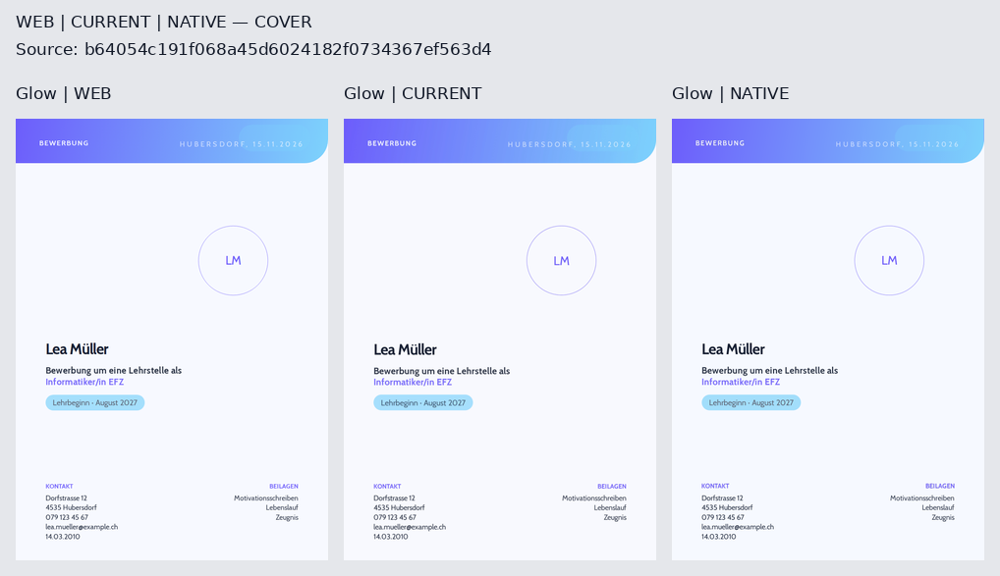

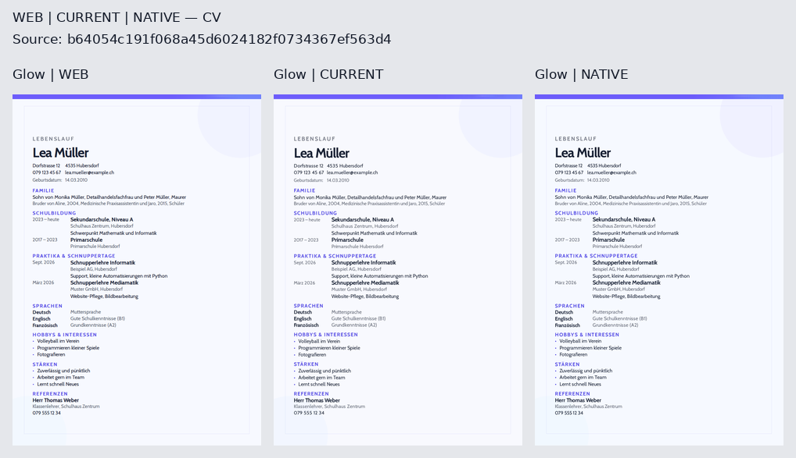

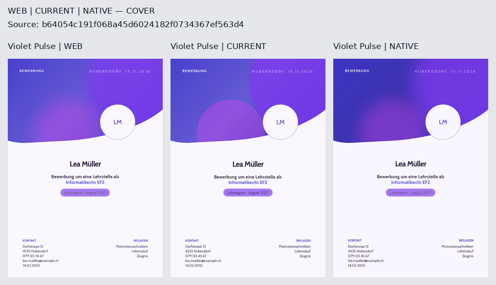

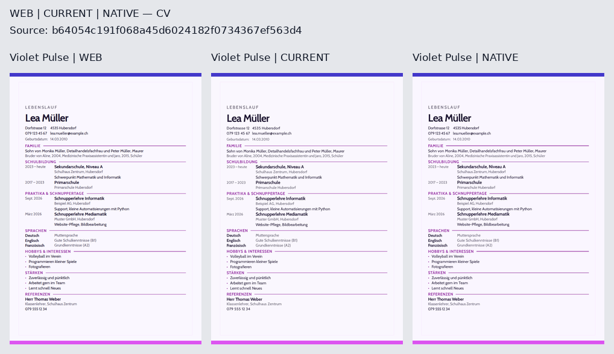

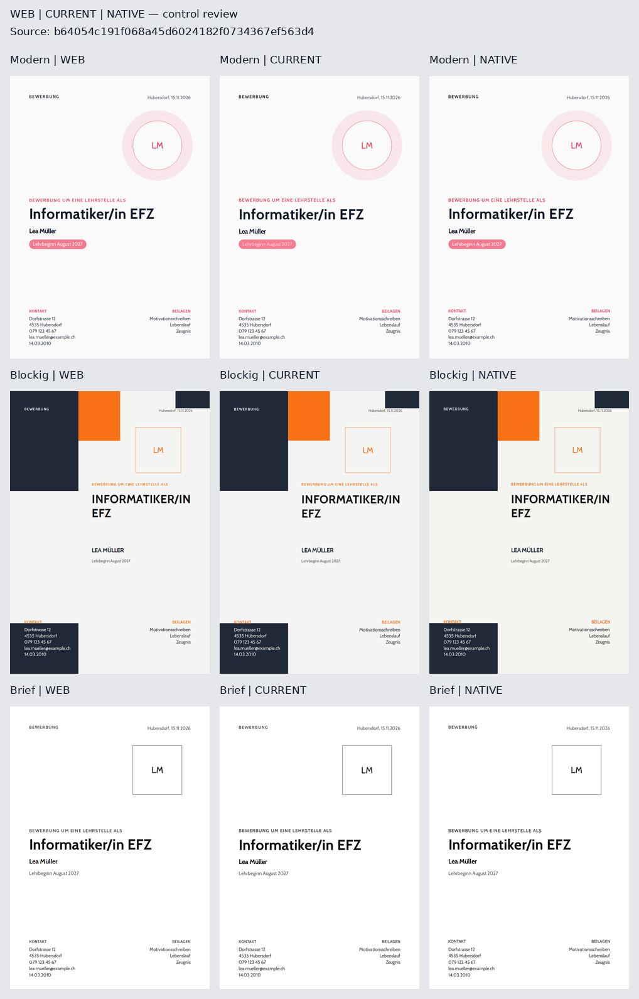

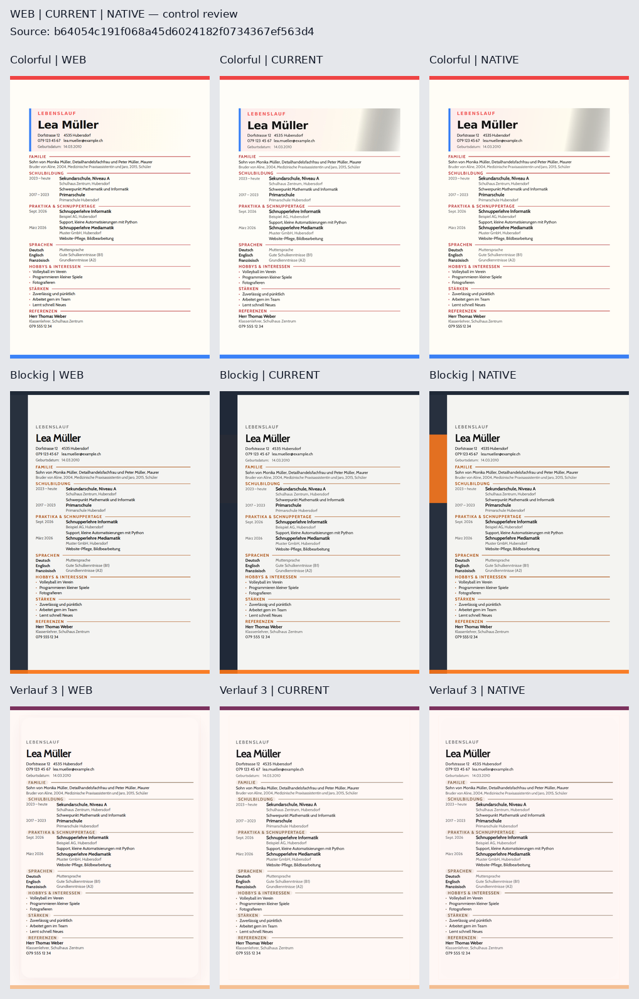

Additional priority Cover/Letter/CV sheets and the original scorer-generated CV contact sheets are retained in the same evidence directory. Raw PDFs/PNGs remain capture artifacts; they are not used as a second benchmark or committed as a full raw gallery.

Only `dev-native-chromium-print` is changed. `dev`, `main` and `render` remain at their reconstructed refs. No deployment, promotion, merge, force push, rebase, amend or squash was performed.

Next: either promote the proven native-print architecture, keep it optional, or close the experiment based on Package 3 evidence.

## Follow-up — Native CV text order (2026-10-12)

The native CV could look correct while exposing its document title after the first entry in extracted PDF text. The repaired renderer now retains title/name order in **39/39** templates. This follow-up does **not** claim to have repaired the remaining tracked-heading searches or background/gradient paint differences.

### Generic renderer correction

Implementation: `b93f05ba2c64ef2c038deb9654b27fd45912be99`, tree `932928245adc6d2e829207f162a6bea3a6803a52`, extending `4da4820b`. Translucent descendants of the CV header could be painted after opaque descendants of later rows. Both measured and physical CV content rows now expose `data-cv-content-row` and use `isolation: isolate`. This gives each canonical row its own paint boundary, retaining row order in the PDF content stream.

The rule applies to every template and both renderer phases. No template branch, print-only data, text overlay, typography value, saved schema, pagination algorithm or export library was changed. The existing html2canvas compatibility scope remains.

| Check | Before | After |
| --- | --- | --- |
| CV title before first entry | 1/39 | **39/39** |
| CV name before first entry | 38/39 | **39/39** |
| Controlled native CV raster pairs | — | **39/39 pixel-identical** |
| Literal first CV section heading | 34/39 | **34/39 — still open** |

The controlled source-`4da4820b` intervention changed only the content-row paint boundary. All 39 rendered CV arrays had maximum channel difference **0**. The production regression then tested all 39 templates through the native product action, with global HTML template identity poisoned. Both PDF.js and the unchanged scorer confirm the corrected title/name order. [Machine audit](native-chromium-print-text-order/text-order-audit.json.gz) retains the individual cases and search counterfactual.

### Remaining search and paint limitations

Modern, Sonne, Studio, Neon and Aurora still fail the existing default literal first-section search. Their original text and visible tracking remain intact. MuPDF inserts inferred spaces within the tracked word; disabling that inference in a **supplementary diagnosis** finds the word in all five cases. Supplementary PDFium build 6462 also fails the default literal search, and adding semantic heading/ARIA labels in the Modern counterfactual does not repair it. None of those diagnostic changes were used to rescore the benchmark or relabel the five failures as passes.

No search workaround was shipped: preserving the visible tracking and the browser-owned PDF output leaves this issue unresolved. The repair addresses paint/extraction order, not a promise of universal literal search for tracked text.

Five CV paint probes (Colorful, Blockig, Horizon, Warm 3, Violet Pulse) found equal representative Web/canonical computed background, opacity, filter and blend signals. Additional `contain: size paint` and printing the CV alone leave the CV raster unchanged. Replacing the existing page transform with `zoom` changes rasterization; it was not adopted as a quality fix. [Paint counterfactual data](native-chromium-print-text-order/paint-audit.json.gz) records these outcomes. These probes are limited to the sampled signals/CV pages and do not establish the precise cause of every background difference.

The known Horizon/Warm 3/Violet Pulse Cover differences, Colorful header gradient and Blockig native rail patch remain open. No template paint exception or unverified geometry change was committed.

### Unchanged authoritative pipeline and matched CI results

[Implementation CI run 38231916466](https://github.com/modebrecht/cv-cover-charm/actions/runs/38231916466) completed **11/11 successful jobs**, including the original 39-template/234-comparison benchmark. Catalog, fixtures, current product export, native action, scorer, text checks, geometry thresholds, size and timing methods are unchanged.

This CI cohort is compared with [the preceding source-`4da4820b` CI run](https://github.com/modebrecht/cv-cover-charm/actions/runs/38200208778), rather than mixed with the earlier local cohort. All **468 individual RGB/layout score values** across the 117 document pairs are exact string matches in the two original CSV outputs. [Pair verification](native-chromium-print-text-order/same-cohort-check.json) records the comparison. No visual score regression or gain is attributed to the text-order fix.

| Document | Current RGB/layout | Native RGB/layout |
| --- | --- | --- |
| Cover | 0.988208 / 0.988878 | 0.993425 / 0.993953 |
| Letter | 0.993525 / 0.994342 | 0.995250 / 0.995820 |
| CV | 0.953445 / 0.954100 | 0.989463 / 0.990140 |
| Overall | 0.978393 / 0.979107 | 0.992713 / 0.993304 |

The original A4, ≤0.02 mm geometry and long-marker guards passed. Studio 3 classic/Gallery sidebar retain their 6/8 physical pages and all markers. Current export controls passed; its 117 RGB/layout results are unchanged in the matched CI comparison. Local validation additionally passed 19 browser/PDF tests, 1,105 unit tests, TypeScript and ESLint (0 errors, 21 existing warnings).

Current/native means in this CI run: **1,307,823 / 303,724 bytes**, and **1931 / 640 ms**. Human print-dialog time is excluded as before.

The original machine outputs are retained losslessly compressed, without rewriting source or fixture identifiers:

- [117 document-pair scores](native-chromium-print-text-order/native-chromium-print-scores.csv.gz)
- [Summary, text/search/order, pagination and timing](native-chromium-print-text-order/native-chromium-print-summary.json.gz)
- [Source/fixture/artifact provenance](native-chromium-print-text-order/native-chromium-print-provenance.json.gz)
- [39 template deltas](native-chromium-print-text-order/native-chromium-print-template-deltas.csv.gz)
- [Original geometry results](native-chromium-print-text-order/native-chromium-print-geometry.csv.gz)

**Recommendation remains B.** Retain automatic PDF as primary; the optional native experiment now has corrected CV text order, with the remaining search/paint constraints disclosed. No promotion, deployment, merge, protected-branch change or published-history rewrite was performed. The evidence commit changes no application source; its final CI is reported after publication.


## Follow-up — Background paint and cross-document CSS (2026-10-12)

The largest remaining Cover failure is repaired through a renderer-local paint contract. Native now wins **all 39 Covers** in both RGB and layout; it also wins all 39 CVs. The small Gallery/Edel Dark Letter losses and five literal tracked-heading searches remain disclosed. Automatic PDF stays primary.

Starting remote experiment HEAD: `6cd2f81a6a5a91d809d8a7e53ab342bf697c69df`. Implementation commits: `7fb866edc0c299cef5c886c3ea9241aa09753944` and `22456a1a9d7ad4239409d4ba593759ca6705f4d7`. Final capture source: `c57c96c5ab35db59ddd03e6fa55f6fd74434c1e4`, complete tree `b7bfa519512ddef115bff75b614bc51764e1323a`, **identical to the published implementation tree at `22456a1a`**. [Publication record](native-chromium-print-paint/publication.json) preserves original local commit objects and mappings; source/fixture identifiers were never retagged. Historical Package 2 and earlier Package 3 sections/files remain unchanged.

### Causes and generic renderer contract

**Chromium paint:** Horizon/Violet Pulse/Warm 3 Cover alpha gradients lose their intended translucent contribution in native PDF paint. Colorful's translucent header gradient gains a dark tail. The [standalone minimal fixture](../../tests/fixtures/native-alpha-gradient-paint.html) reproduces both effects without dossier code. Web and print-DOM paint agree; the produced PDF differs. The same colors/gradient stops in an artwork-only `filter: opacity(1)` layer restore the intended paint. Explicit transparent RGB, isolation, translateZ and paint containment did not fix the controlled cases. MuPDF and Poppler both reproduce the bad unfiltered minimal PDF, so this is not inferred from SSIM or one rasterizer alone. [Skia's alpha-gradient shader/soft-mask implementation](https://skia.googlesource.com/skia/+/main/src/pdf/SkPDFGradientShader.cpp) provides context; no exact internal Chromium 140 bug line is claimed instrumented.

**Local state:** CoverCanvas derives `data-dossier-paint-alpha-gradient` from its own resolved background CSS, including generated artwork. It examines only the background subtree, with no template-name branch, global identity change, clone or export-specific state. Only actual non-opaque CSS gradients receive the identity-filter layer; opaque backgrounds/frames retain their existing paint. The same physical DOM/state serves Web, current PDF and native print. Existing inner blurs remain active. Colorful's existing background declaration is supplied to a generic header pseudo-layer; its text/photos stay outside that layer and remain searchable. No typography/color/spacing values changed.

**Cross-document CSS availability:** CoverBackground conditionally emitted old CV `<style>` rules for Warm/Colorful/Blockig. Mounting a Cover therefore changed CV pseudo-elements despite equal ordinary DOM/computed signals. Those are obsolete adapters for the retired CoverBackground-based CV artwork. Removing them leaves the current DossierSheetBackground in control and removes Blockig's unexpected orange rail patch. This is a DOM/style divergence, not a Chromium paint limitation. The all-template CV guard now checks `::before`/`::after` paint too.

The first complete controlled paint cohort used an identity filter on every Cover background. That unnecessarily rasterized opaque frames: for example Edel/Edge Cover native layout declined by 0.004305/0.002422 versus the preceding local cohort. The final contract is scoped by the actual alpha-gradient primitive, with no template exceptions. [Interim original scores](native-chromium-print-paint/interim-broad-paint-scores.csv.gz) and [summary](native-chromium-print-paint/interim-broad-paint-summary.json.gz) retain that counterfactual instead of hiding it. Its source is `45c814e7`, complete tree identical to `7fb866ed`; it is not the final benchmark.

Letter localization and the existing Glow/Violet print-fitting containment fix remain intact. Neon/Verlauf/Citrus retain the previously proven instance-input correction and 0 mm Web/canonical CV displacement. Neither pagination algorithm, saved schema, current PDF library, filename/metadata/download code nor legacy html2canvas scope helper changed.

### Final unchanged 39-template / 234-comparison pipeline

Same authoritative catalog, fixtures, Web screenshot capture, current product action, native product action, SSIM pipeline, text/search checks, file-size and timing methods. The **≤0.02 mm** content geometry guard and existing PDF MediaBox precision are unchanged. The final local raster environment matches the historical Package 3 local cohort: Python 3.12.14, PyMuPDF 1.26.6, Pillow 12.3.0, NumPy 2.3.5, scikit-image 0.25.2; Chromium 140.0.7339.16 / Playwright 1.55.0 / Node 24.19.0. CI has its own pinned raster cohort and is not mixed into these local deltas.

| Document | Current RGB/layout | Native RGB/layout |
| --- | --- | --- |
| Cover | 0.988208 / 0.988878 | 0.994943 / 0.995056 |
| Letter | 0.993525 / 0.994342 | 0.995250 / 0.995820 |
| Cv | 0.953863 / 0.954528 | 0.990112 / 0.990798 |
| Overall | 0.978532 / 0.979249 | 0.993435 / 0.993891 |

Native wins **116/117 RGB** and **115/117 layout** comparisons. Aggregate RGB/layout improves in **39/39 templates**. Cover and CV each have 39/39 wins; Letter has the remaining 1 RGB / 2 layout regressions.

| Priority document | Previous native layout | Final native layout |
| --- | --- | --- |
| Horizon cover | 0.972157 | 0.991924 |
| Violet Pulse cover | 0.984769 | 0.994080 |
| Warm 3 cover | 0.988806 | 0.993181 |
| Colorful cv | 0.976269 | 0.990532 |
| Blockig cv | 0.982844 | 0.992259 |
| Glow cv | 0.993914 | 0.993914 |
| Violet Pulse cv | 0.991024 | 0.991024 |
| Neon cv | 0.991632 | 0.991632 |
| Citrus cv | 0.992001 | 0.992001 |
| Verlauf cv | 0.992133 | 0.992133 |

Worst five final native layout results (all still outperform current):

| Template/document | Native RGB | Native layout | Native − current layout |
| --- | --- | --- | --- |
| Verlauf 3 / cv | 0.984206 | 0.983558 | +0.002853 |
| Horizon / cv | 0.983318 | 0.983935 | +0.027054 |
| Verlauf 2 / cv | 0.984606 | 0.985359 | +0.001730 |
| Sunrise / cv | 0.984546 | 0.986314 | +0.025708 |
| Edel Dark / cv | 0.988048 | 0.988438 | +0.003541 |

Remaining native layout losses: Gallery Letter −0.000585 and Edel Dark Letter −0.000276. Remaining RGB loss: Gallery Letter −0.000381. No Cover/CV is worse than current in the final paired cohort. Residual CV background differences, especially Verlauf 3/Horizon, are not claimed eliminated.

### Current control, geometry, text and cost

Current product checks remain green. No content loss, physical movement, search/order regression, filename/metadata or automatic-download change was observed. Current scores are not falsely presented as byte-identical: all 117 deltas are retained in [current-control-deltas.json](native-chromium-print-paint/current-control-deltas.json). The largest current layout decline versus the earlier local cohort is Colorful CV −0.000091; Blockig CV improves +0.001052. Colorful's Web reference changes by at most 2 RGB levels (mean absolute difference 0.0312); the current raster changes by mean 0.0281 RGB levels. Manual review retains its composition/text/geometry; its pre-existing current-PDF gray tail remains. Horizon/Violet Pulse current Cover rasters are pixel-identical to the prior local cohort. No thresholds were relaxed to hide these small numeric differences.

All 39 combined PDFs retain canonical A4 page count/order. Maximum Web/canonical displacement is **0 mm**, and canonical/print displacement **0.000063796 mm**. Long Studio 3 classic remains **6 pages**, Gallery sidebar **8 pages**; all 14 Letter, 18 CV and reference markers have exactly the prior canonical/current/native assignment.

Literal recipient/body/name/entry searches remain **39/39** in both PDF paths. Native title/name-before-entry order remains **39/39**. Literal first-section headings remain **34/39 native versus 39/39 current** (Modern/Sonne/Studio/Neon/Aurora); no altered search flags or invisible native text layer was introduced. All normalized samples remain present. Letter body-before-closing remains native 39/39 versus the pre-existing current 0/39.

| Measure | Current | Native |
| --- | --- | --- |
| Mean bytes | 1,308,599 | 361,773 |
| Mean milliseconds | 1,854 | 667 |

Native is **72.4% smaller on average** and headless generation **2.78× faster**. The required alpha-gradient layer increases mean native size versus the earlier ~303,537-byte local cohort to ~361,773 bytes; opaque-artwork refinement avoids the interim ~544,919-byte mean. Maximum native size remains ~1.37 MB. The same timing method excludes human print-dialog time and runs without concurrent local browser QA.

Local checks: **1,106 units**, TypeScript, production build, release formatting, ESLint (0 errors / 21 existing warnings), 8 scorer audits. Earlier focused browser/PDF selection: 20 passing tests plus the corrected paint guard; final refinement selection: **6/6** including all 39 Cover/Letter scope cases, positive alpha-gradient PDF paint/search, opaque artwork and Glow/Violet physical-fitting checks. The CV DOM/clone guard passes all 39 including generated paint. [Implementation CI run 38254149099](https://github.com/modebrecht/cv-cover-charm/actions/runs/38254149099) is **11/11 successful**, including the unchanged full 234-comparison benchmark and all release groups.

### All 39 per-template deltas (mean across three documents)

| Template | Current RGB | Native RGB | Δ RGB | Current layout | Native layout | Δ layout |
| --- | --- | --- | --- | --- | --- | --- |
| Brief | 0.982041 | 0.992808 | +0.010767 | 0.982364 | 0.993217 | +0.010854 |
| Editorial | 0.976767 | 0.994346 | +0.017579 | 0.977397 | 0.994936 | +0.017540 |
| Modern | 0.975106 | 0.993222 | +0.018116 | 0.975098 | 0.993426 | +0.018327 |
| Warm | 0.977931 | 0.993965 | +0.016034 | 0.979231 | 0.994534 | +0.015303 |
| Edel | 0.970078 | 0.992887 | +0.022809 | 0.970904 | 0.993052 | +0.022148 |
| Colorful | 0.973841 | 0.993552 | +0.019711 | 0.973730 | 0.993966 | +0.020236 |
| Blockig | 0.983130 | 0.994062 | +0.010932 | 0.983828 | 0.995034 | +0.011206 |
| Seriös | 0.975438 | 0.993865 | +0.018426 | 0.975649 | 0.994234 | +0.018585 |
| Human | 0.974824 | 0.994388 | +0.019564 | 0.975177 | 0.994654 | +0.019477 |
| Horizont | 0.974495 | 0.993624 | +0.019129 | 0.975000 | 0.994094 | +0.019094 |
| Kolumne | 0.976018 | 0.994146 | +0.018128 | 0.976757 | 0.994682 | +0.017924 |
| Rahmen | 0.975337 | 0.994132 | +0.018795 | 0.975876 | 0.994558 | +0.018682 |
| Sonne | 0.976352 | 0.993400 | +0.017048 | 0.976226 | 0.993571 | +0.017345 |
| Studio | 0.975645 | 0.994676 | +0.019031 | 0.976269 | 0.995448 | +0.019179 |
| Neon | 0.967577 | 0.992592 | +0.025014 | 0.969921 | 0.993850 | +0.023929 |
| Aurora | 0.974467 | 0.992976 | +0.018509 | 0.974534 | 0.993187 | +0.018653 |
| Verlauf | 0.973166 | 0.993494 | +0.020327 | 0.974678 | 0.993939 | +0.019261 |
| Citrus | 0.972947 | 0.993428 | +0.020481 | 0.973999 | 0.994322 | +0.020323 |
| Edge | 0.980732 | 0.993934 | +0.013202 | 0.981483 | 0.994569 | +0.013086 |
| Glow | 0.984488 | 0.995345 | +0.010858 | 0.984503 | 0.995551 | +0.011047 |
| Mono Luxe | 0.981029 | 0.994863 | +0.013834 | 0.981252 | 0.995230 | +0.013978 |
| Horizon | 0.975542 | 0.990262 | +0.014720 | 0.976912 | 0.990747 | +0.013835 |
| Sunrise | 0.979670 | 0.991763 | +0.012093 | 0.980207 | 0.992592 | +0.012385 |
| Forest Flow | 0.981195 | 0.994515 | +0.013320 | 0.981772 | 0.994997 | +0.013224 |
| Violet Pulse | 0.980245 | 0.993405 | +0.013160 | 0.982436 | 0.993503 | +0.011067 |
| Studio 2 | 0.990146 | 0.993247 | +0.003101 | 0.991069 | 0.993783 | +0.002713 |
| Studio 3 | 0.990707 | 0.993083 | +0.002376 | 0.991580 | 0.993555 | +0.001975 |
| Warm 2 | 0.976116 | 0.993892 | +0.017776 | 0.977576 | 0.994423 | +0.016848 |
| Warm 3 | 0.976544 | 0.993142 | +0.016598 | 0.977384 | 0.993617 | +0.016233 |
| Verlauf 2 | 0.983612 | 0.990862 | +0.007251 | 0.985280 | 0.991276 | +0.005996 |
| Verlauf 3 | 0.983487 | 0.990660 | +0.007173 | 0.984779 | 0.990685 | +0.005906 |
| Ledger | 0.976496 | 0.994063 | +0.017567 | 0.976947 | 0.994429 | +0.017482 |
| Prism | 0.975840 | 0.994324 | +0.018484 | 0.976295 | 0.994696 | +0.018401 |
| Gallery | 0.982827 | 0.993846 | +0.011018 | 0.983002 | 0.994043 | +0.011041 |
| Orbit | 0.976902 | 0.994056 | +0.017154 | 0.977246 | 0.994403 | +0.017156 |
| Ribbon | 0.978128 | 0.994649 | +0.016521 | 0.978672 | 0.995153 | +0.016482 |
| Cove | 0.976273 | 0.992626 | +0.016353 | 0.976975 | 0.993177 | +0.016202 |
| Diagonal | 0.991661 | 0.994800 | +0.003139 | 0.992378 | 0.995341 | +0.002963 |
| Edel Dark | 0.985938 | 0.991062 | +0.005124 | 0.986336 | 0.991288 | +0.004953 |

### Durable final evidence and decision

Losslessly compressed original pipeline outputs retain source/fixture/artifact identifiers:

- [117 paired rows / 234 comparisons](native-chromium-print-paint/native-chromium-print-scores.csv.gz)
- [Summary: full text/search/order, long markers, environment, size and timing](native-chromium-print-paint/native-chromium-print-summary.json.gz)
- [Provenance](native-chromium-print-paint/native-chromium-print-provenance.json.gz)
- [39 template deltas](native-chromium-print-paint/native-chromium-print-template-deltas.csv.gz)
- [Original geometry guard outputs](native-chromium-print-paint/native-chromium-print-geometry.csv.gz)
- [Diagnosis](native-chromium-print-paint/diagnostics.json)

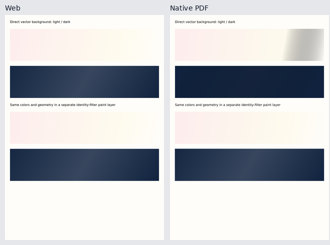

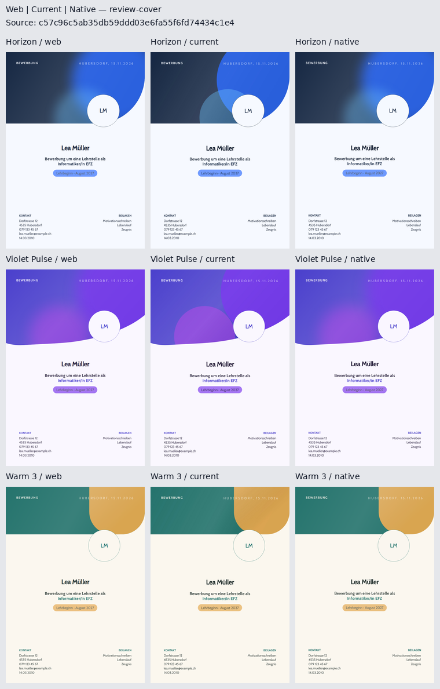

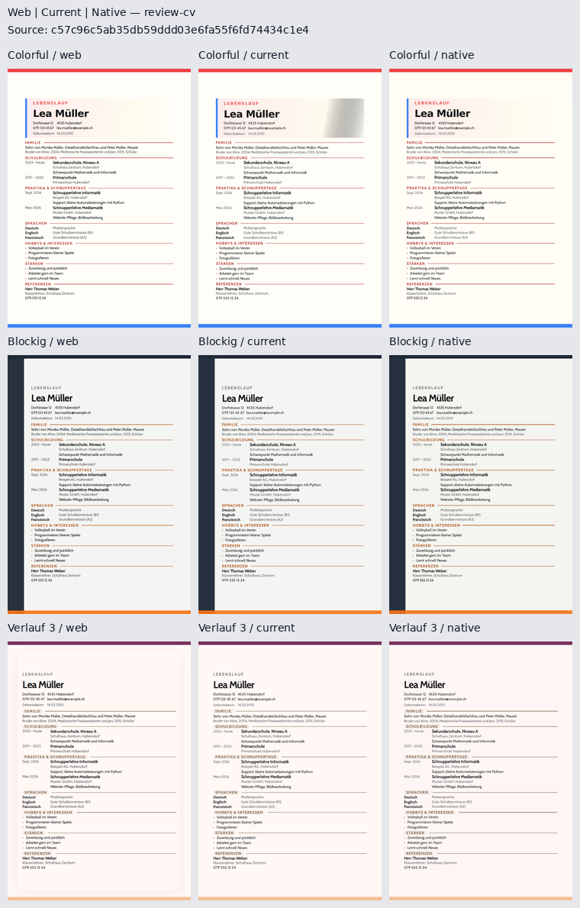

**Decision B — keep automatic PDF primary; retain native as an optional export direction.** Native is broadly better and the largest structural/paint failures are repaired generically. The remaining small Letter differences, five literal heading searches and browser/system print-dialog choices still make automatic download the safer primary flow. No product promotion, deployment or merge was performed. Only the experiment branch changes; `dev`, `main` and `render` remain untouched. Published history was only extended by fast-forward commits.

Next: either promote the proven native-print architecture, keep it optional, or close the experiment based on Package 3 evidence.
