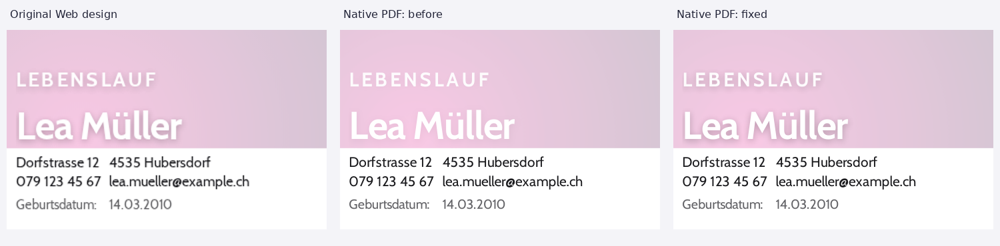

# Native Neon PDF semantic text correction — 14 October 2026

**PASS for the bounded Neon duplicate-text fix. Native Chromium is not promoted.**

One authored CV name now produces one semantic name in PDF.js, MuPDF and PDFium. The original visible name, document title, typography, pagination and Neon shadow design are preserved. The automatic exporter is unchanged.

## Source and verification

- Repository: `modebrecht/cv-cover-charm`.
- Fetched authoritative `dev`: `96fb2b55b35cb5f021c9a4b3cb975643b6161b12`; initially clean checkout; `AGENTS.md` read.
- Work branch: `fix/native-neon-duplicate-text-14okt`.
- Verified executable: `809e5981de957d7390637935a1c538a1ce45bd38`.
- Exact-source [CI 38599714610](https://github.com/modebrecht/cv-cover-charm/actions/runs/38599714610): **completed / SUCCESS**, 14 October 2026, 16:44 UTC.
- A subsequent report/evidence commit adds the explicit work-branch Vercel exclusion; it does not change the verified renderer or QA executables.
- `main` and `render` were not modified. No merge, native promotion or deliberate deployment was performed.

The prior P4.1 search audit was read from its actual remote branch, together with the 14 October read-only audit. The suspected shadow cause was treated as a hypothesis until new PDFs reproduced it.

## Reproduction and root cause

All captures use the actual saved canonical dossier, gallery registry, `DossierPdfCanvas`, production native print preparation and native UI action. Automated tests intercept `window.print` and produce actual Chromium PDF bytes with A4, 100% scaling, zero margins, background graphics and no browser headers/footers. There is no alternate document renderer or post-generation PDF repair.

The untouched Neon case reproduces `LLeeaa MMüülllleerr` in PDFium. PDF.js and MuPDF extract two `Lea Müller` runs. Removing only the resolved text shadow eliminates the extra run. Restoring the shadow on a separate filtered paint primitive preserves one semantic name in all three readers.

The PDF text trace proves what is duplicated:

| Name run in original PDF | Opacity | First glyph origin, PDF points |
| --- | ---: | --- |
| Extra shadow-associated text | 0 | `(56.6593323, 153.4598694)` |
| Original visible foreground text | 1 | `(56.6593323, 152.1848297)` |
| Foreground text after correction | 1 | `(56.6593323, 152.1848297)` |

The two original runs are approximately **1.27504 pt apart vertically**. Different reader ordering heuristics produce repeated strings or interleaved glyphs. This is an extra semantic text object created by Chromium's shadow print path, despite that object's zero opacity; it is not a second authored name. Embedded Cabin fonts are Type0 subsets with `/ToUnicode`. The correct Unicode foreground survives unchanged when only shadow paint is removed, ruling out a broken name/font encoding as the cause of this failure.

The correction touches two production files:

- `src/lib/dossier-native-print.ts`: temporarily records the resolved shadow and existing text for the first Neon CV page's name, document title and optional subtitle; restores the original styles and removes the attributes on release.
- `src/components/dossier/dossier-native-print.css`: during active native printing, paints just the visible shadow in an absolutely positioned, filtered pseudo-element below the original foreground. The foreground remains the single visible vector/text run. The shadow is a graphic, not an invisible searchable text layer.

Geometry and saved state are unchanged. Other templates receive no shadow annotation. Screen rendering and automatic PDF generation retain their existing styling. No search assertion is weakened, and duplicate characters are never repaired or normalized away.

## Actual reader results

Reader versions: PDF.js **6.2.108**, MuPDF **1.26.6**, PDFium **156.0.8076.0** via pypdfium2 **5.14.0**. Browser: Chromium **140.0.7339.16**, Playwright **1.55.0**.

| Original authored `Lea Müller` | PDF.js | MuPDF | PDFium |
| --- | --- | --- | --- |
| Original Neon shadow path | 2 literal occurrences | 2 literal occurrences | 0 literal occurrences; interleaved characters |
| Diagnostic: shadow disabled | 1 correct occurrence | 1 correct occurrence | 1 correct occurrence |
| Corrected Neon shadow paint | **1 correct occurrence** | **1 correct occurrence** | **1 correct occurrence** |

The full cohort contains **21 real combined-dossier PDFs / 69 pages**, covering nine fixtures: standard Neon, Neon with `Zoë Müller` and `Élève à Zürich – français`, a five-page dossier with a three-page Neon CV, and Brief, Modern, Prism, Aurora, Glow and Ribbon controls.

All **27 fixed name/reader checks** pass exact literal occurrence count and correct Unicode without whitespace/glyph cleanup. Sampled CV entry-title and subtitle counts match the authored DOM in all three engines: 103 counted occurrences per reader in this cohort. All captured canonical CV text and font settings remain unchanged.

Copy/selection evidence:

- PDF.js: real browser `TextLayer`, exactly one selectable name span, `Ctrl+C`, `Ctrl+V` into a textarea, exact `Lea Müller` and `Zoë Müller` values.
- MuPDF: native `search_for` finds one name rectangle; raw extraction and the single opaque text run retain the exact name.
- PDFium: native search finds one range; copying that range with `get_text_range` returns the exact name; actual per-character selection boxes are compared independently.

Manual MuPDF/PDFium GUI clipboard interactions and arbitrary OS print-dialog defaults are not claimed. These engine APIs inspect the generated PDF bytes; the PDF.js browser clipboard flow is executed separately.

## Geometry and visual measurements

Measurements below come from the retained local cohort. CI independently runs and passes the same geometry, reader and visual gates on its own immutable checkout and generated bytes.

- Maximum canonical DOM → native-print text-box delta: **0.000106859 mm**, below the existing **0.02 mm** tolerance.
- Foreground glyph-origin delta versus the shadow-disabled foreground reference: **0.00000000 mm**, all nine fixtures.
- PDFium character-selection-box delta versus the same foreground reference: **0.00000000 mm**, all nine fixtures.
- All files retain the expected A4 dimensions, page counts and content; no application UI is printed.

At 144 dpi, original native PDF → corrected native PDF RGB SSIM is:

| Fixture / changed first CV page | SSIM | Changed pixels |
| --- | ---: | ---: |
| Standard Neon | 0.999285850 | 15,345 |
| Unicode Neon with subtitle | 0.998743728 | 22,639 |
| Long Neon CV, first page | 0.999285850 | 15,345 |
| Neon cover, letter and continuation pages | 1.000000000 | 0 |
| All 18 pages of the six control templates | 1.000000000 | 0 |

Only the intended first-page header shadow paint differs. The white foreground glyphs, text placement and all other page pixels retain their source geometry/design. Native's former shadow rendering was itself less faithful to the original Web design:

- Original Web design → corrected print-media Web rendering: **SSIM 0.999993436**.
- Original Web screenshot → old native PDF raster: **0.976275687**.
- Same original Web screenshot → corrected native PDF raster: **0.977032191**.

Screenshot/PDF antialiasing differs before this fix. An initial provisional absolute 0.99 cross-engine gate failed even for the unmodified baseline. The final scorer gates against the measured same-source baseline, allowing at most 0.0005 SSIM regression, while independently retaining ≥0.995 native/native and ≥0.995 original-Web/corrected-Web gates. Name, Unicode, counts and selection acceptance are unchanged. These are paired visual measurements, not percentages of semantic correctness or a new 39-template promotion benchmark.



## Tests and CI

Local and exact-source CI both pass:

- **1,121 unit tests**, zero failures.
- **14 browser tests**: native A4 fitting, alpha paint, Prism/Neon header identity, CV card/typography/state regressions and the new nine-fixture semantic acceptance.
- All nine three-reader acceptance checks, including literal counts, Unicode, search/copy ranges, PDF selection geometry and paired visual gates.
- Application and QA TypeScript, release/changed-file formatting, lint and production build. Lint retains 21 existing warnings, zero errors.
- Saved localStorage and original inline styles are identical after every native export; transient shadow attributes are removed.

The base `dev` already has unrelated red release groups in [run 38592561124](https://github.com/modebrecht/cv-cover-charm/actions/runs/38592561124): two long/delayed-image native-print readiness failures and two Letter preflight/image failures. Those tests were not loosened or silently reclassified. This package's scoped acceptance workflow is green; the entire pre-existing dev release suite is not described as green.

## Deployment side effect and scope

Two automatic Vercel **Preview** deployments were observed after the authorized Git branch writes, despite the inherited `vercel.json` wildcard exclusion:

- `dpl_CYCW9figjp8vnAhqNfWhSYH39tSt`, executable `1c041383`, target `null`.
- `dpl_8FwiteJyTv5PJwL74xkupDRPQ1jk`, executable `809e5981`, target `null`.

No deployment/promotion command or production write was invoked. The existing `*` minimatch rule does not match branch names containing `/`; [Vercel's Git configuration](https://vercel.com/docs/project-configuration/git-configuration) defaults unspecified branches to enabled. The report commit adds only `"fix/native-neon-duplicate-text-14okt": false`, verified against the existing rule matcher, preserving all other branch rules. This addresses this task's no-deployment constraint for subsequent writes without changing global deployment policy. The already-created Preview side effect is disclosed.

Native remains available only through its existing QA visibility gate. Automatic PDF stays primary. This fix does not resolve decorative heading tracking/search, validate every user font/layout combination, test Safari/Firefox/mobile print, or approve native promotion.

## Retained evidence and reproduction

- [CI run, steps and artifact metadata](native-neon-text-14okt/ci-provenance.json).
- [All 21 local PDF hashes and executable/source fingerprints](native-neon-text-14okt/manifest.json).
- [Source geometry, full extracted text and name items](native-neon-text-14okt/capture-results.json.gz).
- [Unmodified three-reader output, name text-object traces, font encoding and selection boxes](native-neon-text-14okt/reader-acceptance.json.gz).

Local capture revision `0cfb1aa9` is the private local counterpart of the initial remote executable commit; renderer hashes are retained and match the final verified executable. Local and CI PDF hashes are separate cohorts and are not combined. The CI artifact `native-neon-809e5981de957d7390637935a1c538a1ce45bd38` contains all raw PDFs, full JSON results and screenshots; artifact ID `11913113275`, SHA256 `4322c82f18ded34f410d49963fb3c899518bcfafd70205a455a8b6b1311b30ee`, expires **28 October 2026**.

```bash
bun install --frozen-lockfile
npm install --no-save --no-package-lock @playwright/test@1.55.0
python -m pip install pymupdf==1.26.6 pypdfium2==5.14.0 pypdf==6.10.0 numpy==2.2.6 pillow==11.3.0 scikit-image==0.25.2
npx playwright install --with-deps chromium
npx playwright test --config tests/qa/playwright.native-neon.config.ts
python scripts/native_neon_pdf_acceptance.py artifacts/native-neon-14okt
```
