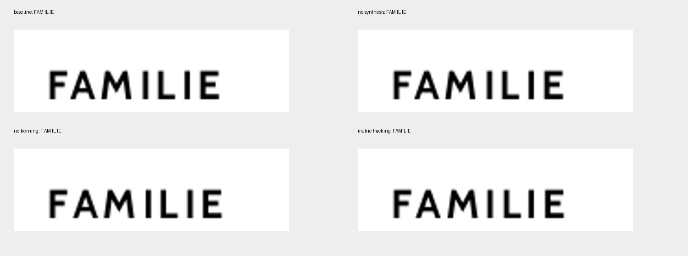
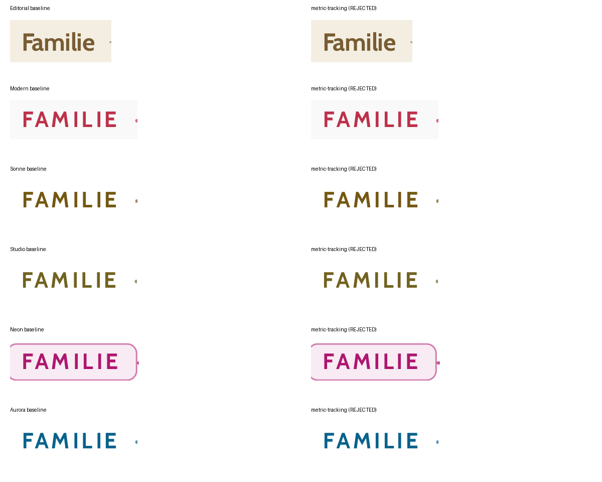

# P4.1 — Native Chromium PDF: searchability and fidelity gate

**Outcome B — Native remains optional. NO-GO for production-grade native search.** The current 39-template cohort reproduces PDF.js 18/39 and MuPDF 34/39 literal `Familie` searches; PDFium reaches 22/39. No safe production fix was established within three generic experiments. Automatic PDF remains primary and passes 39/39 in all three engines.

## 1. Source, branch and scope

- Authoritative base `dev`: `2da666ddeef94dc084d0c0097f221fd0f767562a`.
- Work branch: `fix/native-pdf-search-13okt`.
- Final executable QA commit: `fcd27c2fdc5819b0888565ac0e5bc381a2090699`. A final evidence/report commit follows without executable changes.
- Initial `main`: `44d7eb950b4fe972d6e890a72b6d3256ce365bc9`.
- Initial `render`: `4319c20fb85d3971ac355ae8898cdfef86ee7a8c`.
- Native experiment: `0c52fb94e52065db64f68489257c49669cfc8f00`.
- Relevant dev history: #176 integrated the optional native architecture; #177 fixed automatic Letter word boundaries; the dev checkpoint changes only the hydrated-Letter test wait. AGENTS.md was read. No protected branch, published experiment history, stored dossier model or production export code was changed.

Application `src` tree is **identical** in base dev, the native-search work and the prior automatic-Letter fix `2bb65c54`: `5861529676d8067f19c3e392ce827003ba5f2eba`. Bundled-font tree: `94c67822f55a9103b4efb0253b3b1b632c97b0b3`. This is a diagnostic/QA package, not a renderer or font migration.

The authoritative `GALLERY_CASES` / production registry remains complete at 39 entries; retired templates are excluded by its existing guard. No second fixture/catalog or renderer was introduced. All catalog PDFs use the actual production automatic download and native print action / `DossierPdfCanvas`. `window.print` is intercepted only for automated Chromium `page.pdf` generation.

## 2. Confirmed root cause and actual PDF evidence

The minimal existing `tests/fixtures/native-heading-search.html` reproduces the failure with **one DOM text node**, so DOM fragmentation is not necessary to produce it. Cabin Bold is embedded as a Type0 subset with `/ToUnicode`; the text is not missing and no broken character mapping was found for this heading.

The real baseline contains seven `Tj` glyph operations and six `Td` moves, rather than an explicit semantic word or character-spacing operator. Example: `/F4 14.6800003 Tf`, `<0043> Tj`, `8.6156769 0 Td <0001> Tj`, followed by the remaining glyphs. Its embedded widths include F=525, A=625, M=833, I=282, L=500 and E=568 font units. The extra tracked positioning is not represented as part of those natural glyph widths. Reader gap heuristics infer spaces between some glyphs.

PDF.js 6.2.108's installed worker uses `SPACE_IN_FLOW_MIN_FACTOR = 0.102`; `addFakeSpaces` inserts a space from positional gaps. The actual CSS tracking is 0.11em / 0.12em. Integer/fractional glyph advances and print scaling affect which boundaries cross the reader threshold. Different readers therefore disagree about the same PDF bytes.

Baseline literal results: PDF.js, MuPDF and PDFium read `FAM IL IE` in the minimal case. MuPDF with `TEXT_INHIBIT_SPACES` reconstructs `FAMILIE`, **diagnostically only**. All inspected minimal variants contain zero `/ActualText` operators. Previously tested Chromium PDF tagging does not supply ActualText here; tagging and geometricPrecision are documented prior rejected controls and were not repeated as new experiments.

Primary source references: [PDF.js evaluator](https://github.com/mozilla/pdf.js/blob/master/src/core/evaluator.js), [Skia PDF glyph positioning](https://github.com/google/skia/blob/main/src/pdf/SkPDFDevice.cpp). These explain the mechanisms; the root-cause conclusion is supported by the actual bundled engine and generated PDF streams, not by assuming current upstream code matches the pinned browser.

[Raw minimal streams, font widths and reader observations](native-pdf-search-13okt/probe-readers.json.gz) and [diagnostic PDF bytes](native-pdf-search-13okt/diagnostic-pdfs.zip) are retained. No word replacement, whitespace-normalized acceptance or reader-threshold override was used.

## 3. Three bounded generic experiments

All three were evaluated in the minimal fixture and on Neon, Modern, Sonne, Studio, Aurora and passing Editorial. The initially attempted product-font override was found not to win the CSS cascade; the corrected, actually loaded font variant is the retained result. Negative/zero tracking is left unchanged by the metric-compensation hypothesis. Failed harness runs were diagnostic development, not successful acceptance runs or additional hypotheses.

| Generic experiment                       | Hypothesis                                                         | PDF.js focused literal count | MuPDF / PDFium focused count | Geometry / visible result                                                                                                | Decision                                              |
| ---------------------------------------- | ------------------------------------------------------------------ | ---------------------------: | ---------------------------: | ------------------------------------------------------------------------------------------------------------------------ | ----------------------------------------------------- |
| Baseline                                 | Production text positioning                                        |                          1/6 |                    1/6 / 1/6 | Reference                                                                                                                | Existing blocker                                      |
| Disable synthesis                        | Synthetic weight 800 creates extra glyph advances                  |                          1/6 |                    1/6 / 1/6 | 0 mm change; CV raster identical in all six                                                                              | Reject: no search improvement                         |
| Disable kerning/ligatures; optimizeSpeed | Shaping/advance rounding causes unwanted boundaries                |                          1/6 |                    1/6 / 1/6 | Maximum 0.264484 mm; 249–760 changed CV pixels at 72 dpi                                                                 | Reject: search unchanged and geometry exceeds 0.02 mm |
| Tracking in font advance metrics         | Increase hmtx widths, use unchanged outlines and zero CSS tracking |                          6/6 |                    6/6 / 6/6 | Minimal glyph delta 0.206617 mm; focused text-box maximum 1.115800 mm; 3,335–3,468 changed CV pixels in affected designs | Reject: typography/geometry changes                   |

The metric variant establishes causality: incorporating the tracked advance into PDF font widths prevents the readers' inferred spaces. It does **not** establish a safe product solution. Browser quantization produces different visible advances; the original strict geometry contract is violated. A reusable dynamic-font system would also need to prove all font weights, negative tracking, combining marks, wrapping and long-dossier pagination. It is not implemented or shipped.

The existing no-tracking, geometricPrecision, weight-700 and tagged controls remain rejected for their documented search/geometry limits. There was no fourth new experiment, per-template renderer branch, custom PDF patch, invisible native layer or duplicated native heading workaround.





## 4. Current exact 39-template literal results

Case-insensitive **literal word** `Familie` search is used, consistent with the prior 18/39 baseline; uppercase display does not make a different word. `FAM IL IE` is a FAIL. No inserted spaces are added between PDF.js items; its extraction appends only real `hasEOL` line endings.

| Template     | Native PDF.js | Native MuPDF | Native PDFium | Automatic: all 3 |
| ------------ | ------------- | ------------ | ------------- | ---------------- |
| Brief        | FAIL          | PASS         | PASS          | PASS             |
| Editorial    | PASS          | PASS         | PASS          | PASS             |
| Modern       | FAIL          | FAIL         | FAIL          | PASS             |
| Warm         | PASS          | PASS         | PASS          | PASS             |
| Edel         | PASS          | PASS         | PASS          | PASS             |
| Colorful     | FAIL          | PASS         | FAIL          | PASS             |
| Blockig      | FAIL          | PASS         | FAIL          | PASS             |
| Seriös       | FAIL          | PASS         | FAIL          | PASS             |
| Human        | FAIL          | PASS         | FAIL          | PASS             |
| Horizont     | PASS          | PASS         | PASS          | PASS             |
| Kolumne      | PASS          | PASS         | PASS          | PASS             |
| Rahmen       | PASS          | PASS         | PASS          | PASS             |
| Sonne        | FAIL          | FAIL         | FAIL          | PASS             |
| Studio       | FAIL          | FAIL         | FAIL          | PASS             |
| Neon         | FAIL          | FAIL         | FAIL          | PASS             |
| Aurora       | FAIL          | FAIL         | FAIL          | PASS             |
| Verlauf      | FAIL          | PASS         | FAIL          | PASS             |
| Citrus       | FAIL          | PASS         | FAIL          | PASS             |
| Edge         | FAIL          | PASS         | PASS          | PASS             |
| Glow         | FAIL          | PASS         | FAIL          | PASS             |
| Mono Luxe    | PASS          | PASS         | PASS          | PASS             |
| Horizon      | FAIL          | PASS         | FAIL          | PASS             |
| Sunrise      | FAIL          | PASS         | FAIL          | PASS             |
| Forest Flow  | PASS          | PASS         | PASS          | PASS             |
| Violet Pulse | PASS          | PASS         | PASS          | PASS             |
| Studio 2     | PASS          | PASS         | PASS          | PASS             |
| Studio 3     | PASS          | PASS         | PASS          | PASS             |
| Warm 2       | FAIL          | PASS         | PASS          | PASS             |
| Warm 3       | PASS          | PASS         | PASS          | PASS             |
| Verlauf 2    | FAIL          | PASS         | FAIL          | PASS             |
| Verlauf 3    | FAIL          | PASS         | FAIL          | PASS             |
| Ledger       | FAIL          | PASS         | PASS          | PASS             |
| Prism        | PASS          | PASS         | PASS          | PASS             |
| Gallery      | PASS          | PASS         | PASS          | PASS             |
| Orbit        | PASS          | PASS         | PASS          | PASS             |
| Ribbon       | PASS          | PASS         | PASS          | PASS             |
| Cove         | PASS          | PASS         | PASS          | PASS             |
| Diagonal     | FAIL          | PASS         | FAIL          | PASS             |
| Edel Dark    | PASS          | PASS         | PASS          | PASS             |

| Path      | PDF.js before / retained | MuPDF before / retained | PDFium before / retained |
| --------- | -----------------------: | ----------------------: | -----------------------: |
| Native    |            18/39 → 18/39 |           34/39 → 34/39 |            22/39 → 22/39 |
| Automatic |            39/39 → 39/39 |           39/39 → 39/39 |            39/39 → 39/39 |

“Retained” means no production change was accepted. These are not claims of a successful post-fix full benchmark. The focused metric result is not extrapolated to 39/39.

## 5. Name, title, headings, entries, Unicode and order

The following table is the **local cohort**: 664 source field strings are inspected without normalizing extraction into a literal pass. Exact-source CI separately reaches automatic 664/664 in all three readers and native 488/664 (PDF.js), 591/664 (MuPDF), 569/664 (PDFium). The minor whole-field-string differences concern line-break placement; the failed word queries, Neon duplication and 18/34/22 `Familie` totals agree. Local and CI outputs are not combined into one cohort:

| Field / path                                 |         PDF.js |      MuPDF |     PDFium |
| -------------------------------------------- | -------------: | ---------: | ---------: |
| Native CV name                               |          39/39 |      39/39 |      38/39 |
| Native CV document title                     |           0/39 |       1/39 |       0/39 |
| Native section headings                      |        136/274 |    238/274 |    218/274 |
| Native entry titles                          |        312/312 |    312/312 |    311/312 |
| Native recipient name, street, salutation    | 39/39 dossiers |      39/39 |      39/39 |
| Automatic CV name / title                    |     39/39 each | 39/39 each | 39/39 each |
| Automatic section headings                   |        273/274 |    273/274 |    273/274 |
| Automatic entry titles                       |        312/312 |    312/312 |    312/312 |
| Automatic recipient name, street, salutation | 39/39 dossiers |      39/39 |      39/39 |

The single automatic field-string failure is Kolumne's line-wrapped `Hobbys & Interessen`; all its words are present. The report preserves this strict whole-string failure rather than claiming every possible phrase is 39/39. Experience/education entries, address phrases, Müller and the body’s accented Unicode words are retained. Native uppercase `STÄRKEN` is split in 12 templates by PDF.js and five by MuPDF/PDFium: another tracked-word search failure, not loss of Ä.

Header title/name precede education/experience anchors in all 39 with PDF.js and MuPDF. PDFium reaches 38/39 because of Neon’s duplicated header paint. Sidebar language entries are not used as main-header order anchors; Kolumne legitimately reads sidebar content first. Recipient → salutation → closing order passes 39/39 in all three engines and paths.

**Separate semantic defect: Neon.** One DOM name/title becomes two nearby PDF text paints. MuPDF/PDF.js extract repeated name/title strings; PDFium interleaves the glyphs as `LLeeaa MMüülllleerr` and `LLEEBBEENNSS LLAA UUFF`, preventing the literal name/title query. Actual positions show the duplicate name runs ~1.275 pt apart. Existing resolved shadow paint is the likely cause; that attribution is an inference and was not tested with a fourth production-style change. This is not an invisible overlay introduced here. Other tested CV/Letter lexical counts match the source; Neon accounts for the five count discrepancies. PDFium's two unresolved field strings are these interleaved header runs, not missing source characters.

**Decorative Cover text is a different category.** The automatic Cover is raster output; some native decorative artwork labels, including Human's `HALLO, SCHÖN ...`, are also painted without corresponding extracted text. These are genuinely absent from searchable text even though visible. User data remains present in the native Cover. Cover decorative-label differences are inventoried separately and are not misclassified as CV/Letter user-content loss or inferred whitespace.

[Complete literal fields, Unicode, reader order and diagnostics](native-pdf-search-13okt/summary.json.gz) and [all extracted PDF.js items / canonical geometry](native-pdf-search-13okt/catalog-results.json.gz) preserve failed observations. Compact strings are used only to locate glyph-backed content and diagnose word-count differences; they never make `Familie`, a title or a heading pass.

## 6. Fidelity, physical geometry and pagination

No application or production-font change is accepted. Therefore the before/retained source is identical, not a visually different typography variant.

The last established full 234-pair control has native overall layout SSIM **0.993891266**, automatic **0.979249280**, with identical production `src`/fonts. This is **historical evidence**, not a new P4.1 SSIM measurement. The Package 3 joint-candidate ~0.993874 and later automatic-Letter control are distinct cohorts; their metrics are not mixed.

Stage B / the expensive 234-comparison acceptance benchmark is **not executed**, because Stage A rejected every safe fix. Its catalog, scorer, fixtures, tolerances, branch guard and existing long-dossier distributions remain unchanged. A NO-GO does not require pretending there is a post-fix acceptance cohort.

Current baseline audit: 78 actual catalog PDFs; all have the canonical three pages, A4 dimensions, correct document order, no printed UI and unchanged saved project data. Maximum canonical→print CV box delta is **0.000063796 mm**, below the unchanged **0.02 mm** limit. The strict catalog test explicitly enforces this limit and matching canonical text.

The 35 existing product tests additionally pass long CV marker distribution across visible/standalone/combined output, all-template demo pagination, long international identities, sidebar mirroring, image-wrap/attachment safety, native multi-page scenarios, delayed images/readiness/cancellation, canonical state isolation, Glow/Violet physical scaling and alpha artwork. These are executed regression checks; they do not replace the skipped full 234 benchmark/photo cohort. The previously retained 14 Letter / 18 CV marker benchmark distributions are not falsely claimed as a new P4.1 full-benchmark run.

## 7. Optional product acceptance and browser support

The automatic button still produces a direct download. Native still invokes `window.print` on the canonical renderer and requires the normal browser/system print UI. Automation observes the invocation/preparation/cleanup and generates actual Chromium print PDF bytes; manual OS print-dialog interaction is not executed.

Supported test configuration: A4, scale 100%, background graphics enabled, browser headers/footers disabled, zero margins, CSS page size enabled. Actual generated A4 files contain no application UI or browser header/footer artifacts under this configuration. Defaults on an arbitrary user's print dialog are not asserted.

Saved cover/Letter/CV/chrome state is compared before and after both exports for every catalog entry. Global/template isolation and independent export paths pass existing product controls.

| Browser / surface                                                     | Status                                                       |
| --------------------------------------------------------------------- | ------------------------------------------------------------ |
| Chromium 140.0.7339.16 / Playwright 1.55.0 automated print-PDF engine | EXECUTED                                                     |
| Manual browser/system print dialog                                    | UNVERIFIED UI interaction; normal window.print call verified |
| Firefox                                                               | UNVERIFIED                                                   |
| Safari                                                                | UNVERIFIED                                                   |
| Mobile browsers                                                       | UNVERIFIED                                                   |

## 8. Tests and CI

Local: **1,118 unit tests PASS**; **35 existing product/CV/PDF/pagination browser tests PASS**; six-template focused audit PASS as diagnostic collection; 39-template actual-byte automatic/native audit PASS as diagnostic collection, including strict geometry. “Diagnostic PASS” never means the native search acceptance gate passed.

Application and QA TypeScript, release/new-file formatting, lint and production build pass. Lint retains 21 existing warnings, zero errors. Altered PDF hashes and incomplete catalog controls are deliberately rejected by the new summary gate. No assertions, retries, geometry limits, production baselines or primary-export behavior were weakened.

The existing Dossier Regression workflow is enabled for this exact work branch and adds a branch-scoped pinned native-search diagnostic job. The full benchmark job keeps its original experiment-branch guard and is skipped. Only final report/evidence-only paths are excluded from redundant workflow execution; executable QA changes still run all release jobs. No deployment workflow was enabled for the work branch. **Observed external side effect:** the existing Vercel Git integration nevertheless created an automatic branch Preview (`dpl_BjcYmBnAeknkWkyY9tc724TX2hoZ`, `source=git`, `target=null`, READY). The checked-in policy allows only main; this integration behavior was verified read-only with the Vercel deployment tools/skill and left unchanged. No explicit deployment/promotion action was invoked and production was not promoted. This automatic Preview is disclosed rather than claiming that no deployment of any kind occurred.

**Final exact-source CI is completed / SUCCESS:** [run 38383535232](https://github.com/modebrecht/cv-cover-charm/actions/runs/38383535232) on `fcd27c2fdc5819b0888565ac0e5bc381a2090699`. Eleven jobs succeed (fast checks, native diagnostics, all eight browser groups, final status); the original 234-comparison benchmark job is skipped. Zero pending checks in this run. Exact steps, artifact metadata and CI field totals are retained in [ci-provenance.json](native-pdf-search-13okt/ci-provenance.json). Final report/evidence-only commits do not trigger another executable run.

## 9. Retained evidence and reproduction

- [Artifact hashes](native-pdf-search-13okt/manifest.json), [local check / source-tree provenance](native-pdf-search-13okt/local-validation.json).
- All 39 source/capture hashes, extracted items, failed literal queries and reader fonts/operators are committed losslessly as gzip JSON.
- The ZIP contains the four minimal PDFs, six focused production baselines and Modern’s three experiments. Remaining catalog/experiment raw bytes are in the CI diagnostic artifact with 14-day retention; their exact hashes/extractions are retained in git.
- Local minimal/focused cohorts recorded base `2da666dd`; final catalog recorded `062d3e3e`. The shared application/font trees are byte-identical. Final CI runs against its immutable committed checkout, so its source SHA is authoritative for executable QA. No mixed PDF-byte cohort is accepted by the summary.
- Local environment: Node 24.19.0, Bun 1.3.11, PDF.js 6.2.108, MuPDF 1.26.6, PDFium 156.0.8076.0 / pypdfium2 5.14.0, fontTools 4.61.1. Existing node dependencies were reused only after exact bun.lock identity verification; lock SHA256 is in local provenance. CI uses Node 22 with the same locked application and pinned browser/reader packages.

```bash
bun install --frozen-lockfile
npm install --no-save --no-package-lock @playwright/test@1.55.0
python -m pip install pymupdf==1.26.6 pypdfium2==5.14.0 pypdf==6.10.0 fonttools==4.61.1
node scripts/native_pdf_search_probe.mjs
npx playwright test --config tests/qa/playwright.native-search.config.ts
python scripts/native_pdf_search_readers.py artifacts/native-pdf-search-13okt/probe
python scripts/native_pdf_search_readers.py artifacts/native-pdf-search-13okt/focused
python scripts/native_pdf_search_readers.py artifacts/native-pdf-search-13okt/catalog
python scripts/native_pdf_search_summary.py artifacts/native-pdf-search-13okt
npx playwright test --config tests/qa/playwright.native-product.config.ts
```

The fixture probe serves the existing HTML and font through Playwright routes; it needs no alternate product renderer. The catalog configuration starts the application normally.

## 10. Recommendation and branch safety

**B: retain native as an optional visual print path; retain automatic PDF as the compatibility baseline.** Do not promote native, remove legacy text layers or claim ATS/reader semantic equivalence. Name/title/search limitations make outcome A impossible on current evidence; no severe page/content regression caused by this package justifies C.

Next architecture gate: require a generic browser-print representation that expresses word boundaries/Unicode independently from positional tracking **without changing visible glyph geometry**, including shadow semantics. If Chromium cannot provide that boundary without semantic duplication or new typography, close this promotion path and retain the automatic export. This package does not implement a new PDF backend or a fourth experimental workaround.

Merge recommendation: after green exact-source CI, merge only this diagnostic/regression/report package if its evidence is useful to maintainers. No merge or production promotion was performed; the automatic Git-created Preview side effect is disclosed above. Final remote ref verification is retained with CI provenance; dev/main/render and the published native experiment remain unchanged by this package.
