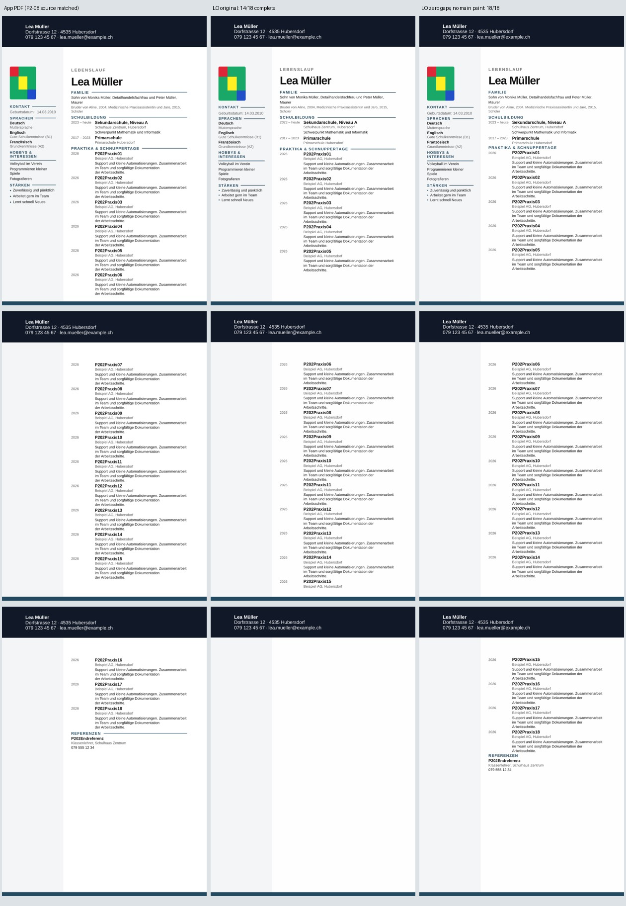
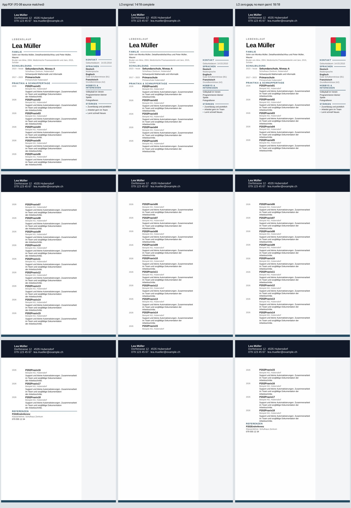

# P2-11 — outer controls x main heading drawings

Branch `work/01nov-p2-11-outer-factors`, base
`0efd29bc0623e94de1da7906ece7c86a28891052`.
Implementation `1e19eb88dc4b9486f1beb57674f234c8378b6bd2`.
[Native run 41330261460](https://github.com/modebrecht/cv-cover-charm/actions/runs/41330261460).

## Bounded source matrix

Use the two unchanged full 18-entry production Next downloads from P2-08,
source-export SHA `b11ec0345e999d64f0f3d8fdeba82613ca9cc9f6`, with their
pinned complete App-PDF metrics. P2-10's native report is pinned SHA256
`08aa3fbd9908cb4c28bc0d742c3788a909807476619d6850cb47a8b0bd2fae05`.
No new browser/App export or x39 availability run is counted.

Four factor combinations per side, crossed with original/all-18-zero gaps (16 full copies):

- Original: baseline.
- Outer controls: unpack the 32 body SDT envelopes outside the 19 critical
  tables, retaining all 75 inner controls. All visible text and drawings remain.
- Main heading paint: remove only the four named family/school/experience/
  reference heading drawings in the main cell. Retain all 107 body SDTs.
- Both factors together. Retain the critical inner controls and all body text.

The main cell is selected by authored entry content rather than physical column.
Photo, sidebar text, page background, active header/footer references and every
non-document.xml package part remain unchanged. Media, styles, settings and
relationships are byte-identical. The original photo drawing XML and cell-start
paragraph properties remain unchanged. Main-paint variants deliberately lose
four decorative drawings; any narrow App metric PASS still cannot make their
full visual trial a PASS.

The original/all-zero full inputs must reproduce four saved P2-10 input hashes
and twelve page signatures. Four separate controls reproduce twelve more page
signatures: the small coupled negative, small positive, and both protected-
context positives from P2-10 (all 75 inner controls retained). The latter are
bound to both their fixture manifest and the pinned original native report.

Execution PASS requires all 20 usable conversions and those saved controls.
Trial PASS is limited to the recorded content/page/layout/photo gates on this
Modern synthetic source. No Word/x39/product acceptance or exporter change.
Visible main-heading drawing deletion forces trial FAIL regardless of narrow
metric outcome. Product disposition remains NOT_ACCEPTED for every research row.

90 local controls pass: 7 new outer-factor, 10 context, 8 compatibility,
10 production-copy, 9 boundary, 13 preamble, 10 spacing, 9 semantic/photo,
10 earlier isolation and 4 converter tests. Existing workflow and five job IDs
remain. `fixture_probe: outer-factors` selects the native-only job; all other
lanes stay idle on this branch. Private LO profile and 90-second conversion cap;
15-minute matrix cap; no app/browser install or dependency/product-source changes.

## Native result: content recovered, layout still fails

LibreOffice `24.2.7.2 420(Build:2)`, one native matrix, 20 successful
conversions, 60 actual PDF pages, no conversion BLOCKED. The table applies
independently to both sidebar sides; each cell represents one three-page PDF
per side. Counts describe complete entry bodies, not just visible headings.

| Diagnostic copy | Original gaps, left / right | All 18 gaps zero, left / right | Full App visual trial |
|---|---|---|---|
| Original | FAIL 14/18 / FAIL 14/18 | FAIL 14/18 / FAIL 14/18 | FAIL |
| Unwrap 32 outer controls | FAIL 14/18 / FAIL 14/18 | FAIL 14/18 / FAIL 14/18 | FAIL |
| Remove four main heading drawings | FAIL 14/18 / FAIL 14/18 | **PASS 18/18 / PASS 18/18** | FAIL |
| Both factors | FAIL 14/18 / FAIL 14/18 | **PASS 18/18 / PASS 18/18** | FAIL |

Four full-copy content PASS, twelve content FAIL, zero BLOCKED. All sixteen
full visual trials FAIL. The four separate controls pass their pinned pixel
checks; they are not four additional product acceptances.

The content-positive copies include all eighteen complete descriptions and the
reference role/phone, with no entry split across pages. All source Word text,
the calibration photo, sidebar and header/footer/background parts remain.
All 107 body SDTs remain when only main heading paint is removed. Therefore
neither the 32 outer nor 75 inner controls need to be removed to recover this
source's text under the tested zero-gap condition.

The eight paired comparisons with/without outer envelopes have identical
96-dpi RGB page signatures: **24 of 24 page pairs**. This holds for both sides,
both gap settings and both paint settings in this matrix. It does not assert
equivalence for other files, editor behavior or all SDT configurations.
See [paired proof](p2-11-outer-pixel-pairs.json).

The remaining layout errors are explicit:

- App starts entry 06 on page 1 and entry 15 on page 2; the content-positive
  LO copies start them on pages 2 and 3. Both PDFs still have three pages.
- On matching pages, subsequent titles differ vertically by up to 26.379 mm,
  exceeding the existing 2 mm trial gate. The reference starts 24.691 mm lower.
- Left photo: PASS under the existing geometry/pattern gate. Right photo:
  FAIL, x displaced +19.844 mm. Both preserve the calibration pattern at 1.0;
  size deltas 1.059 / 1.323 mm remain within 2 mm.
- The four deliberately removed main heading lines remain a visible loss,
  independently preventing full visual acceptance.

The four drawings are `cv.section.custom:familie.heading.flow-paint`,
`cv.section.schule.heading.flow-paint`,
`cv.section.erfahrung.heading.flow-paint` and
`cv.section.referenzen.heading.flow-paint`. This experiment removes them as a
group; it does not establish that every member is necessary or sufficient.

## Visual review and durable controls

Reviewed all three pages in each contact sheet below: cached source-matched
P2-08 App PDF, new native original, new native zero-gap/main-paint copy.
The App PDFs were re-hashed before rendering, not counted as new exports:

- Left: `d1d2fbe74e513166a82da6171e5a9fab292c0ca6ec84138ea8b0d0d710bf95cc`.
- Right: `75a5e2073d243bee8dc406905cf4721e9a3276d625d67dd1343d859949d16cef`.





The original's clipped entry 15 and missing tail/reference are visible. The
positive copies restore the tail and reference on page 3 while retaining the
full header, sidebar, background and calibration image. The missing main lines,
different entry pagination and displaced right photo are also visible. These
are diagnostic QA artifacts, not approved final documents.

Two content-positive full DOCX controls are retained in
[`tests/fixtures/lo-import-p2-11`](../../tests/fixtures/lo-import-p2-11/README.md),
with source/copy/PDF/page hashes and metrics in its manifest. Only
`word/document.xml` differs from its respective full source; all 19 critical
table payloads remain identical. All other ZIP payloads, including every
image, settings, styles, relationships and header/footer parts, are unchanged.
No photograph of a person or private Word file was used.

## Evidence, replay and resources

- Tested implementation: `1e19eb88dc4b9486f1beb57674f234c8378b6bd2`;
  tree `17d4917b4618478c37a07fdea26dc33a588faebe`.
- Native run `41330261460`, job `124918668659`: execution **PASS**;
  90 Python controls PASS, 20 native conversions. Four other jobs skipped.
  No retry, further installation attempt, browser export or ONLYOFFICE run.
- Artifact `13092714477`, `dossier-outer-factors`, 9,374,387 bytes;
  archive SHA256 `55da99d16eee3de644726db7eb4014bd89f384b68876a6f5ba41141491267973`.
  GitHub retention expires 2026-11-15; retained repository evidence survives
  artifact expiration.
- [Unmodified native report](p2-11-outer-results.json), 374,624 bytes,
  SHA256 `172a739de85052569340601a4de000ff1a8cd6259280166ba9730e332597f266`.
- [Audit proof](p2-11-audit-proof.json): replay reads all saved PDFs, rebuilds
  diagnostic DOCX copies and checks their hashes. All sixteen case rows and
  four control rows equal the native report, including native resource rows.
  Audit PASS, **zero additional conversions**. The original native JSON is
  retained verbatim before audit rewrites its temporary output.
- Original/all-zero baselines repeat all four pinned P2-10 input hashes and
  twelve page signatures. Four independent controls repeat twelve more page
  signatures. These baseline checks are distinct from the 24 outer-pair checks.
- Actual job log interval 17:12:16.401–17:15:51.874 UTC: **3:35.473**.
  Summed LO process wall time **130.460 s**, highest individual process RSS
  **242,824 KiB / 237.13 MiB**. These are conversion measurements, not
  whole-runner RAM or a CI sizing guarantee for all 39 templates.

Replay on Linux after extracting the matching artifact:

```sh
python scripts/dossier_lo_outer.py --out-dir /path/to/extracted-artifact --audit-only
```

A new native run uses the same command without `--audit-only`, or the existing
workflow's `fixture_probe: outer-factors` selector on this branch. It requires
LibreOffice, the existing Python analysis dependencies and source fixtures;
no Windows, Word or user PC. No second workflow or job was introduced.

## Decision and P2-12 handoff

Keep LibreOffice as the existing measured converter, with these failures
reported. ONLYOFFICE's earlier unregistered watermark rejection is unchanged;
there is no new vendor comparison or reason to replace LO here.

The positive result is narrower and more useful than P2-10: text recovery is
possible while retaining the full photo/sidebar/header context and all SDTs.
The tested combination is not a product repair: it deletes authored decoration
and fails App pagination/geometry, with an additional mirrored-photo defect.
Modern only, eighteen entries only; no x39 fidelity or manual Word acceptance.

For P2-12, keep the full source and all 107 body controls. Under the same
zero-gap condition, test the four main heading drawings individually and, if
needed, bounded combinations, with the current original/positive controls.
Determine which drawing interaction controls the missing tail before changing
any exporter code. Keep the existing page, title, photo and visible-loss gates;
record any text recovery separately from visual acceptance. Do not remove
controls globally or change normal exports based on this matrix.

All changes remain on `work/01nov-p2-11-outer-factors`. Product source,
dependencies and `dev`, `render`, `main` remain unchanged.
