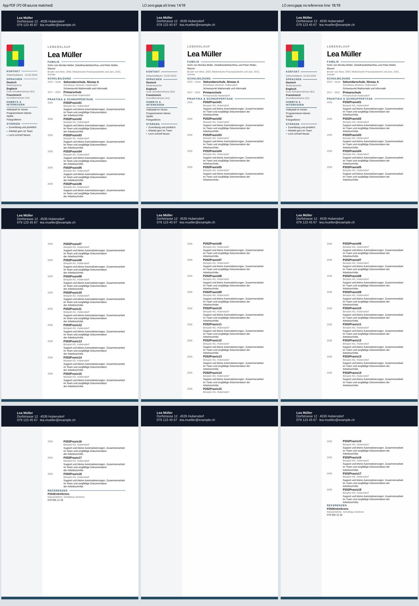
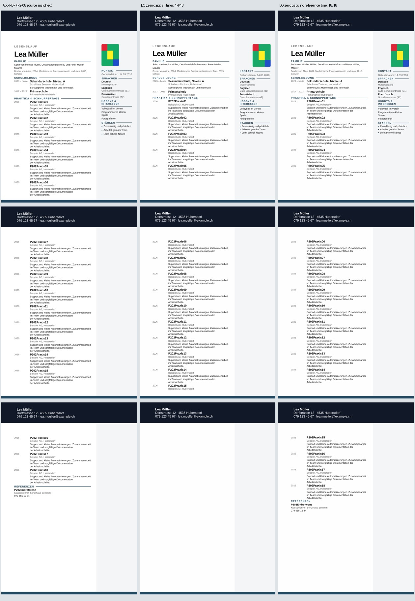

# P2-12 — Welche Haupttext-Trennlinie beeinflusst den Textverlust?

## Einordnung des Auftrags

Der ursprüngliche ONLYOFFICE-Vergleich ist abgeschlossen:

| P2-01 Testdokument | App-PDF | LibreOffice | ONLYOFFICE Builder ohne Lizenz |
|---|---|---|---|
| Titelblatt | PASS | PASS | FAIL: sichtbares Wasserzeichen |
| Motivationsschreiben | PASS | PASS | FAIL: sichtbares Wasserzeichen |
| Kurzer CV mit Sidebar und synthetischem Bild | PASS | PASS | FAIL: sichtbares Wasserzeichen |

Das sind die eingefrorenen Ergebnisse aus
[P2-01](p2-01-onlyoffice.md), keine neuen Konvertierungen dieser Runde.
ONLYOFFICE ist als saubere visuelle Referenz abgelehnt. Seine Ergebnisse mit
Wasserzeichen erlauben keinen fairen Vergleich der unmarkierten Renderqualität.
LibreOffice bleibt der vorhandene Konverter; die Eignung aller 39 Next-Vorlagen
ist weiterhin BLOCKED, weil der produktive Next-Zugang nur Modern/sidebar
freigibt. Keine Freigabe oder Änderung dieser Produktbeschränkung.

Die nachfolgenden Runden untersuchen einen zusätzlichen Fehler beim langen CV:
LibreOffice zeigt im vollen synthetischen 18-Einträge-Export nur 14 vollständige
Einträge. App und DOCX-Quelldaten enthalten alle 18. P2-11 zeigte:
Alle vier Haupttext-Trennlinien entfernen plus 18 Leerabsätze auf Nullabstand
setzen stellt den Text wieder her. Das erhält Foto, Sidebar, Kopf-/Fusszeilen
und alle 107 Inhaltssteuerelemente. Seitenumbrüche, Foto rechts und die bewusst
entfernten Linien verhindern aber weiterhin eine visuelle Freigabe.

P2-12 grenzt diesen Befund auf einzelne Linien und deren Kombinationen ein.
Der normale Export wird dadurch nicht verändert.

## Begrenzte Versuchsmatrix

Arbeitsbranch `work/01nov-p2-12-heading-subsets`, Basis
`611c010ed982e969f4b04c7060edf8fc0a6939b9`.
Getestete Implementierung `6882e4d6fe310bd784b375094801a9464c6af0da`,
Tree `8d8df2559e0986763997442a7e04555c7bfbbdfc`.
[Nativer Lauf 41331865157](https://github.com/modebrecht/cv-cover-charm/actions/runs/41331865157).

Zwei unveränderte vollständige P2-08-Next-Downloads mit Sidebar links/rechts,
Quell-Export-Commit `b11ec0345e999d64f0f3d8fdeba82613ca9cc9f6`.
Die vollständigen App-PDF-Messungen werden aus demselben Exportstand wiederverwendet;
kein neuer Browser-/App-Export oder Vorlagenlauf wird gezählt.

Die 18 bereits identifizierten Leerabsatz-Abstände sind in allen 32
Versuchsdateien null. Pro Seite werden sämtliche 16 Teilmengen dieser vier
Haupttext-Zeichnungen entfernt, einschliesslich keiner/aller:

| Bitwert | Label | Zeichnungsname |
|---:|---|---|
| 1 | family | `cv.section.custom:familie.heading.flow-paint` |
| 2 | school | `cv.section.schule.heading.flow-paint` |
| 4 | experience | `cv.section.erfahrung.heading.flow-paint` |
| 8 | reference | `cv.section.referenzen.heading.flow-paint` |

Die Maske ist die Summe der entfernten Bitwerte. Die Matrix erlaubt eine
Minimalaussage nur in diesem vollständigen endlichen Bereich, unter festem
Nullabstand, auf diesen beiden Modern-Quellen und der getesteten LO-Version.
Sie ist keine Suche über alle Word-Einstellungen oder über unveränderte Abstände.

Vier Kontroll-Konvertierungen: zwei kleine bekannte Negativ-/Positivquellen
sowie beide unveränderten vollen Originale. Die vier Matrix-Endpunkte 0/15
müssen zusätzlich die gespeicherten P2-11-DOCX-Hashes und Seitenpixel reproduzieren.
Insgesamt 36 geplante native Konvertierungen.

## Unveränderte Inhalte und Prüfkriterien

Alle 19 kritischen Tabellen bleiben kanonisch identisch, ebenso Reihenfolge
und sämtlicher Word-Text. Alle 107 Body-Steuerelemente, darunter 75 innere,
bleiben erhalten. Foto-Zeichnung, Sidebar-Zelle und die drei initialen
Absatz-Eigenschaften bleiben unverändert. Alle Paketdateien ausser
`word/document.xml` sind byte-identisch: Medien, Kopf-/Fusszeilen, Hintergründe,
Beziehungen, Styles und Einstellungen.

Eine fehlende dekorative Linie erzwingt weiterhin Gesamtversuch FAIL, auch wenn
der kritische Text vollständig ist. Text, Seitenverteilung, Titelgeometrie und
Foto werden separat gemessen. Die bestehenden 2-mm-/0.90-Fotogrenzen und die
2-mm-Titelgrenze bleiben unverändert. Keine stille Lockerung der Abnahme.

99 lokale Python-Prüfungen PASS: 9 neue Teilmengen-/Erhaltungsprüfungen und
90 vorhandene Kontrollen. Die Endpunkt-Prüfung vergleicht die vollständigen
Paket-Metadaten mit dem festgeschriebenen P2-11-Bericht, nicht nur einen Marker.
Unvollständige oder doppelte Teilmengen können keine Minimumaussage erzeugen.
Nichtmonotone Ergebnisse werden ausdrücklich aufgeführt.

Nur der bestehende Workflow `dossier-visual-parity.yml` und dessen vorhandener
Fixture-Job werden erweitert, per `fixture_probe: heading-subsets`.
Weiterhin fünf Job-IDs; die vier anderen Jobs bleiben bei diesem Lauf aus.
LO-only-Installation, 90 Sekunden pro Konvertierung, 15 Minuten für den Job.
Keine Produktquellen, Abhängigkeiten, zweiten Workflows oder Windows-Zugriffe.

## Ergebnisse und Entscheidung

Nativer Lauf **PASS**, 99 Python-Prüfungen PASS, 36 erfolgreiche
Konvertierungen / 108 PDF-Seiten, null Konvertierungen BLOCKED.
LibreOffice `24.2.7.2 420(Build:2)`. Eine einzige native Matrix, kein Retry.

Für links und rechts ergibt sich dieselbe vollständige Wahrheitstabelle:

| Entfernte Haupttext-Linien | Masken | Textstatus je Seite | Vollständige Einträge | Layoutstatus |
|---|---|---|---:|---|
| Keine / beliebige Teilmenge von Familie, Schule, Erfahrung; Referenzlinie bleibt | 0–7 | FAIL in allen 8 Fällen | 14/18 | FAIL |
| Referenzlinie / Referenzlinie plus beliebige Teilmenge der anderen drei | 8–15 | PASS in allen 8 Fällen | 18/18 | FAIL |

Damit sind 16 der 32 vollständigen CV-Kopien textlich PASS, 16 FAIL,
keine BLOCKED. Alle 32 visuellen Gesamtversuche bleiben FAIL. Die vier
Kontrollen bestehen ihre gespeicherten Pixelprüfungen; das ist keine zusätzliche
Produktabnahme. Die Einzelzeilen stehen im
[kompakten Teilmengenbeleg](p2-12-subset-findings.json).

Die einzigartige kleinste erfolgreiche Zeichnungs-Reduktion ist **Maske 8**:
nur `cv.section.referenzen.heading.flow-paint` entfernen. Das gilt auf beiden
Seiten. Die Referenzzeichnung wird in jeder erfolgreichen Teilmenge entfernt;
keine Teilmenge der anderen drei Linien kann ihre Entfernung ersetzen. Es gibt
in diesem vollständig gemessenen Bereich keine erfolgreiche Teilmenge mit
fehlschlagender Obermenge. Die anderen drei Linien können erhalten bleiben.

Diese Minimumaussage gilt nach den 18 fest eingestellten Abstandsänderungen.
Die erfolgreiche Einzelzeichnungskopie enthält insgesamt 18 Abstandsänderungen
und eine entfernte Zeichnung. Referenzlinie allein entfernen bei ursprünglichen
Abständen wurde hier nicht getestet. Auch die interne Ursache in LibreOffice
ist durch die Blackbox-Matrix nicht bewiesen.

Die unveränderten Restfehler der Maske 8 sind auf beiden Seiten messbar:

- Alle 18 Beschreibungen und Referenzrolle/Telefon erscheinen vollständig,
  ohne über Seiten geteilte Einträge, auf drei Seiten.
- Eintrag 06 beginnt auf Seite 2 statt App-Seite 1; Eintrag 15 auf Seite 3
  statt App-Seite 2. Übrige Titel liegen auf passenden Seiten bis 26.379 mm
  tiefer; die Referenz beginnt 24.691 mm tiefer. Die 2-mm-Grenze ist verletzt.
- Foto links PASS; Foto rechts FAIL, x-Verschiebung +19.844 mm. Kalibriermuster
  beidseits 1.0, Grössendifferenzen 1.059 / 1.323 mm innerhalb des 2-mm-Gates.
- Die absichtlich fehlende Referenzlinie verhindert zusätzlich die volle
  visuelle Freigabe. Die drei anderen Haupttext-Linien bleiben sichtbar.

## Visuelle Kontrolle und dauerhafte Referenzdateien

Alle drei Seiten beider Vergleichsbilder wurden angesehen: links App-PDF,
Mitte LO mit allen Linien/Nullabständen, rechts LO Maske 8. Sichtbar sind der
abgeschnittene Text im mittleren PDF, der wiederhergestellte Schluss samt
Referenz rechts, die drei erhaltenen Haupttext-Linien, die verbleibende
Seitenverschiebung und das weiterhin versetzte rechte Foto.





Die wiederverwendeten App-PDFs wurden vor dem Rendern nochmals gehasht:
links `d1d2fbe74e513166a82da6171e5a9fab292c0ca6ec84138ea8b0d0d710bf95cc`,
rechts `75a5e2073d243bee8dc406905cf4721e9a3276d625d67dd1343d859949d16cef`.
Das zählt keine neuen Browser-Downloads.

Die beiden vollständigen Maske-8-DOCX-Dateien liegen mit Hash-Manifest und
beobachteten Metriken unter
[`tests/fixtures/lo-import-p2-12`](../../tests/fixtures/lo-import-p2-12/README.md).
Sie sind diagnostische Text-Positivfälle mit visuellen Fehlern. Kein privates
Word-Dokument, keine Fotografie einer Person: das Bild ist das bekannte
synthetische Vierfarben-Kalibriermuster. Jede Datei lässt sich aus der
unveränderten P2-08-Quelle mit `make_copy(source,target,8)` exakt wiederherstellen.

## Belege, Reproduktion und Ressourcen

- [Unveränderter nativer Bericht](p2-12-native-results.json): 827,573 Bytes,
  SHA256 `e479a8e22fda52691f8858ed74461ac5529f545cea39a97327a53986dfa0c685`.
  P2-11-Referenz SHA256
  `172a739de85052569340601a4de000ff1a8cd6259280166ba9730e332597f266`.
- Lauf `41331865157`, Job `124923470374`, Implementierung
  `6882e4d6fe310bd784b375094801a9464c6af0da`. Der vorhandene Fixture-Job
  lief erfolgreich; die vier anderen Jobs sind nachweislich übersprungen.
- Artefakt `13094027254`, `dossier-heading-subsets`, 16,013,438 Bytes,
  ZIP-SHA256 `bf537140fb82f2cec88bdbb12b585381873c4e2754d880f36ce4df8b6e33e300`.
  GitHub-Ablaufdatum 2026-11-15; Bericht und ausgewählte Dateien bleiben im Git.
- Vier Kontroll-DOCX-/Pixelbaselines PASS und vier Teilmengen-Endpunkte
  (0/15 beidseits) mit identischen P2-11-DOCX-Hashes/PDF-Seitenpixeln PASS:
  zusammen 24 wiederholte Seiten-Signaturen.
- [Auditbeleg](p2-12-audit-proof.json): alle 32 vollständigen Fallzeilen,
  vier Kontrollzeilen und Teilmengenbefunde stimmen exakt mit den nativen
  Ergebnissen überein. PDF-Hashes und rekonstruierte DOCX-Hashes geprüft;
  native Ressourcen erhalten. Audit PASS, **null zusätzliche Konvertierungen**.
  Der native Bericht wurde vor dem Audit unverändert kopiert.
- Job-Log-Zeitspanne 17:31:08.379–17:38:48.986 UTC: **7:40.607**.
  Summierte LO-Prozesszeit **330.932 s**, höchster einzelner Konvertierungs-RSS
  **242,952 KiB / 237.26 MiB**. Einzelkonvertierungen 1.605–25.422 s.
  Kein Messwert für den gesamten Runner-Speicher oder eine x39-Ressourcengarantie.

Audit nach Entpacken des passenden Artefakts:

```sh
python scripts/dossier_lo_paint.py --out-dir /pfad/zum/artefakt --audit-only
```

Ohne `--audit-only` erfolgt ein neuer nativer Lauf; alternativ im bestehenden
Workflow auf diesem Branch `fixture_probe: heading-subsets` wählen. Linux,
LibreOffice und die vorhandenen Python-Analyseabhängigkeiten reichen aus.

## Entscheidung und gezielter nächster Schritt

Die ONLYOFFICE-Entscheidung bleibt abgeschlossen: Wasserzeichen-FAIL,
LibreOffice beibehalten. P2-12 schliesst die vier-Linien-Teilmengenfrage ab:
Unter den festgelegten Nullabständen ist genau die Referenzlinie der relevante
Zeichnungsfaktor für den beobachteten Textverlust. Globale SDT-Entfernung und
Entfernung der anderen drei Linien sind dafür unnötig.

Ein Produktfix ist weiterhin offen. Der gezielte nächste Schritt P2-13 kann
die Referenzlinie in diagnostischen Vollquellen erhalten und nur ihre
Verankerung untersuchen. Zuerst den Referenzlinien-Einzelfall auch mit
Originalabständen prüfen, damit der Abstandsanteil getrennt messbar wird.
Danach eine kleine explizite Matrix der Ankereigenschaften, jeweils mit
Original-/Nullabständen und beidseits. Original und Maske 8 bleiben Kontrollen.
Seiten-, Foto-, Geometrie- und sichtbare-Linien-Gates bleiben verbindlich.
Eine Textrettung darf weiterhin nicht als Layoutfreigabe gelten.

Produktcode und Pakete wurden nicht geändert. Kein zweiter Workflow, kein
Merge, keine Änderung an `dev`, `render` oder `main`, kein Zugriff auf einen
Benutzer-PC. Alle Arbeiten bleiben auf dem separaten P2-12-Branch.
