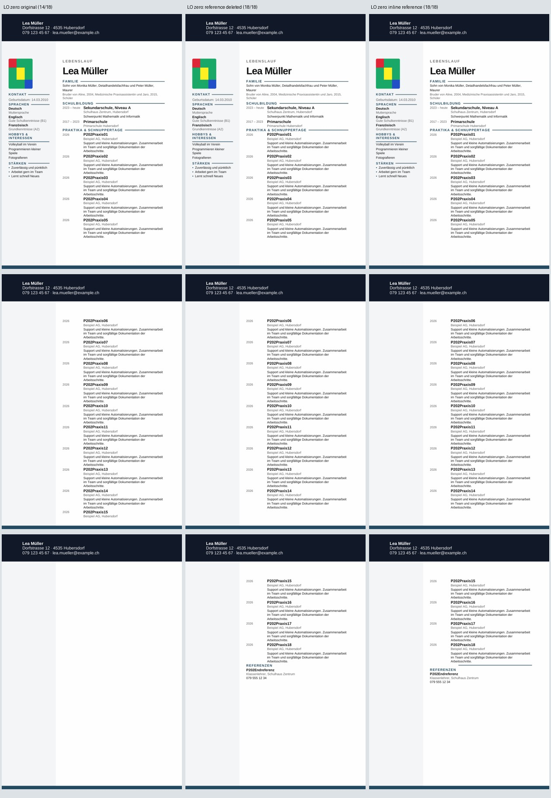
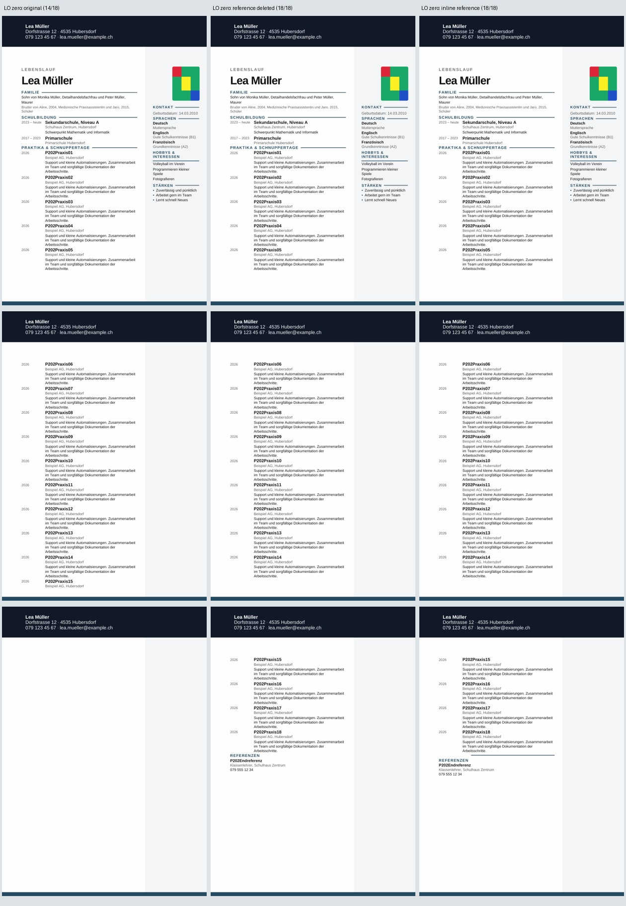

# P2-13 — Referenzlinie erhalten und Verankerung prüfen

P2-12 hat unter Nullabständen die Referenzlinie als relevanten Zeichnungsfaktor
eingegrenzt. Diese Runde prüft Originalabstände sowie sechs Varianten, die ihre
Grafik erhalten. Nur synthetische vollständige Modern-Next-Quellen aus P2-08;
kein Produktcode, normaler Export oder geschützter Branch wurde geändert.

Branch `work/01nov-p2-13-reference-anchor`, Basis
`8ee1e2fa6cbba896b156152acb83563a686b9f5b`.
Getestet `ef2853a27ab8844bc5c285f0e0dd71741163575a`,
Tree `c2ecc22330ebc23dd87ab57d1f17837b96bbecd7`.
[Nativer Lauf 41333761319](https://github.com/modebrecht/cv-cover-charm/actions/runs/41333761319).

## Matrix und Ergebnisse

Acht Profile × Original-/Nullabstände × Sidebar links/rechts = 32 Vollquellen.
Zwei bekannte kleine Positiv-/Negativkontrollen ergeben 34 Konvertierungen.
Der vorhandene Workflow und seine fünf Jobs bleiben; nur der vorhandene
Fixture-Job läuft, die anderen vier Jobs sind übersprungen.

**Ausführung PASS:** 107 Python-Prüfungen, 34 native Konvertierungen,
102 PDF-Seiten, keine Konvertierung BLOCKED. LibreOffice `24.2.7.2 420(Build:2)`.
Die folgende Tabelle gilt jeweils für beide Sidebar-Seiten:

| Referenzprofil | Originalabstände | Alle 18 Abstände null | Linie neben Überschrift / volle Layoutprüfung |
|---|---|---|---|
| Original | FAIL 14/18 | FAIL 14/18 | FAIL / FAIL |
| Nur Referenzlinie entfernt | FAIL 14/18 | PASS 18/18 | FAIL / FAIL |
| `layoutInCell=0` | FAIL 14/18 | FAIL 14/18 | FAIL / FAIL |
| `behindDoc=0` | FAIL 14/18 | FAIL 14/18 | FAIL / FAIL |
| `allowOverlap=0` | FAIL 14/18 | FAIL 14/18 | FAIL / FAIL |
| Vertikal relativ zum Absatz | FAIL 14/18 | FAIL 14/18 | FAIL / FAIL |
| Absatz-relative Vertikale und `layoutInCell=0` | FAIL 14/18 | FAIL 14/18 | FAIL / FAIL |
| `wp:inline` statt schwebendem Anker | FAIL 14/18 | PASS 18/18 | FAIL / FAIL |

Vier Text-PASS, 28 Text-FAIL, alle 32 visuellen Gesamtversuche FAIL. Alle PDFs
haben drei Seiten. Die vier Text-Positivfälle enthalten alle Beschreibungen,
Referenzrolle und Telefon; keine Beschreibung ist über Seiten geteilt.

Die Referenzlinie allein zu entfernen genügt bei Originalabständen nicht.
Auch `inline` benötigt hier die fest eingestellten Nullabstände. Die fünf
anderen Ankerprofile retten in keiner der beiden Abstandsvarianten den Text.
Das ist eine abgeschlossene begrenzte Blackbox-Matrix, keine allgemeine
Aussage über alle Word-/LibreOffice-Einstellungen oder die 39 Vorlagen.

## Grafikdaten erhalten ist noch keine richtige Platzierung

`inline` erhält die Bilddaten, Abmessungen und Grafikidentität. Im nativen PDF
ist die Linie sichtbar, liegt jedoch **über** der Überschrift. Links liegt
das Bild auf Seite 3 bei x=70.997, y=150.478, Breite=118.991, Höhe=4.162 mm;
rechts bei x=20.003 mit derselben Vertikalen und Grösse. Die Überschrift beginnt
erst bei y=155.415 mm. Die Linie steht damit nicht auf Höhe ihrer Beschriftung.

Eine neue separate Pixelprüfung verlangt einen durchgehenden dunklen Lauf über
mindestens 85% eines 30-mm-Ausschnitts rechts vom Wortbereich auf Höhe der
Referenzüberschrift. Sie wird mit den gespeicherten, gehashten Ausschnitten
einer vorhandenen App-Linie (PASS, 0.888889) und einer bewusst entfernten Linie
(FAIL, 0.0) sowie einem Text-/Strich-Negativfall geprüft. Die beiden kleinen
Ausschnitte enthalten keine Personenfotografie.

Die `inline`-Linie fällt korrekt durch diese Positionsprüfung (0.0), obwohl sie
anderswo auf der Seite sichtbar ist. Bei den 28 unvollständigen PDFs fehlt
bereits die Referenzüberschrift; dort bedeutet Linien-FAIL kein gesondertes
Urteil darüber, ob die Grafik irgendwo sonst gerendert wurde. Die Messgrenze
wurde nach dem nativen Ergebnis nicht gelockert.

Alle Varianten erhalten 19 kritische Tabellen, sämtlichen Word-Text und 107
Body-Steuerelemente, darunter 75 innere. Sidebar, Foto, die anderen drei
Haupttext-Linien, initiale Absatzeigenschaften und alle Paketdateien ausser
`word/document.xml` bleiben erhalten. `inline` erhält alle acht Body-Grafiken.
Keine privaten lokalen Dateien oder Bilder von Personen.

Die App-Abweichungen bleiben: Einträge 06 und 15 beginnen in LO jeweils eine
Seite später, Folgetitel liegen bis 26.379 mm tiefer. Bei `inline` beginnt die
Referenz 29.312 mm unter der App-Position, gegenüber 24.691 mm ohne Referenzbild.
Foto links PASS, rechts FAIL (+19.844 mm x), Musterübereinstimmung beidseits 1.0.
Die bisherigen 2-mm-/0.90-Grenzen bleiben unverändert.

## Visuelle Kontrolle und gespeicherte Fälle

Alle drei Seiten beider Vergleichsbilder wurden angesehen. Spalten:
LO Original/Nullabstände, LO Referenzlinie entfernt/Nullabstände, LO inline/
Nullabstände. Die abgeschnittene Fortsetzung, die wiederhergestellten Einträge
und die oberhalb der Überschrift platzierte Linie sind sichtbar. Der Vergleich
mit App-Geometrie verwendet weiterhin die eingefrorenen P2-08-Metriken; kein
neuer App-/Browser-Export wird gezählt.





Die zwei vollständigen Inline-DOCX-Dateien samt Hash-Manifest stehen unter
[`tests/fixtures/lo-import-p2-13`](../../tests/fixtures/lo-import-p2-13/README.md).
Es sind Text-Positivfälle mit bekannten visuellen Fehlern, keine Produktfixes.

## Belege und Ressourcen

- [Unveränderter nativer Bericht](p2-13-native-results.json), 742,229 Bytes,
  SHA256 `26345be9e0ab6b78812e04ba3e32c715a2de0ff7c71873ea706aa511b8f31048`.
  Quell-Export `b11ec0345e999d64f0f3d8fdeba82613ca9cc9f6`; eingefrorener
  P2-12-Bericht SHA256
  `e479a8e22fda52691f8858ed74461ac5529f545cea39a97327a53986dfa0c685`.
- Lauf `41333761319`, Job `124929128207`, Artefakt `13094716682`,
  `dossier-reference-anchor`, 14,420,610 Bytes,
  ZIP-SHA256 `448b709489be99fd205fc30f8eded6197ad80985edf40f9f5ad63da1f3c619ba`.
  GitHub-Ablaufdatum 2026-11-15; ausgewählte Belege bleiben im Git.
- Zwei kleine Kontrollen und sechs Vollquellen-Endpunkte reproduzieren
  gespeicherte DOCX-Hashes und 24 Seiten-Signaturen. Keine erneute Browser- oder
  ONLYOFFICE-Installation; ein nativer Matrixlauf, kein Retry.
- [Auditbeleg](p2-13-audit-proof.json): alle 32 Fallzeilen und zwei Kontrollzeilen
  einschliesslich nativer Ressourcen stimmen exakt überein; rekonstruierte
  DOCX- und gespeicherte PDF-Hashes geprüft. Audit PASS, null neue Konvertierungen.
  Die vier Analysepakete wurden für den Cloud-Audit in den CI-Versionen isoliert
  geladen; kein Konverter wurde lokal installiert oder neu ausgeführt.
- Native Jobspanne 18:53:34.259–19:00:56.005 MEZ: **7:21.747**.
  Summierte LO-Wandzeit **310.274 s**, höchster Konvertierungs-RSS
  **243,084 KiB / 237.39 MiB**. Keine Ganz-Runner-RAM- oder x39-Kapazitätsmessung.

```sh
python scripts/dossier_reference_anchor.py --out-dir /pfad/zum/artefakt --audit-only
```

## Entscheidung

Keines der getesteten Profile ist ein visueller Fix. `inline` rettet unter
Nullabständen den Text bei erhaltener Grafik, verschiebt aber die Überschrift
unter die Linie. Die weitere begrenzte Untersuchung kann Inline-Belegungsmasse
und explizite Ankerkoordinaten getrennt prüfen. Feste Koordinaten wären dabei
eine Diagnose dieses eingefrorenen Falls und keine dynamische Exportlösung.

ONLYOFFICE bleibt wegen des früheren Wasserzeichenbefunds als Referenz
abgelehnt; LibreOffice bleibt der vorhandene gemessene Konverter. Die x39-
Eignung ist unverändert nicht belegt. Normaler Produktexport, Abhängigkeiten
und `dev`, `render`, `main` bleiben unverändert; kein Merge, kein zweiter
Workflow, kein PC-/Word-Zugriff.
