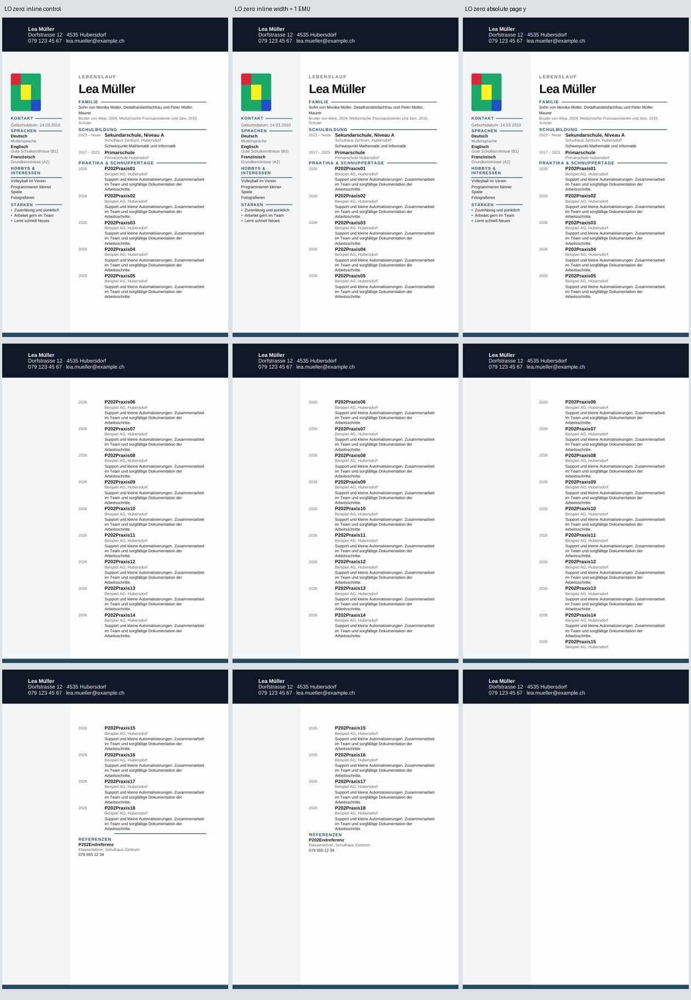
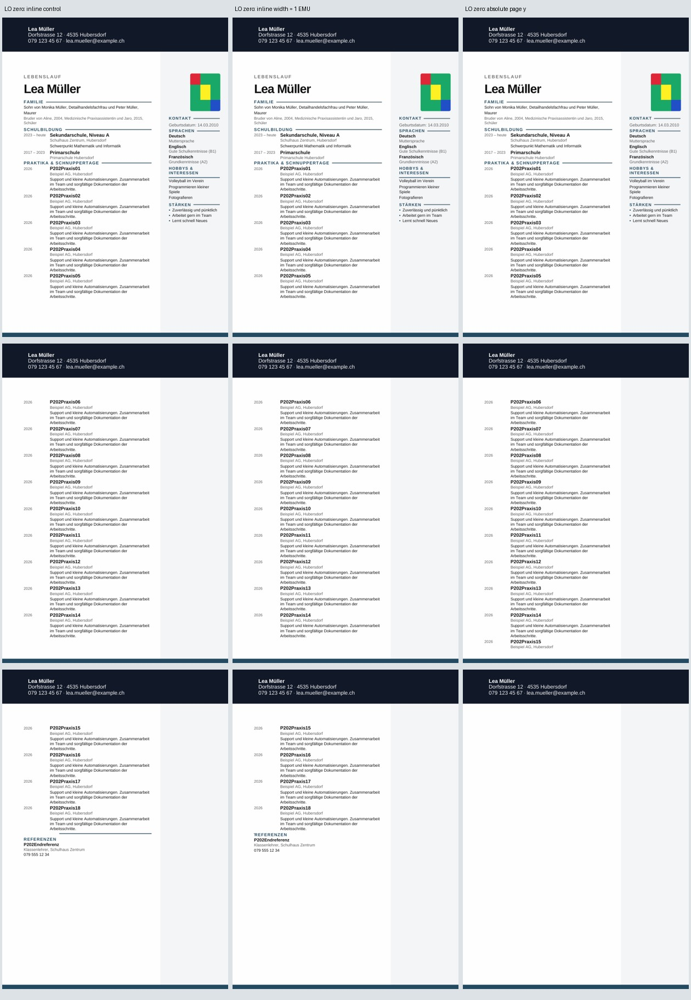

# P2-14 — Inline-Belegung und explizite Referenzanker

P2-13 erhält mit `inline` und Nullabständen alle 18 Einträge, setzt die Linie
aber über ihre Überschrift. Diese begrenzte Matrix trennt Inline-Belegungsmasse
und absolute Ankerposition. Ausschliesslich vollständige synthetische Modern-
Quellen aus dem P2-08-Next-Export; keine normalen Produktexporte verändert.

Branch `work/01nov-p2-14-reference-placement`, Basis
`2d80903ed4e5acb6ea322d860d2283e26dcaf76a`.
Getestete Implementierung `ffbb4a8bcd23cd24193e0929b6be9be285cd0198`,
Tree `1128be2cf14698c37107c3f32feb1906127a3f50`.
[Nativer Lauf 41358002067](https://github.com/modebrecht/cv-cover-charm/actions/runs/41358002067).

## Neun Profile, zwei Abstände, beide Sidebar-Seiten

| Profil | Gezielte Änderung an der Referenzgrafik |
|---|---|
| Original | Keine Ankeränderung |
| Referenz entfernt | Bewusste Text-Positiv-/Linien-Negativkontrolle |
| Inline | P2-13-Text-Positivfall mit falsch platzierter Linie |
| Inline-Minimalbreite | Nur `wp:extent/@cx=1` EMU; intrinsische Grafikdaten unverändert |
| Inline-Minimalgrösse | `wp:extent` Breite und Höhe je 1 EMU; intrinsische Grafikdaten unverändert |
| Seiten-relative Vertikale | `positionV` relativ zur Seite, y=150.478 mm |
| Seiten-relative Vertikale ausserhalb Zelle | Zusätzlich `layoutInCell=0` |
| Einfache absolute Position | `simplePos=1`, explizite x-/y-Koordinaten |
| Einfache absolute Position ausserhalb Zelle | Zusätzlich `layoutInCell=0` |

Die absoluten Koordinaten stammen aus dem nativen P2-13-Inline-Bildrahmen:
y=150.478 mm, x links=70.997 mm, x rechts=20.003 mm. Sie beziehen sich auf
diesen eingefrorenen 18-Einträge-Fall. Sie sind keine dynamischen Positionen für
beliebige Lebensläufe, Eintragszahlen oder Vorlagen. Gleichheit der Grafikdaten
bei winziger Inline-Belegung beweist ebenfalls keine sichtbare Linie; genau
dafür bleibt die separate Pixelprüfung bestehen.

Neun Profile × zwei Abstände × zwei Sidebar-Seiten = 36 Vollquellen, zusätzlich
zwei kleine bekannte Kontrollen. Zwölf Original-/Entfernungs-/Inline-Fälle
müssen P2-13-DOCX-Hashes, Seitenpixel und Linienmessungen exakt reproduzieren.
Mit den kleinen Kontrollen sind das 42 gespeicherte Seiten-Signaturen.

19 kritische Tabellen, sämtlicher Word-Text, 107 Body-Steuerelemente, Foto,
Sidebar, andere Zeichnungen und alle Paketdateien ausser `word/document.xml`
bleiben erhalten. Eine entfernte Linie verhindert die visuelle Freigabe;
Textstatus, Linienposition, App-Geometrie, Seitenverteilung und Foto werden
weiterhin getrennt geprüft. Keine Lockerung der 85%-Linien-, 2-mm-Geometrie-
oder 0.90-Fotomuster-Grenzen.

113 lokale Python-Prüfungen PASS: sechs neue Erhaltungs-/Positionsprüfungen und
107 vorhandene. Die wiederverwendete P2-13-Prüfsteuerung reproduziert zusätzlich
alle 32 alten Fallzeilen und zwei Kontrollzeilen exakt, mit null Konvertierungen.
Der bestehende Workflow und seine fünf Job-IDs bleiben; Auswahl über
`fixture_probe: reference-placement`. 15-Minuten-Joblimit, 90 Sekunden je
Konvertierung, kein zweiter Workflow oder Job.

## Verifizierte Ergebnisse

**Ausführung PASS:** 113 Python-Prüfungen, 38 native Konvertierungen,
114 PDF-Seiten, keine Konvertierung BLOCKED. LibreOffice `24.2.7.2 420(Build:2)`.
Ein nativer Lauf ohne Wiederholung; vier andere Jobs nachweislich übersprungen.

Die Ergebnisse gelten beidseits:

| Profil | Originalabstände | Nullabstände | Referenzlinie neben Überschrift | Voller visueller Versuch |
|---|---|---|---|---|
| Original | FAIL 14/18 | FAIL 14/18 | FAIL | FAIL |
| Referenz entfernt | FAIL 14/18 | PASS 18/18 | FAIL | FAIL |
| Inline | FAIL 14/18 | PASS 18/18 | FAIL | FAIL |
| Inline-Minimalbreite | FAIL 14/18 | PASS 18/18 | FAIL | FAIL |
| Inline-Minimalgrösse | FAIL 14/18 | PASS 18/18 | FAIL | FAIL |
| Seiten-relative Vertikale | FAIL 14/18 | FAIL 14/18 | FAIL | FAIL |
| Seiten-relative Vertikale ausserhalb Zelle | FAIL 14/18 | FAIL 14/18 | FAIL | FAIL |
| Einfache absolute Position | FAIL 14/18 | FAIL 14/18 | FAIL | FAIL |
| Einfache absolute Position ausserhalb Zelle | FAIL 14/18 | FAIL 14/18 | FAIL | FAIL |

Acht Text-PASS, 28 Text-FAIL, alle 36 visuellen Gesamtversuche FAIL.
Alle Dateien haben drei Seiten. Die Text-Positivfälle enthalten alle 18
vollständigen Beschreibungen und die Referenz, ohne geteilte Einträge.

## Weshalb die kleinen Inline-Masse keinen Fix ergeben

Die unveränderten intrinsischen Grafikdaten werden beim PDF-Rendern trotzdem
in den geänderten Rahmen skaliert. Die Referenzgrafik wird bei Minimalbreite
auf etwa **0.406 mm × 4.163 mm** zusammengestaucht; bei Minimalgrösse auf etwa
**0.406 mm × 0.406 mm**. Ein voller 118.992-mm-Trennstrich bleibt dabei nicht
sichtbar. Die Linienprüfung fällt mit 0.0 korrekt durch. Die belegte
Rahmenbeobachtung steht in [p2-14-frame-observations.json](p2-14-frame-observations.json).

Der normale Inline-Fall zeigt den Strich über der Überschrift. Die absoluten
Ankervarianten retten den Text gar nicht: Eintrag 15 bleibt unvollständig,
16–18 und die Referenz fehlen. Bei diesen Fällen scheitert die Linienprüfung
schon an der fehlenden Referenzüberschrift; sie behauptet nicht, dass irgendwo
auf der Seite keinerlei Grafik gezeichnet wird.

Die anderen Layoutfehler bleiben: Einträge 06 und 15 beginnen jeweils eine
Seite später als im App-PDF. Die Referenz beginnt bei normalem Inline 29.312 mm,
bei Minimalbreite 25.185 mm, bei Minimalgrösse 24.691 mm unter der App-Position.
Foto links besteht das bestehende Gate, rechts bleibt x um +19.844 mm
verschoben. Keine Abnahmegrenze wurde geändert.

## Visuelle Kontrolle und Reproduktion

Alle drei Seiten beider Vergleichsbilder wurden angesehen. Spalten: normales
Inline mit Nullabständen, Minimalbreite mit Nullabständen, absolute Seiten-y-
Position mit Nullabständen. Sichtbar sind die falsch platzierte Linie, die
zusammengestauchte Grafik und die fehlende Fortsetzung bei absolutem Anker.





Keine zusätzlichen unbrauchbaren Voll-DOCX-Kopien werden als vermeintliche
Kandidaten gespeichert. Die unveränderten P2-08-Quellen, Generator und exakten
Kopier-/XML-Hashes im nativen Bericht erlauben deren Reproduktion. Das native
Artefakt enthält sämtliche 38 geprüften DOCX-/PDF-Dateien und Messungen.

- [Unveränderter nativer Bericht](p2-14-native-results.json): 847,591 Bytes,
  SHA256 `4a43cfdbc07347d255fceed2d99e3c06ec5b495aead77eaa77d9a70be87b172c`.
  Quell-Export-Commit `b11ec0345e999d64f0f3d8fdeba82613ca9cc9f6`.
- Lauf `41358002067`, Job `125002117100`, Artefakt `13104082264`,
  `dossier-reference-placement`, 16,363,523 Bytes,
  ZIP-SHA256 `9d68be348a1148020f1557d822e58f3d329f1f463d804bceed491293ff9c52b9`.
  GitHub-Ablaufdatum 2026-11-15; Berichte und Ausgangsquellen bleiben im Git.
- [Auditbeleg](p2-14-audit-proof.json): alle 36 Fallzeilen und zwei
  Kontrollzeilen einschliesslich Ressourcen stimmen exakt mit dem nativen
  Bericht überein. PDF-Hashes und rekonstruierte DOCX-Hashes geprüft. Audit PASS,
  null neue Konvertierungen. Zwölf gemeinsame Vollfälle plus zwei kleine
  Kontrollen bestätigen die 42 gespeicherten Seiten-Signaturen.
- Jobspanne 23:36:47.667–23:44:51.339 MEZ: **8:03.672**.
  LO-Wandzeit summiert **299.447 s**, höchster einzelner Konvertierungs-RSS
  **243,028 KiB / 237.33 MiB**. Keine Ganz-Runner-RAM- oder x39-Kapazitätsaussage.

```sh
python scripts/dossier_reference_placement.py --out-dir /pfad/zum/artefakt --audit-only
```

## Entscheidung

Die neun Profile sind für diese beiden Vollquellen abgeschlossen geprüft.
Kein visueller Fix: Die zusätzlichen Inline-Varianten verlieren den sichtbaren
Strich, die absoluten Anker beheben den Textverlust nicht. Keine dieser
Änderungen wird in den normalen Export übernommen.

Die nächste ressourcenbegrenzte Gegenprobe vergleicht den bisherigen
Ubuntu-Konverter mit einer isolierten aktuellen offiziellen LibreOffice-
Version an unveränderten Quellen. Sie prüft die Engine-Version statt weiterer
Layoutänderungen. ONLYOFFICE bleibt wegen des früheren Wasserzeichens als
Referenz abgelehnt. Keine Freigabe aller 39 Next-Vorlagen; keine Änderung an
`dev`, `render`, `main`, keine neue Workflow-Datei oder Job-ID, kein PC-/Word-Zugriff.
