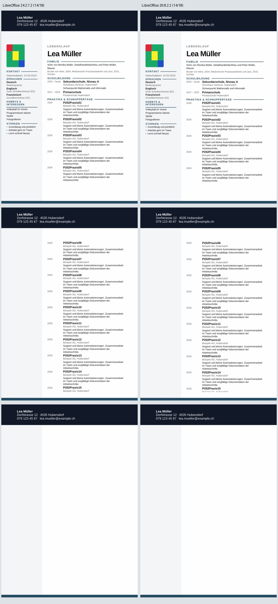
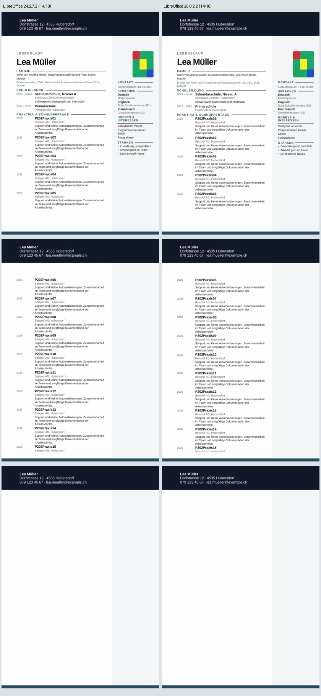

# P2-15 — Unveränderte CV-Quellen mit zwei LibreOffice-Versionen

Der ursprüngliche ONLYOFFICE-Vergleich bleibt entschieden: Der getestete
unklizenzierte Builder erzeugt in allen drei P2-01-Testdokumenten sichtbare
Wasserzeichen. LibreOffice bleibt der bestehende Konverter. Die neueren Runden
untersuchen zusätzlich den Textverlust in vollständigen langen Modern-CVs.

P2-13 und P2-14 liefern keinen visuellen Exportfix: Unter Nullabständen lässt
sich der vollständige Text mit Inline-Grafik ausgeben; die Referenzlinie wird
dabei verschoben oder bei kleiner Belegung zusammengestaucht. Absolute Anker
retten den Text nicht. Die Belege beider abgeschlossenen Runden sind auf diesem
Arbeitsbranch ebenfalls enthalten.

Diese unabhängige Gegenprobe verändert keine DOCX-Quelldatei. Sie vergleicht
Ubuntu LibreOffice 24.2.7.2 mit einer isolierten offiziellen Version 26.8.2 an
denselben vier Eingaben. Es wird weder der normale Export noch der bestehende
Konverterstandard ersetzt. Keine x39-/Word-Abnahme oder neuen Browser-Exporte.

## Quellen und begrenzte Ausführung

Arbeitsbranch `work/01nov-p2-15-libreoffice-version`, gemeinsame Codebasis mit
P2-14 `ffbb4a8bcd23cd24193e0929b6be9be285cd0198`.

- Vollständiger unveränderter 18-Einträge-Next-CV mit Sidebar links.
- Derselbe synthetische Datensatz mit Sidebar rechts.
- Kleine bekannte gekoppelte Negativkontrolle.
- Kleine bekannte Ein-Abstands-Positivkontrolle.

Die vollständigen Originaldownloads stammen aus P2-08, Export-Commit
`b11ec0345e999d64f0f3d8fdeba82613ca9cc9f6`. App-Metriken bleiben aus demselben
Exportstand. P2-13-Bericht festgeschrieben als SHA256
`26345be9e0ab6b78812e04ba3e32c715a2de0ff7c71873ea706aa511b8f31048`.
Alle vier Ubuntu-Ergebnisse müssen dessen gespeicherte Seitenpixel bestätigen.
Neuere Engine-Ergebnisse dürfen abweichen; sie werden an Text, App-Geometrie,
Linienposition und Foto gemessen. Die kleinen reduzierten Quellen dienen als
Kontrollen und erhalten keine volle App-Layoutfreigabe.

Die offizielle [Release-Seite](https://www.libreoffice.org/release-notes/)
führt 26.8.2 als Veröffentlichung vom 29. Oktober 2026. Der
[Linux-DEB-Download](https://us.libreoffice.org/download/libreoffice-stable/?lang=gug&type=deb-x86_64&version=26.8.2)
ist die Quelle des versionierten Archivs. Ein Installationsversuch lädt dessen
offizielle Metalink-Metadaten, verlangt den SHA256 des passenden Dateinamens,
prüft das Archiv vor der Ausführung und entpackt DEB-Inhalte mit `dpkg-deb` in
ein isoliertes temporäres Verzeichnis. Keine System-Paketinstallation oder
Ausführung von DEB-Wartungsskripten. Die vorhandene Ubuntu-Installation bleibt.

Downloadlimit 350 MiB / 240 Sekunden, Entpacklimit 300 Sekunden, äusseres
Setup-Limit sechs Minuten, 90 Sekunden pro Konvertierung. Ein gescheitertes
Setup wird als BLOCKED dokumentiert; es folgen keine Installationsschleifen.
Installer-Metadaten, Archivhash, gemeldete Engine-Version, Paketanzahl,
Entpackvolumen und Setup-Dauer werden gespeichert. Die grosse Softwaredatei
wird nicht als Testartefakt oder im Git abgelegt.

Der vorhandene Workflow und dessen Fixture-Job werden weiterverwendet,
`fixture_probe: lo-version`. Weiterhin fünf Job-IDs, kein zweiter Workflow.
Fünf neue Prüfsummen-Metadaten-Tests bestehen; der native Lauf führt zusätzlich
die vorhandenen 113 Kontrollen aus.

## Korrigierter Startfehler

Implementierung `68c287a68162ff51715c2877063d71b074de4446`, Lauf
`41358894132`, wurde von GitHub bereits bei der Workflow-Auswertung verworfen:
keine Jobs, keine Artefakte, null Installationen oder Konvertierungen. Die
Job-Umgebung verwendete `runner.temp`, obwohl der `runner`-Kontext dort laut
[GitHub-Kontextreferenz](https://docs.github.com/en/actions/reference/workflows-and-actions/contexts)
nicht verfügbar ist. Ein expliziter temporärer Pfad korrigiert dies.

Korrigierte getestete Implementierung
`c099e58f531371d461a279962ca0e53554f78ff5`,
Tree `74fdcebbf655e3c7a79702d4af45bd0ac4a1b634`.
[Nativer Versionslauf 41359089325](https://github.com/modebrecht/cv-cover-charm/actions/runs/41359089325).
Dies ist der erste gestartete Installations-/Konvertierungsversuch der Runde.

## Ergebnisse

**Ausführung PASS:** 118 Python-Prüfungen, acht erfolgreiche native
Konvertierungen, 24 PDF-Seiten, keine Konvertierung BLOCKED. Offizielle Version
`LibreOffice 26.8.2.2 9dea406ab7695df6325b11b0e19fdca8db4b7276`, bisherige
Version `LibreOffice 24.2.7.2 420(Build:2)`.

| Unveränderte Quelle | Ubuntu 24.2.7.2 | Offiziell 26.8.2.2 | Seiten je PDF | Bewertung |
|---|---|---|---:|---|
| Voller CV, Sidebar links | FAIL 14/18 | FAIL 14/18 | 3 | Beide voller visueller Versuch FAIL |
| Voller CV, Sidebar rechts | FAIL 14/18 | FAIL 14/18 | 3 | Beide voller visueller Versuch FAIL |
| Kleine gekoppelte Negativkontrolle | 15/18 | 15/18 | 3 | Erwarteter alter Negativbefund bestätigt |
| Kleine Ein-Abstands-Positivkontrolle | 18/18 | 18/18 | 3 | Erwarteter alter Text-Positivbefund bestätigt |

Alle vier Inhaltsbefunde einschliesslich Marker-Seiten, vollständigen
Beschreibungen, Teilung und Referenzkörper sind zwischen den Engines identisch.
Eintrag 15 bleibt in beiden vollen CVs angeschnitten; 16–18 und Referenz fehlen.
Die Linie kann dort wegen fehlender Referenzüberschrift nicht an der richtigen
Position bestehen. Foto links PASS, Foto rechts FAIL (+19.844 mm x), bei beiden
Versionen dieselben Fotometriken und Musterübereinstimmung 1.0.

Die Renderings sind unterschiedlich: Elf von zwölf verglichenen Seitenpaaren
haben unterschiedliche Pixel. Gemeinsame CV-Titel auf derselben Seite ändern
ihre vertikale Position um bis zu 1.465 mm; die erste Station beginnt in der
neuen Version 0.424 mm tiefer. Dies behebt weder Textverlust noch App-Parität.
Die [Versionsvergleichsdaten](p2-15-engine-comparison.json) halten diese
Unterschiede getrennt vom Inhaltsbefund fest. Keine SSIM- oder x39-Aussage wird
aus den Pixelhashes abgeleitet.

Alle drei Seiten beider Kontaktbilder wurden angesehen: links Ubuntu-Version,
rechts offizielle Version. Sichtbar bleiben die abgeschnittene Fortsetzung,
die fehlenden letzten Einträge und der leere Haupttextbereich auf Seite 3.
Foto, Sidebar und Kopf-/Hintergrundgestaltung bleiben sichtbar; der rechte
Fotoversatz bleibt. Keine manuelle Word-Abnahme.





## Messdaten, Softwareprovenienz und Ressourcen

- [Unveränderter nativer Bericht](p2-15-native-results.json): 103,676 Bytes,
  SHA256 `e8c326e01c7d9772d24ffb4516101725ec40bb4bc97176bb6c292093e59b879e`.
- Lauf `41359089325`, Job `125005375065`, Artefakt `13104851256`,
  `dossier-lo-version`, 3,206,967 Bytes,
  ZIP-SHA256 `b21c7efca78fada8ad9de2ba4c24efcbfe12b711b63bdeed02fcec81525de77a`.
  GitHub-Ablaufdatum 2026-11-15. Die ausgewählten Belege bleiben im Git.
- [Isoliertes Setup](p2-15-release-setup.json) und
  [offizielle Metalink-Metadaten](p2-15-release.metalink): 221,006,208 Archivbytes,
  42 DEB-Pakete, 731,527,270 entpackte Bytes, Setup-Dauer **14.295 s**.
  Zusätzlich existieren während des Setups komprimierte DEB-Zwischendateien;
  ein maximaler Gesamt-Diskverbrauch wurde nicht gemessen.
- Archiv-SHA256, vor Ausführung mit offiziellem Digest bestätigt:
  `8290c8f46cb33d6df8f681cb796e0697461ea070f86ec55b63c94d7eb9d9a476`.
  Metadaten-SHA256
  `8ed2bf239d88c8def15cff2a26a00536dd8cef7f8d9b5c432bbdeae6728f5788`.
- [Auditbeleg](p2-15-audit-proof.json): alle acht Fallzeilen einschliesslich
  nativer Ressourcen stimmen exakt überein; Quell-/PDF-Hashes und offizieller
  Metadaten-/Archivdigest geprüft. Audit PASS, null neue Installationen oder
  Konvertierungen. Alle zwölf alten Ubuntu-Seiten-Signaturen bestätigen P2-13.
- Native Jobspanne 23:50:01.584–23:53:47.121 MEZ: **3:45.537**. Vier andere
  Jobs übersprungen. Der vorherige abgewiesene Workflow startete null Jobs.

| Gemessen im selben Versionslauf | Ubuntu 24.2.7.2 | Offiziell 26.8.2.2 |
|---|---:|---:|
| Native Konvertierungen | 4 | 4 |
| PDF-Seiten | 12 | 12 |
| Summierte Konvertierungs-Wandzeit | 30.383 s | 32.692 s |
| Höchster einzelner Konvertierungs-RSS | 242,620 KiB / 236.93 MiB | 263,880 KiB / 257.70 MiB |

Das sind Beobachtungen einer kleinen seriellen Stichprobe und der einzelnen
Konverterprozesse. Kein allgemeiner Performancevergleich und keine Messung des
gesamten Runner-RAMs. Neue Version und vorhandene Installation liefen auf
demselben Linux-Runner mit derselben Fontconfig-Umgebung (Arial wird auf
Liberation Sans abgebildet; Cabin ist installiert). Interne Renderer-/
Schriftbehandlung darf sich versionsbedingt ändern.

Audit mit dem passenden entpackten Artefakt; keine Softwareinstallation nötig:

```sh
python scripts/dossier_lo_version.py --out-dir /pfad/zum/artefakt --release-root /nicht-benoetigt --audit-only
```

Für einen neuen nativen Lauf kann der vorhandene Workflow-Selektor `lo-version`
verwendet werden. Das bleibt eine optionale Gegenprobe auf dem Forschungsbranch.

## Abschluss und Empfehlung

Die ursprüngliche Konverterentscheidung und diese drei begrenzten Runden sind
abgeschlossen: P2-13 **34 Konvertierungen / 102 Seiten**, P2-14 **38 / 114**,
P2-15 **8 / 24**; zusammen **80 native Konvertierungen / 240 PDF-Seiten**.
Audits erzeugten keine weiteren PDFs. Die abschliessende CI bestätigt 118
Tests; die älteren Testanzahlen sind separate Läufe, keine zusätzlichen
eindeutigen Tests.

Kein geprüfter Anker- oder Versionswechsel liefert einen freigegebenen
Vollquellen-Export. Die Referenzlinie ist als relevanter Kontextfaktor unter
Nullabständen eingegrenzt; Löschen, Verschieben oder Zusammenschrumpfen ist
keine visuelle Reparatur. Auch ein Update auf 26.8.2.2 behebt den Textverlust
bei unveränderten Quellen nicht. Weitere zufällige Ankerkombinationen werden
aus dieser Runde nicht abgeleitet.

**Empfehlung:** bestehenden LibreOffice-Konverter und App-PDF-Referenz behalten;
Textverlust, Seitenabweichungen und Fotoversatz als separate FAIL-Gates
weiterführen. ONLYOFFICE-Wasserzeichen bleiben ein Ausschlussgrund für dessen
getestete unlizenzierte Referenz. Kein pauschaler Versionswechsel oder Ersatz.
Für eine Produktkorrektur braucht es einen separaten, gezielten Review der
DOCX-Tabellen-/Zeichnungsstruktur mit den nun eingefrorenen Reproduktionsfällen.
Der aktuelle Auftrag ändert den normalen Produktexport ausdrücklich nicht.

Die Eignung aller 39 Next-Vorlagen bleibt BLOCKED: diese Forschung prüft den
freigegebenen Modern/sidebar-Pfad und ersetzt keine vollständige Matrix.
`dev`, `render`, `main` und sämtliche Produktquellen bleiben unverändert.
Keine neue Workflow-Datei oder Job-ID, kein Merge, kein PC-/Word-Zugriff,
keine privaten Word-Dateien oder Fotografien von Personen.

Vorherige gesicherte Abschlüsse:
[P2-13, Commit 2d80903e](https://github.com/modebrecht/cv-cover-charm/blob/2d80903ed4e5acb6ea322d860d2283e26dcaf76a/docs/qa/p2-13-reference-anchor.md),
[P2-14, Commit c2bf29e8](https://github.com/modebrecht/cv-cover-charm/blob/c2bf29e89a495702ab7253e86405877b9e1f19f2/docs/qa/p2-14-reference-placement.md).
Die sechs P2-14-Belegdateien wurden mit unveränderten Blob-Hashes zusätzlich
in diesen Abschlussbranch übernommen; der parallele Versionslauf baut auf
dem gemeinsamen Code-Commit ffbb4a8b auf.
