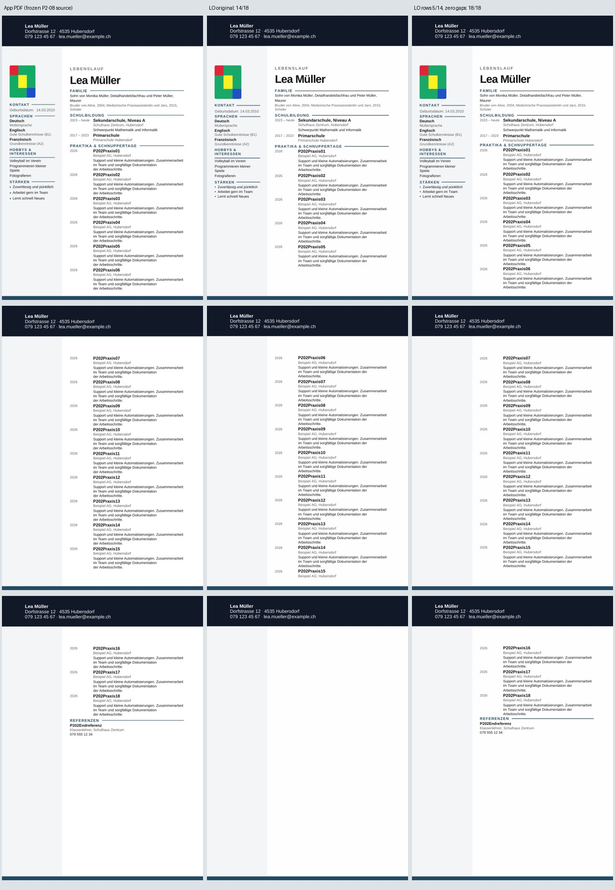
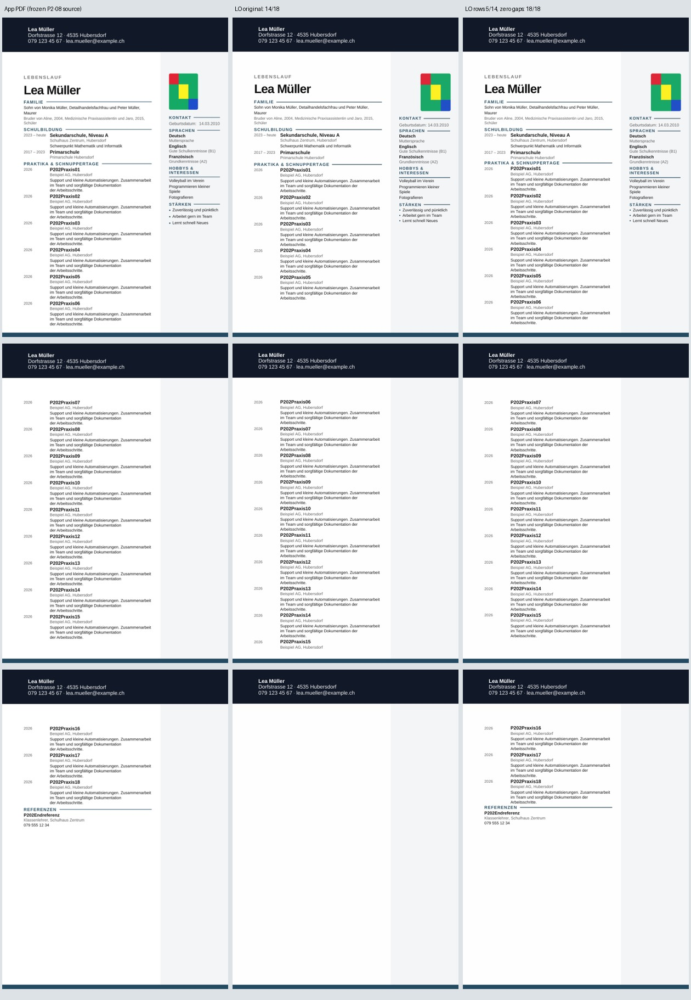

# P2-16 — Mehrseitige Layout-Zeile strukturell aufteilen

**Ergebnis:** Eine vollständige linke 18-Einträge-Kopie besteht erstmals die
bestehenden Text-/Seiten-/Titel-/Foto-/Referenzlinien-Gates bei erhaltenen
Grafiken. Rechts bestehen Text, Hauptlayout und Linie, aber der bekannte
Fotoversatz bleibt. Das ist ein enger Forschungs-PASS, keine Produktfreigabe.

Die bisherigen Anker- und Versionsgegenproben liefern keinen visuellen Fix.
Dieser Schritt untersucht die umgebende Tabellenstruktur: Die vollständige
mehrseitige Hauptspalte und die Sidebar liegen in **einer einzigen äusseren
Tabellenzeile** mit drei Zellen. Es gibt dort weder `trPr` noch feste Zeilenhöhe.
P2-03 hat bereits die Abhängigkeit vom ersten physischen Zellenabsatz gezeigt;
dessen Eigenschaften bleiben in dieser Runde unverändert.

## Begrenzter Aufbau

Branch `work/02nov-p2-16-layout-rows`, Basis
`71c94a2fb2b9612288e3c8820003efc0ccd7c594`.
Getestete Implementierung `aea7b95229d3485757cd4214d9abd584eece07e3`,
Tree `a12f997628b720f5cff3dd7e086217bf33866579`.

Die beiden vollständigen synthetischen Modern-Next-Quellen sind unverändert
aus P2-08, Export-Commit `b11ec0345e999d64f0f3d8fdeba82613ca9cc9f6`.
App-Metriken und Quellen werden wiederverwendet; kein neuer Browser-Export.
Vier Strukturen werden mit Original-/Nullabständen und Sidebar links/rechts
gekreuzt: 16 Vollfälle plus zwei bekannte kleine Kontrollen, 18 Konvertierungen.

| Struktur | Äussere Zeilen | Haupttext je Zeile |
|---|---:|---|
| Original | 1 | Gesamter CV |
| `reference-row` | 2 | Gesamter bisheriger Text; Referenzüberschrift samt Referenz separat |
| `rows-5-14` | 3 | Vorspann + Einträge 01–05; 06–14; 15–18 + Referenz |
| `rows-6-15` | 3 | Vorspann + Einträge 01–06; 07–15; 16–18 + Referenz |

Die Grenzen sind am eingefrorenen 18-Einträge-Fall ausgerichtete Diagnosen.
Sie sind kein dynamischer Seitenalgorithmus und setzen keine expliziten
Seitenumbrüche. Die erste mehrseitige Zeile wird lediglich in zusätzliche
Layout-Zeilen zerlegt. Sidebar und Foto stehen weiterhin ausschliesslich in
der ersten Zeile. Fortsetzungszellen übernehmen die drei vorhandenen Breiten
und Zelleneigenschaften. Nur leere Sidebar-/Zwischenraum-Zellen erhalten einen
neuen ungekuppelten Leerabsatz mit einem Twip Zeilenhöhe.

## Erhaltungsprüfungen und Abnahmegrenzen

Alle ursprünglichen Haupttext-Blöcke werden exakt und in ihrer Reihenfolge
verschoben: keine neuen Haupttext-Absätze, keine geänderten Absatzbindungen,
keine gelöschten Linien. Bei der Nullabstandsvariante ändern sich ausschliesslich
die bereits bekannten 18 Leerabsatz-Abstände vor der Strukturänderung.

Alle 19 kritischen Tabellen bleiben kanonisch identisch und geordnet, alle 107
Body-Steuerelemente und acht Grafik-Payloads bleiben erhalten. Sidebar inklusive
Foto und die drei ersten Zellenabsätze bleiben exakt gleich. Alle ZIP-Dateien
ausser `word/document.xml` bleiben byte-identisch, darunter Medien, Kopf-/
Fusszeilen, Hintergründe, Styles, Beziehungen und Einstellungen.

**Bei Sidebar rechts ändert sich die globale XML-Lesereihenfolge:** Die
Sidebar der ersten Zeile folgt nun dem ersten Haupttext-Abschnitt; die weiteren
Haupttext-Abschnitte kommen danach. Sämtlicher Text bleibt mit gleicher
Häufigkeit erhalten, und Haupttext sowie Sidebar bleiben je Geschichte exakt
gleich. Der Bericht behauptet keine unveränderte globale Lesereihenfolge oder
Word-/Barrierefreiheitsabnahme. Die globale Zeichnungsreihenfolge wird ebenfalls
protokolliert; individuelle Grafik-Payloads und z-Order-Attribute bleiben gleich.

125 lokale Python-Prüfungen bestehen: sieben neue strukturelle Prüfungen und
118 vorhandene Kontrollen. Die vier Originalfälle müssen gespeicherte
P2-12-Pixelbaselines bestätigen; die beiden vollen Originale zusätzlich
P2-15. Die zwei kleinen Kontrollen bestätigen sechs weitere Seiten.

Text, Seitenzuordnung, vollständige Beschreibungen, Foto und sichtbare
Referenzlinie werden getrennt gemessen. Die bestehenden 2-mm-Geometrie-,
0.90-Fotomuster- und 85%-Liniengrenzen bleiben. Eine erfolgreiche Ausführung
ist keine Produktfreigabe. Alle Forschungsfälle bleiben `NOT_ACCEPTED`.

Nur der bestehende Workflow und vorhandene Fixture-Job werden erweitert,
`fixture_probe: layout-rows`; fünf Job-IDs bleiben. Die zusätzliche offizielle
LibreOffice-Installation wird in dieser Runde nicht ausgeführt. Linux/Cloud,
kein Benutzer-PC oder manuelles Word. 90 Sekunden je Konvertierung,
15 Minuten Joblimit. Normaler Export und geschützte Branches bleiben unverändert.

## Native Ergebnisse

[Lauf 41362278464](https://github.com/modebrecht/cv-cover-charm/actions/runs/41362278464),
Job `125015003256`: **Ausführung PASS**, 125 Python-Prüfungen, 18 erfolgreiche
Konvertierungen, 54 PDF-Seiten, keine Konvertierung BLOCKED.
LibreOffice `24.2.7.2 420(Build:2)`. Vier andere Jobs übersprungen; die neue
offizielle LibreOffice-Installation wurde wie vorgesehen übersprungen.

| Struktur | Originalabstände, Text links / rechts | Nullabstände, Text links / rechts | Hauptlayout bei Nullabstand | Linie bei Text-PASS |
|---|---|---|---|---|
| Original | FAIL 14/18 / FAIL 14/18 | FAIL 14/18 / FAIL 14/18 | FAIL / FAIL | — |
| Referenz-Zeile | FAIL 14/18 / FAIL 14/18 | PASS 18/18 / PASS 18/18 | FAIL / FAIL | PASS |
| Zeilengruppen 05/14 | PASS 18/18 / PASS 18/18 | **PASS 18/18 / PASS 18/18** | **PASS / PASS** | PASS |
| Zeilengruppen 06/15 | PASS 18/18 / PASS 18/18 | PASS 18/18 / PASS 18/18 | FAIL / FAIL | PASS |

Zehn Text-PASS, sechs Text-FAIL. Alle PDFs haben drei Seiten. Der einzige
vollständige kombinierte Trial-PASS ist **`left-zero-rows-5-14`**. Die übrigen
15 Vollfälle sind Trial-FAIL, einschliesslich des rechten Layout-Positivfalls.
Alle 16 behalten die Produkt-Disposition `NOT_ACCEPTED`.

## Was der positive Fall tatsächlich zeigt

Beide 05/14-Nullabstandskopien erhalten alle 18 vollständigen Beschreibungen
und Referenzdaten. Kein Eintrag wird über eine Seite geteilt. Die sichtbare
Referenzlinie besteht das unveränderte Gate mit 0.888889 gegen 0.85.
Die Seitenzuordnung entspricht dem App-PDF: 01–06 auf Seite 1, 07–15 auf
Seite 2, 16–18 samt Referenz auf Seite 3. Die Strukturgrenzen nach 05/14 sind
also keine erzwungenen Seitenumbrüche; der Konverter paginiert innerhalb der
äusseren Zeilen weiter.

Alle 19 gemessenen Titel liegen auf den erwarteten Seiten. Grösste
Titelabweichung beidseits **1.984 mm**, beim ersten Titel auf Seite 2, gegen
ein unverändertes Limit von 2.0 mm. Das lässt lediglich **0.016 mm Reserve**
und ist kein belastbarer Nachweis für andere Schriftmetriken oder Inhalte.
Die Referenz beginnt nur 0.056 mm oberhalb ihrer App-Position.

Foto links PASS: x-/y-Delta 0, Grössendifferenzen 1.059 / 1.323 mm,
Musterübereinstimmung 1.0. Foto rechts FAIL: unverändert +19.844 mm in x,
bei gleicher Grösse und gleichem Muster. Die Tabellenstruktur repariert diesen
gesonderten Ankerfehler nicht.

Der Befund ist stärker als die früheren Text-Positivfälle: Grafikdaten und
sichtbare Referenzlinie bleiben erhalten, und die Haupttext-Geometrie besteht
im selben eingefrorenen Fall. Er beweist jedoch keine interne C++-Ursache,
keine allgemeine Pagination und keine gleichwertige XML-Lesereihenfolge.

## Visuelle Kontrolle und reproduzierbare Dateien

Alle drei Seiten beider Kontaktbilder wurden angesehen: App-PDF, unveränderter
LO-Originalfall, neuer 05/14-Nullabstandskandidat. Die bisher fehlenden Einträge
und Referenz erscheinen, die Linie steht neben der Überschrift, Kopfzeilen,
Hintergründe, Sidebar und Foto bleiben sichtbar. Der rechte Fotoversatz bleibt
im direkten Vergleich erkennbar. Der PASS bezeichnet die vorhandenen
endlichen Mess-Gates, keine pixelidentische oder manuelle Word-Abnahme.





Für diesen direkten Vergleich wurden ausschliesslich die zwei eingefrorenen
P2-08-App-PDFs erneut geladen und vor dem Rendern gehasht:
links `d1d2fbe74e513166a82da6171e5a9fab292c0ca6ec84138ea8b0d0d710bf95cc`,
rechts `75a5e2073d243bee8dc406905cf4721e9a3276d625d67dd1343d859949d16cef`.
Der ursprüngliche Archivhash
`d83f9db90763deabb3e829d21076a37123cae24e524734db51f3c9ded59810e2`
wurde bestätigt. Kein neuer App-/Browser-Export wird gezählt.

Beide vollständigen Kandidaten liegen mit Quell-/Kopier-/PDF-/Seitenhashes und
nativen Messungen unter
[`tests/fixtures/lo-import-p2-16`](../../tests/fixtures/lo-import-p2-16/README.md).
Sie wurden zusätzlich aus den unveränderten Quellen neu erzeugt und exakt
gegen die nativen DOCX-Hashes und Paket-Metadaten geprüft. Keine privaten
Word-Dateien oder Personenfotografien; das Foto ist das bekannte synthetische
Vierfarbenmuster.

## Belege und CI-Ressourcen

- [Unveränderter nativer Bericht](p2-16-native-results.json): 387,950 Bytes,
  SHA256 `3ab18cac619ae7f3fc82a463afdcfd525e9a2082fbcc83afc821f4746126ad42`.
- Lauf `41362278464`, Job `125015003256`, Artefakt `13105168415`,
  `dossier-layout-rows`, 8,054,237 Bytes,
  ZIP-SHA256 `c84eca95e63e2d5a57b0b7d67edef8e0e7055cf04d5b7695900f14eb34f40b55`.
  GitHub-Ablauf 16.11.2026 um 00:33 MEZ; ausgewählte Belege und Ausgangsquellen
  bleiben im Git.
- [Auditbeleg](p2-16-audit-proof.json): alle 16 Fallzeilen und zwei Kontrollzeilen
  einschliesslich nativer Ressourcen stimmen exakt mit dem nativen Bericht
  überein. Audit PASS, null neue Konvertierungen. Vier volle Originalbaselines
  und zwei kleine Kontrollen reproduzieren 18 gespeicherte Seiten-Signaturen.
- Native Jobspanne am 02.11.2026, 00:28:39.599–00:33:55.079 MEZ:
  **5:15.480**. Summierte LO-Wandzeit **123.560 s**, höchster einzelner
  Konvertierungs-RSS **242,896 KiB / 237.20 MiB**. Keine Messung des gesamten
  Runner-RAMs und keine x39-Ressourcengarantie.

```sh
python scripts/dossier_layout_rows.py --out-dir /pfad/zum/artefakt --audit-only
```

## Entscheidung und nächster begrenzter Schritt

Die vier Strukturen sind abgeschlossen geprüft. Der 05/14-Nullabstandsfall
ist ein reproduzierbarer vollständiger linker Test-PASS und ein rechter
Hauptlayout-/Linien-PASS mit verbliebenem Foto-FAIL. Die bisherigen Aussagen
über fehlende Reparaturen bleiben für die früher geprüften Profile korrekt;
P2-16 ergänzt einen neuen positiven Strukturkandidaten.

Vor einer Produktkorrektur müssen die festen Grenzen aus tatsächlicher
Seitenbelegung abgeleitet und mit anderen Eintragslängen, Inhalten und
Schriftmetriken geprüft werden. Die knappe 2-mm-Reserve darf nicht durch ein
weiteres Gate kaschiert werden. Der rechte Fotoanker und die geänderte globale
XML-Lesereihenfolge sind getrennte verbleibende Anforderungen.

Die aktuelle Runde verändert den normalen Export nicht. LibreOffice bleibt
bestehender Konverter; ONLYOFFICE-Wasserzeichenentscheidung unverändert.
Keine Freigabe aller 39 Next-Vorlagen, keine neue Workflow-Datei oder Job-ID,
kein Merge, keine Änderung an `dev`, `render`, `main`, kein Benutzer-PC-Zugriff.
