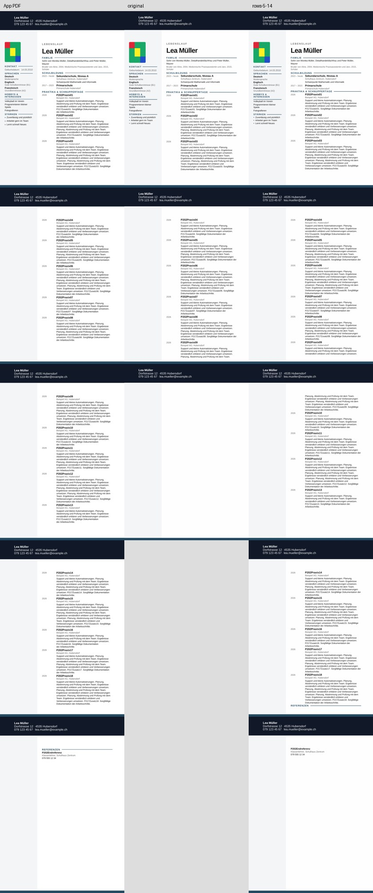
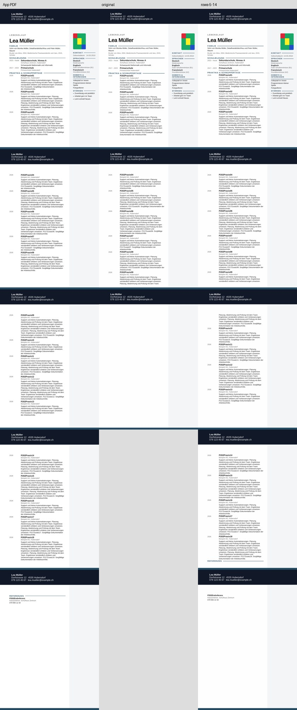

# P2-17 — feste Tabellenaufteilung bei anderen Inhalten

**Ergebnis: Ausführung PASS; feste Aufteilung nur teilweise geeignet, keine Produktfreigabe.**
Die P2-16-Kopie besteht links auch mit 17 und 19 gleich langen Einträgen. Längere,
wechselnde Beschreibungen sind vollständig, weichen aber erheblich vom App-Layout ab.
Rechts bleibt der separate Fotoversatz von **+19,844 mm** in allen vier Fällen.

## Provenienz

- Basis P2-16: `4f0cccea40628bbee0c22dc447f11c7088190dee`.
- Getesteter Implementierungs- und neuer Quell-Export-Commit: `42bab2e13572145b201d1e9deabfa3baa8dab426`.
- Branch: `work/02nov-p2-17-row-generalization`.
- [Native Actions-Ausführung 41364498934](https://github.com/modebrecht/cv-cover-charm/actions/runs/41364498934), Job `125021674991`.
- Lauf: **2. November 2026, 00:56:07–01:02:44 MEZ**, 6 min 37 s einschließlich Einrichtung, Browser und Artefakten.
- Artefakt `dossier-semantic-parity`, ID `13106249318`: 31.216.257 Bytes,
  SHA256 `c2d5380ad06c323034ddf6c42e2850de224af31e400e0dae13b31cef10011b59`.
- [Unveränderte native Rohdaten](p2-17-native-results.json):
  SHA256 `c48da0d455604efb27521bd8f111db5ea072b9e1b626c608d2da7dbd8b38f327`.
- [Nachprüfungsbeleg](p2-17-audit-proof.json): alle acht Fall-Datensätze identisch
  nach erneutem Vermessen der erhaltenen PDFs und Wiederaufbau der Diagnosekopien;
  **0 zusätzliche native Konvertierungen**. Vier 18-Einträge-Varianten reproduzieren
  sämtliche 12 P2-16-Seiten pixelgenau.

## Tatsächlicher Versuch

Acht neue echte PDF-/DOCX-Download-Paare über die bestehenden App-Menüs:
17/18/19 Einträge mit linker/rechter Sidebar sowie 18 Einträge mit 1/2/3 zusätzlichen
Textabschnitten im Wechsel. Synthetische Namen, Telefonnummern und Canvas-Kalibrierbild.
Die längeren Beschreibungen enthalten eindeutige `P217ZusatzXX`-Markierungen und enden
erst danach mit `Arbeitsschritte`; sichtbare Titel allein zählen nicht als vollständige Einträge.

Je Quelle wurden der unveränderte DOCX-Next-Download und eine nachträgliche
Diagnosekopie konvertiert: **16 erfolgreiche Konvertierungen, 52 native PDF-Seiten**.
Die acht zugehörigen App-PDFs haben zusammen 28 Seiten und vollständige Inhalte ohne
geteilte Einträge. **0 BLOCKED**. In CI bestanden **49 Python-Kontrolltests und
9 Browser-E2E-Tests** (acht Downloads plus 39er-Verfügbarkeitsprüfung).
Sieben eingefrorene P2-16-Zeilenprüfungen bestanden zusätzlich lokal.

Die Kopie verwendet unverändert feste Zeilengrenzen vor Eintrag 06 und 15 und
nullt nur die bekannten leeren Hauptspalten-Abstände. Keine Anpassung an die neuen
App-Seiten. Alle 18/19/20 kritischen Tabellen bei 17/18/19 Einträgen bleiben pro
Quelle kanonisch identisch; ebenso 103/107/111 Inhaltssteuerelemente, alle acht
Grafikpayloads, ursprüngliche Zellanfänge, Zellbreiten/-ränder und die gesamte Sidebar.
Alle anderen ZIP-Teile bleiben bytegleich. Ganze Hauptspaltenblöcke werden in ihrer
Reihenfolge verschoben; rechts ändert sich weiterhin die globale XML-Lesereihenfolge.
Das ist keine Word- oder Barrierefreiheitsabnahme.

## Einzelbefunde

`Trial` verlangt vollständige Inhalte, passende Seiten/ungespaltene Einträge,
Titelpositionen innerhalb von 2 mm, Foto innerhalb des bestehenden 2-mm-/90-%-Gates
und sichtbare Referenzlinie. `PASS` ist ausschließlich dieses begrenzte Prüfergebnis.

| Quelle | Import | Trial | Vollständig | App/LO Seiten | Hauptlayout | Foto | Referenzlinie |
|---|---|---|---:|---:|---|---|---|
| cv-17-left | original | FAIL | 14/17 | 3/3 | FAIL | PASS | FAIL |
| cv-17-left | rows-5-14 | PASS | 17/17 | 3/3 | PASS | PASS | PASS |
| cv-17-right | original | FAIL | 14/17 | 3/3 | FAIL | FAIL | FAIL |
| cv-17-right | rows-5-14 | FAIL | 17/17 | 3/3 | PASS | FAIL | PASS |
| cv-18-left | original | FAIL | 14/18 | 3/3 | FAIL | PASS | FAIL |
| cv-18-left | rows-5-14 | PASS | 18/18 | 3/3 | PASS | PASS | PASS |
| cv-18-right | original | FAIL | 14/18 | 3/3 | FAIL | FAIL | FAIL |
| cv-18-right | rows-5-14 | FAIL | 18/18 | 3/3 | PASS | FAIL | PASS |
| cv-18-varied-left | original | FAIL | 8/18 | 5/3 | FAIL | PASS | FAIL |
| cv-18-varied-left | rows-5-14 | FAIL | 18/18 | 5/5 | FAIL | PASS | PASS |
| cv-18-varied-right | original | FAIL | 8/18 | 5/3 | FAIL | FAIL | FAIL |
| cv-18-varied-right | rows-5-14 | FAIL | 18/18 | 5/5 | FAIL | FAIL | PASS |
| cv-19-left | original | FAIL | 14/19 | 3/3 | FAIL | PASS | FAIL |
| cv-19-left | rows-5-14 | PASS | 19/19 | 3/3 | PASS | PASS | PASS |
| cv-19-right | original | FAIL | 14/19 | 3/3 | FAIL | FAIL | FAIL |
| cv-19-right | rows-5-14 | FAIL | 19/19 | 3/3 | PASS | FAIL | PASS |

Insgesamt: **3 Trial PASS, 13 FAIL**. Alle acht Diagnosekopien haben vollständige
Inhalte; alle acht unveränderten LO-Importe verlieren Inhalte. Bei normalen
Beschreibungen: 14 vollständige Einträge im Original gegenüber 17/18/19 in der Kopie.
Bei längeren Beschreibungen: Original 8/18 auf 3 Seiten, Kopie 18/18 auf 5 Seiten.

### Grenzen der Aufteilung

Bei gleich langen Beschreibungen entsprechen alle sechs Kopien den App-Seiten und
haben ungeteilte Einträge. Die maximale Titelabweichung bleibt **1,984 mm** bei
2 mm Grenzwert: weiterhin nur **0,016 mm Reserve**. Die linken drei Kopien bestehen
auch die Foto- und Linienprüfung. Die rechten drei scheitern ausschließlich am
bekannten Fotoversatz; das Muster stimmt mit 1,0 überein.

Bei variablen Textlängen werden alle 18 zusätzlichen Endmarkierungen in beiden
Kopien nachgewiesen. Trotzdem ist **Eintrag 09 zwischen Seite 2 und 3 geteilt**;
im App-PDF beginnt er vollständig auf Seite 3. Weitere Titel sind bis zu
**23,542 mm** verschoben (Eintrag 13 auf Seite 3). Gleiche Seitenanzahl 5/5 bedeutet
also keine Layoutgleichheit.

Die Sichtprüfung zeigt außerdem eine **verwaiste Referenzüberschrift**: Linie und
Überschrift auf Seite 4, Referenztext erst auf Seite 5; im App-PDF gemeinsam auf
Seite 5. Die bestehende Linienprüfung bewertet nur ihre sichtbare Präsenz am
Überschriftenort. Ihr PASS bestätigt keine Verbindung zum Referenztext. Diese
zusätzliche Seitenbeziehung ist im Audit-Beleg festgehalten; der Fall ist bereits
wegen Eintragsteilung/Geometrie FAIL. Keine nachträgliche Lockerung der Prüfgates.

Alle Seiten dieser beiden Kontaktbögen sowie die linken 17-/19-Einträge-Kontaktbögen
wurden visuell geprüft. Die fehlenden Fortsetzungen des Originals, der geteilte
Eintrag, die getrennte Referenz und der rechte Fotoanker sind sichtbar.
[Erhaltene schwierigere Quelle, Diagnosekopie und beide nativen FAIL-PDFs](../../tests/fixtures/lo-import-p2-17/README.md)
mit Hash-Manifest sind dauerhaft in diesem Branch gespeichert. Die vollständigen
acht App-/DOCX-Quellen und alle 16 nativen PDFs liegen im Actions-Artefakt, **14 Tage
Aufbewahrung**. Die großen App-Raster-PDFs werden im Git-Repository nicht dupliziert;
Originalhashes, Messungen und die obigen Kontaktbögen bleiben erhalten.

## CI-Ressourcen und Konverterentscheidung

Getestet: **LibreOffice 24.2.7.2 420(Build:2)** auf `ubuntu-24.04`.
Die 16 Konverterprozesse benötigen summiert **174,398 s** und maximal
**246.724 KiB RSS (240,94 MiB)** pro gemessenem Konverterprozess. Der komplette
Workflow dauert 6 min 37 s. Dieser RSS-Wert umfasst nicht den gesamten CI-Job mit
Browser, Node/Bun, OCR und Installationsschritten; deren gemeinsamer Speicherbedarf
wurde nicht gemessen. Es gab einen Einrichtungslauf ohne Installationswiederholung.

Die frühere P2-01-Entscheidung bleibt bestehen: ONLYOFFICE führte die drei
Konvertierungen aus, lieferte aber Wasserzeichen und eignet sich in der getesteten
freien Ausführung nicht als saubere visuelle Referenz. P2-17 enthält keinen neuen
ONLYOFFICE-Lauf. LibreOffice bleibt Prüfkonverter; weder seine aktualisierte
Version aus P2-15 noch die aktuelle Strukturkopie rechtfertigen einen allgemeinen
Austausch oder einen Eingriff in den normalen Export.

**Empfehlung für P2-02 / nächste Arbeiten:** Inhaltsvollständigkeit, Seitenbelegung,
Eintragsteilung, Grafikpräsenz und Fotogeometrie getrennt als Kriterien behalten.
Die feste Aufteilung ist ein reproduzierbarer Forschungsbefund, aber kein robuster
Paginierungsalgorithmus. Vor einer Produktentscheidung müssen variable Eintragshöhen
und das Zusammenhalten von Referenzüberschrift/-text gelöst werden; den rechten
Fotoanker separat untersuchen. Die erneute 39er-Verfügbarkeitsprüfung bestätigt nur
Modern als zulässig und 38 Vorlagen als BLOCKED. **Layoutfreigabe für 39 Vorlagen:
BLOCKED / nicht nachgewiesen.**

Der bestehende Workflow mit fünf Jobs bleibt erhalten; nur `semantic-parity` lief.
Produktcode, normaler Export und Paketdateien bleiben unverändert. Keine Prüfung
auf einem Benutzer-PC, keine privaten Dateien und keine manuelle Word-Abnahme.
`dev`, `render` und `main` wurden erneut gegen ihre bisherigen SHAs geprüft und
nicht verändert; die SHA-Werte stehen im Audit-Beleg. Kein Merge.

Der Abschlusscommit enthält ausschließlich Dokumentation und Evidenz und verwendet
`[skip ci]`; sein SHA steht im Branch-Verlauf. Der tatsächlich nativ getestete
Implementierungscommit bleibt der oben ausgewiesene `42bab2e1…`.
