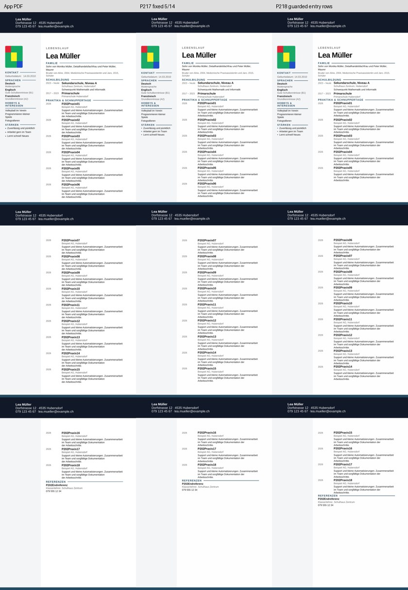
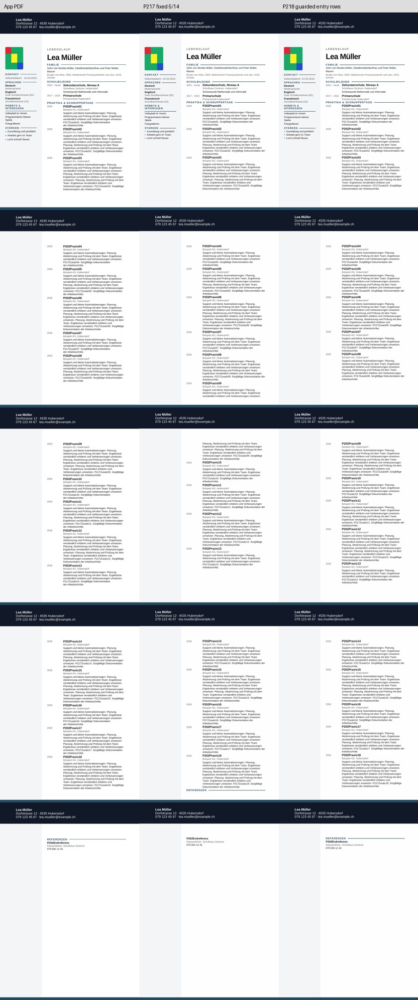

# P2-18 — Folgeeinträge und Referenzgruppe

**Ausführung PASS; zwei begrenzte Layoutkandidaten, weiterhin keine allgemeine Lösung.**
Bei langen Beschreibungen beheben einzelne geschützte Folgezeilen die geteilten Einträge
und die verwaiste Referenzüberschrift. Derselbe Aufbau verschiebt bei kurzen Texten
Einträge 06 und 15 auf spätere Seiten. Die bisherige feste Aufteilung bleibt dort besser.

## Nachweis

Basis `7d937d504d583ee6cc7d373df38ccd20baa2121c`; Branch
`work/02nov-p2-18-entry-rows`. Nativ getesteter Commit:
`744381e4e695b9eb56668861426fe977ea9de005`.

[Actions-Lauf 41406026494](https://github.com/modebrecht/cv-cover-charm/actions/runs/41406026494),
Job `125148124214`; **02.11.2026 08:23:48–08:27:22 MEZ**, 3 min 34 s.
Artefakt `dossier-entry-rows`, ID `13123153616`, 7.829.759 Bytes, 14 Tage Aufbewahrung;
ZIP-SHA256 `a142ea55c9b9469ae1e615346c104ac9b797ca879b9fcec10528129d56f1fbb4`.

[Native Rohdaten](p2-18-native-results.json), SHA256
`35576f8737db1a66af9ba37b38dbf54dab094b6dd9cc753ba849fff5c6e48f41`.
[Auditbeleg](p2-18-audit-proof.json): sämtliche zwölf Fälle nach erneutem Vermessen
und Wiederaufbau der Kopien identisch, **0 neue Konvertierungen**. Alle vier
P2-17-Kontrollkopien inklusive Seitenpixel exakt reproduziert.

## Versuch

Vier echte, eingefrorene Next-Downloads aus Quell-Commit
`42bab2e13572145b201d1e9deabfa3baa8dab426`: 18 Einträge mit normalen/wechselnden
Beschreibungslängen, links/rechts. App-Vergleich mit den zugehörigen eingefrorenen
P2-17-Messungen, keine neuen App-Exporte. Der rechte längere Originaldownload wurde
aus dem hashgeprüften P2-17-Artefakt zusätzlich dauerhaft gespeichert.

Drei Profile pro Quelle: `fixed-5-14` (P2-17), `entry-rows` (ab Eintrag 06 je eine
äußere Zeile, Referenzüberschrift und -text in gemeinsamer Zeile),
`entry-rows-nosplit` (zusätzlich `cantSplit` auf diesen Folgezeilen).
Die ersten fünf Einträge und die vollständige Sidebar bleiben in der ursprünglichen
Layoutzeile. Keine Anpassung der Grenzen an die App-Seiten. Alle 19 inneren
Eintrags-/Referenztabellen, 107 Inhaltssteuerelemente, acht Grafikpayloads,
Hauptspaltenblöcke, Zellanfänge und alle anderen ZIP-Teile bleiben unverändert.
Rechts besteht die bekannte Änderung der globalen XML-Lesereihenfolge weiter.

Der zusätzliche Referenzprüfer verlangt Überschrift und Referenztext auf derselben
Seite. Sichtbare Linie allein genügt nicht. Bisherige Inhalts-, Split-, 2-mm-Titel-
und Foto-/Mustergates sind unverändert; Zusatzmarkierungen der langen Beschreibungen
werden weiter einzeln geprüft. Keine Word-/Barrierefreiheits- oder Produktabnahme.

## Ergebnisse

| Fall | Trial | Vollständig | Seiten | Hauptlayout | Foto | Referenzgruppe |
|---|---|---:|---:|---|---|---|
| cv-18-left-fixed-5-14 | PASS | 18/18 | 3 | PASS | PASS | PASS |
| cv-18-left-entry-rows | FAIL | 17/18 | 3 | FAIL | PASS | PASS |
| cv-18-left-entry-rows-nosplit | FAIL | 18/18 | 3 | FAIL | PASS | PASS |
| cv-18-varied-left-fixed-5-14 | FAIL | 18/18 | 5 | FAIL | PASS | FAIL |
| cv-18-varied-left-entry-rows | FAIL | 18/18 | 4 | FAIL | PASS | PASS |
| cv-18-varied-left-entry-rows-nosplit | PASS | 18/18 | 5 | PASS | PASS | PASS |
| cv-18-right-fixed-5-14 | FAIL | 18/18 | 3 | PASS | FAIL | PASS |
| cv-18-right-entry-rows | FAIL | 17/18 | 3 | FAIL | FAIL | PASS |
| cv-18-right-entry-rows-nosplit | FAIL | 18/18 | 3 | FAIL | FAIL | PASS |
| cv-18-varied-right-fixed-5-14 | FAIL | 18/18 | 5 | FAIL | FAIL | FAIL |
| cv-18-varied-right-entry-rows | FAIL | 18/18 | 4 | FAIL | FAIL | PASS |
| cv-18-varied-right-entry-rows-nosplit | FAIL | 18/18 | 5 | PASS | FAIL | PASS |

**12 Konvertierungen PASS, 46 native PDF-Seiten, 0 BLOCKED; 132 Kontrolltests PASS.**
Trial: 2 PASS, 10 FAIL. Acht reine Strukturänderungen sind keine acht erfolgreichen
Layouts: die Variante ohne Teilungsschutz verliert bei normalen Texten einen
Eintrag und liefert bei langen Texten vier statt fünf App-Seiten.

Mit Teilungsschutz sind lange Texte vollständig auf fünf Seiten, ohne geteilte
Einträge, mit Referenzüberschrift/-text gemeinsam auf Seite 5. Maximale
Titelabweichung **1,631 mm** (Grenze 2 mm). Links Trial PASS, rechts nur Foto FAIL
(+19,844 mm). Bei normalen Texten rutschen Eintrag 06/15 auf Seite 2/3;
maximale vergleichbare Titelabweichung **26,044 mm**, daher Layout FAIL.
Dort bleibt die P2-17-Aufteilung mit maximal 1,984 mm der bessere Kontrollfall.
Es gibt noch keine belastbare automatische Auswahl zwischen den Profilen.

Alle Seiten beider Kontaktbögen wurden visuell geprüft. Die lange linke
Diagnosekopie und ihr tatsächlich erzeugtes PDF sind unter
`tests/fixtures/lo-import-p2-18/` dauerhaft erhalten; Hashes im Auditbeleg.
Sämtliche zwölf Kopien/PDFs und Messbilder liegen im 14-Tage-Artefakt.

## Ressourcen und Folgerung

LibreOffice 24.2.7.2 auf Ubuntu 24.04; summierte Konverter-Wandzeit **21,509 s**,
maximales gemessenes Konverter-RSS **245.492 KiB (239,74 MiB)**. Der gesamte Lauf
inklusive Einrichtung und 132 Tests dauert 3:34. Der Konverter-RSS ist keine
Messung des gesamten CI-Speicherbedarfs.

Nächster begrenzter Versuch: den rechten Fotoanker auf den jeweils bereits
nachgewiesenen Layout-Kontrollkopien isoliert prüfen: bei normalen Beschreibungen
`fixed-5-14`, bei den längeren `entry-rows-nosplit`. Diese explizite Versuchsauswahl
ist kein automatischer Produktalgorithmus. Anschließend bleiben die unterschiedlichen
Umbruchreaktionen und weitere Texthöhen zu klären.

LibreOffice beibehalten. Kein neuer ONLYOFFICE-Installationsversuch; dessen
P2-01-Wasserzeichenbefund bleibt bestehen. 39er-Layoutfreigabe weiterhin BLOCKED.
Nur der bestehende Kompatibilitätsjob wurde genutzt, kein neuer Workflow oder Job.
Produktcode, normaler Export und Paketdateien unverändert; kein Merge und keine
Änderung an `dev`, `render`, `main`. Abschluss nur Dokumentation/Evidenz `[skip ci]`;
maßgeblicher getesteter Commit bleibt `744381e4…`.
