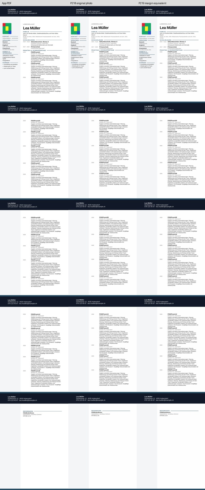
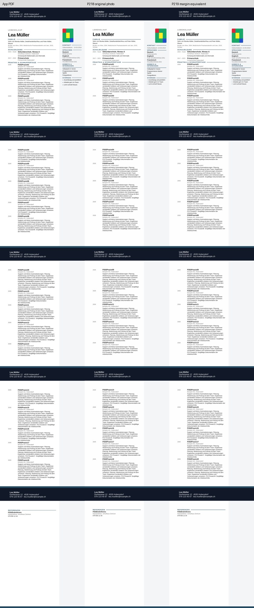

# P2-19 — horizontaler Bezugsrahmen des Fotos

**Ausführung PASS; rechter Fotoversatz innerhalb des bisherigen Gates behoben.**
Die gleichwertige Randkoordinate reduziert rechts den gemessenen x-Fehler von
19,844 auf **0,258 mm**, sowohl bei normalen als auch langen Beschreibungen.
Links verursacht derselbe Bezugswechsel **+7,935 mm** Fehler und wird verworfen.
Dort bleibt der bisherige Seitenanker. Keine globale Umstellung aller Fotoanker.

## Provenienz

Basis `d3e764063fab5656e79724804654429a2621ff07`, Branch
`work/02nov-p2-19-photo-frame`. Nativ getesteter Commit
`aebcf91f5f9443ff452bc74624dabd8f6a056606`.

[Actions 41407449666](https://github.com/modebrecht/cv-cover-charm/actions/runs/41407449666),
Job `125152580098`; **02.11.2026 08:36:59–08:41:13 MEZ**, 4 min 14 s.
Artefakt `dossier-photo-frame`, ID `13124003208`, 10.527.194 Bytes, 14 Tage Aufbewahrung,
ZIP-SHA256 `ed76d1de9fc9b8aee88b6ce9516c1bf8f89eaf023f102fe41f0c22addb22842f`.

[Rohdaten](p2-19-native-results.json), SHA256
`cefb4ea23416455ae11da353eeb6d03caefe0084e748575c638da59a4506642d`.
[Auditbeleg](p2-19-audit-proof.json): alle 16 Fälle nach erneutem Vermessen und
Wiederaufbau identisch, **0 neue Konvertierungen**. Vier P2-18-Eingaben und sämtliche
zugehörigen Seitenpixel exakt reproduziert.

## Kontrollierte Änderung

Vier echte eingefrorene Next-Quellen mit passenden P2-17-App-Messungen
(Quell-Export-Commit `42bab2e13572145b201d1e9deabfa3baa8dab426`). Keine neuen App-Exporte.
Explizite QA-Kontrollauswahl: normale Beschreibungen `fixed-5-14`, längere
`entry-rows-nosplit`. Dies ist keine automatische Produktregel und löst die
aus P2-18 bekannte unterschiedliche Umbruchreaktion nicht.

Vier Foto-Profile je Quelle:

- `original-photo`: unveränderte P2-18-Kontrollkopie.
- `margin-equivalent`: Bezug `margin`, Offset minus linkem Seitenrand.
- `margin-unadjusted`: Bezug `margin`, bisheriger Offset als Gegenprobe.
- `page-compensated`: Bezug `page`, Offset minus Rand als reine LO-Kompensation.

Links ist der linke Rand 0; rechts 1134 Twips = 720090 EMU = 20,0025 mm.
Originales deklaratives Foto-x: links 8 mm, rechts 155 mm.
Die Randangabe rechts ist 134,9975 mm plus Rand und beschreibt rechnerisch dieselbe
absolute Position. Die Microsoft-Dokumentation beschreibt den Bezugspunkt durch
[RelativeFrom](https://learn.microsoft.com/en-us/dotnet/api/documentformat.openxml.drawing.wordprocessing.horizontalposition.relativefrom?view=openxml-3.0.1)
und den Abstand vom Bezugspunkt durch
[PositionOffset](https://learn.microsoft.com/en-us/dotnet/api/documentformat.openxml.drawing.wordprocessing.positionoffset?view=openxml-3.0.1).
Die Umrechnung für diese erste Sektion ist eine Schlussfolgerung daraus, keine
Word-Engine-Abnahme. Die weiteren rechten Gegenproben verändern die deklarierte
absolute Position um +/−20,0025 mm und bleiben reine Konverterdiagnosen.

Nur horizontales `relativeFrom`/`posOffset` am Foto werden geändert. Vertikaler
Anker, Bild-/Crop-Payload, andere Grafiken, alle 19 inneren Eintragstabellen und
107 Inhaltssteuerelemente bleiben gleich. Text und alle anderen ZIP-Teile sind
unverändert. Fotoankeränderungen in der Sidebar werden ausdrücklich ausgewiesen;
keine Behauptung bytegleicher kompletter Sidebar nach Ankeränderung.

Der gemeinsame Runner hat optionale Hooks; seine P2-18-Standardeinstellungen wurden
gegen alle zwölf gespeicherten Fälle ohne native Neukonvertierung geprüft:
sämtliche Datensätze identisch. Fünf neue Foto-Invariantenprüfungen bestanden.

## Native Ergebnisse

| Fall | Trial | Hauptlayout | Foto-x-Abweichung mm | Deklarierte Seite-x gleich? |
|---|---|---|---:|---|
| cv-18-left-original-photo | PASS | PASS | 0.0 | True |
| cv-18-left-margin-equivalent | FAIL | PASS | 7.935 | True |
| cv-18-left-margin-unadjusted | FAIL | PASS | 7.935 | True |
| cv-18-left-page-compensated | PASS | PASS | 0.0 | True |
| cv-18-varied-left-original-photo | PASS | PASS | 0.0 | True |
| cv-18-varied-left-margin-equivalent | FAIL | PASS | 7.935 | True |
| cv-18-varied-left-margin-unadjusted | FAIL | PASS | 7.935 | True |
| cv-18-varied-left-page-compensated | PASS | PASS | 0.0 | True |
| cv-18-right-original-photo | FAIL | PASS | 19.844 | True |
| cv-18-right-margin-equivalent | PASS | PASS | 0.258 | True |
| cv-18-right-margin-unadjusted | FAIL | PASS | 19.844 | False |
| cv-18-right-page-compensated | PASS | PASS | 0.258 | False |
| cv-18-varied-right-original-photo | FAIL | PASS | 19.844 | True |
| cv-18-varied-right-margin-equivalent | PASS | PASS | 0.258 | True |
| cv-18-varied-right-margin-unadjusted | FAIL | PASS | 19.844 | False |
| cv-18-varied-right-page-compensated | PASS | PASS | 0.258 | False |

**16 Konvertierungen PASS, 64 native PDF-Seiten, 0 BLOCKED, 137 Kontrolltests PASS.**
Trial: 8 PASS / 8 FAIL. Alle 16 Fälle bewahren 18/18 vollständige Einträge,
korrekte 3/5-Seiten-Belegung, ungeteilte Beschreibungen und gemeinsame Referenzgruppe.
Ihre Hauptlayoutprüfung bleibt PASS. Die Versuchsprofile unterscheiden sich damit
nur in der Fotoprüfung. Alle Fotomuster stimmen mit 1,0 überein; Größenabweichungen
1,059/1,323 mm liegen unverändert im 2-mm-Gate.

Die reinen `page-compensated`-Gegenproben bestehen zwar auch rechts die Bildprüfung,
deklarieren dort aber eine um 20,0025 mm verschobene Seitenposition. Sie werden
nicht als Exportlösung empfohlen. Links ist diese Gegenprobe bei Rand 0 ein
reproduzierter Null-Eingriff. Rechts `margin-equivalent` erhält die deklarierte
Position; links bleibt `original-photo`. Diese seitenabhängige Kombination besteht
auf den vier expliziten Layout-Kontrollen, ist aber noch keine allgemeine
Exportfreigabe.

Alle Seiten beider Kontaktbögen visuell geprüft. Rechte lange Diagnosekopie und
nativer Trial-PASS-PDF unter `tests/fixtures/lo-import-p2-19/` dauerhaft erhalten;
Hashes im Auditbeleg. Vollständige 16 Kopien/PDFs im 14-Tage-Artefakt.

## Ressourcen und nächste Grenze

LibreOffice 24.2.7.2 auf Ubuntu 24.04; summierte Konverter-Wandzeit **28,830 s**,
maximales Konverter-RSS **245.760 KiB (240 MiB)**. Gesamtlauf 4:14 einschließlich
Einrichtung und Tests. Konverter-RSS misst nicht den gesamten CI-Bedarf.

Für den nächsten begrenzten Versuch bleibt das Foto links unverändert, rechts
wird die rechnerisch gleichwertige Randkoordinate verwendet. Hauptfrage bleibt
eine einheitliche Umbruchstruktur für beide Textlängen. Sieben leere Hauptspalten-
Absätze im ersten Layoutblock besitzen noch je eine feste 20-Twip-Zeilenhöhe.
Ein einzelner Gegenversuch mit 1 Twip auf genau diesen sieben Absätzen, ohne den
ursprünglichen Zellanfang und ohne Eintragspayloads zu ändern, soll prüfen, ob der
kurze Fall ebenfalls mit geschützten Folgezeilen funktioniert. Keine nachträgliche
Lockerung von 2-mm-, Inhalts-, Foto- oder Referenzgates.

39er-/Word-/Produktfreigabe weiterhin nicht nachgewiesen. LibreOffice bleibt
Prüfkonverter; ONLYOFFICE-P2-01-Wasserzeichenentscheidung unverändert. Normaler
Produktexport, `src`, Paketdateien und `dev`/`render`/`main` unverändert. Nur der
bestehende Kompatibilitätsjob, kein neuer Workflow oder Job, kein Merge.
Abschluss ausschließlich Evidenz und Dokumentation `[skip ci]`; tatsächlich
nativ getesteter Commit bleibt `aebcf91f…`.
