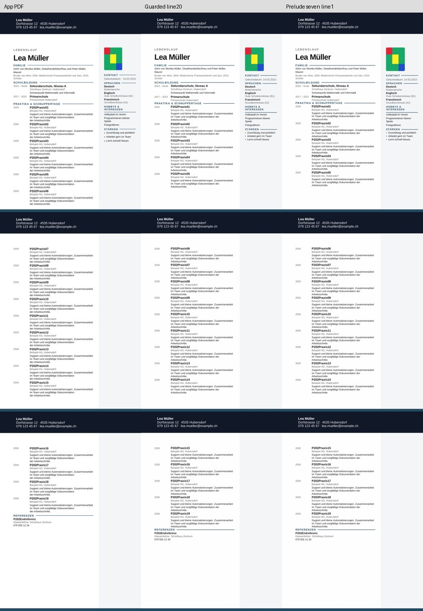
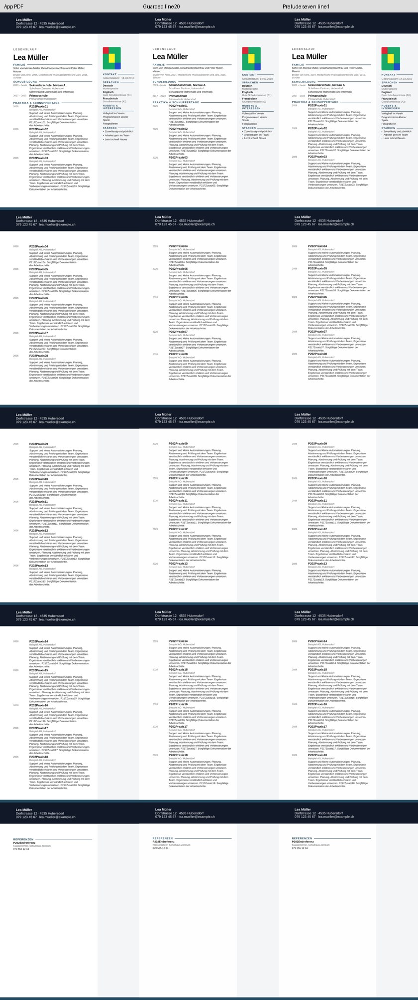

# P2-20 — einheitliche Folgezeilen: Leerabsatz-Hypothese verworfen

**Ausführung PASS; universelle Umbruchlösung FAIL.**
Die Reduktion von sieben leeren Absatzhöhen verändert die erste Seite sichtbar,
behebt aber die falschen Seitenwechsel bei normalen Beschreibungen nicht.
Längere Beschreibungen bestehen weiterhin beidseitig, einschließlich Foto.
Weitere Höhensuchen folgen aus diesem Versuch nicht.

## Provenienz und Nachprüfung

Basis `f02e8cea8b24b858d201792d41a274c94a846145`, Branch
`work/02nov-p2-20-unified-rows`. Tatsächlich nativ getesteter Commit
`f50706cb8a68467f468ebda67b6a6bb7e4081428`.

[Actions 41408816525](https://github.com/modebrecht/cv-cover-charm/actions/runs/41408816525),
Job `125156894178`; **02.11.2026 08:49:50–08:53:03 MEZ**, 3:13.
Artefakt `dossier-unified-rows`, ID `13124338733`, 9.067.110 Bytes, 14 Tage;
ZIP-SHA256 `66cadd4b7d8a095d3c5d2e86391d3b6af0d087bcd88e9fce19b4940d78e77ca5`.
[Rohdaten](p2-20-native-results.json), SHA256
`70f645ac6a1af62cac3b6f6d0fde2e3b6d564865a3ceecb59a997ee2d1d445ad`.
[Auditbeleg](p2-20-audit-proof.json): alle 16 Fälle durch Kopien-Wiederaufbau und
Neuvermessung der behaltenen PDFs identisch, **0 neue Konvertierungen**.
Vier 18er-Kontrollen reproduzieren P2-18-Haupttext-/Fortsetzungsseiten und die
zugehörigen P2-19-Fotomessungen.

## Begrenzter Versuch

Acht echte P2-17-Next-Quellen aus
`42bab2e13572145b201d1e9deabfa3baa8dab426`, mit ihren passenden eingefrorenen
App-Messungen: 17/18/19 normale und 18 längere Einträge, links/rechts.
Keine frischen App-Exporte. Die vier zusätzlichen 17-/19-Originale wurden aus dem
hashgeprüften P2-17-Artefakt übernommen und mit Provenienz dauerhaft gespeichert.

Gleiche geschützte Folgezeilen ab Eintrag 06 und gemeinsame Referenzzeile für alle
Quellen; keine Auswahl nach Textlänge oder erwarteten App-Seiten. Foto links
unveränderter Seitenanker, rechts rechnerisch gleiche Randkoordinate aus P2-19.
Gegenprobe: nur sieben leere Absätze im ersten Hauptspaltenblock von exakter
Zeilenhöhe 20 auf 1 Twip. Ursprünglicher Zellanfang bleibt unverändert.

Alle 18/19/20 inneren Eintragstabellen und 103/107/111 Inhaltssteuerelemente für
17/18/19 Einträge, sämtliche Texte, Bild-/Crop-Payloads und anderen ZIP-Teile
bleiben erhalten. In der Gegenprobe ändern sich genau sieben Absatzhöhen; diese
Hauptspaltenblöcke sind ausdrücklich nicht bytegleich zur Ausgangskopie. Die
bekannte Änderung der globalen XML-Lesereihenfolge rechts bleibt ausgewiesen.
Gemeinsame Helfer unterstützen explizite Eintragszahlen/QA-Layoutparameter;
alle 16 P2-19-Standardfälle wurden nach der Erweiterung ohne native Neukonvertierung
identisch reproduziert. Keine Lockerung der 2-mm-, Inhalts-, Foto- oder Referenzgates.

## Dokumentstatus

| Quelle | Bisherige Leerzeilen | Sieben verkleinerte Leerzeilen | Vollständig | App/LO Seiten |
|---|---|---|---:|---:|
| cv-17-left | FAIL | FAIL | 17/17 beide | 3/3 |
| cv-17-right | FAIL | FAIL | 17/17 beide | 3/3 |
| cv-18-left | FAIL | FAIL | 18/18 beide | 3/3 |
| cv-18-right | FAIL | FAIL | 18/18 beide | 3/3 |
| cv-18-varied-left | PASS | PASS | 18/18 beide | 5/5 |
| cv-18-varied-right | PASS | PASS | 18/18 beide | 5/5 |
| cv-19-left | FAIL | FAIL | 19/19 beide | 3/3 |
| cv-19-right | FAIL | FAIL | 19/19 beide | 3/3 |

**16 Konvertierungen PASS, 56 native PDF-Seiten, 0 BLOCKED, 142 Kontrolltests PASS.**
Trial 4 PASS / 12 FAIL. Alle 16 Fälle: Inhalt, Fotogate und gemeinsame Referenzgruppe
PASS, keine geteilten Einträge. Bei normalen Texten liegen Eintrag 06 und 15 weiterhin
auf späteren Seiten; maximale vergleichbare Titelabweichung **26,044 mm**.
Bei längeren Texten bleibt sie **1,631 mm**, fünf Seiten wie im App-PDF.

Die Höhenänderung ist in allen acht Paaren an den Seitenpixeln messbar; sie ist
kein wirkungsloser XML-Eingriff. Sie löst jedoch das untersuchte Umbruchproblem
nicht. Der unveränderte `guarded-line20`-Kontrollkandidat bleibt für lange Texte
vorzuziehen; die zusätzliche Änderung hat keinen nachgewiesenen Nutzen.

Alle Seiten beider Kontaktbögen visuell geprüft. Neue Originalquellen samt Hashes
in `tests/fixtures/lo-import-p2-20/SOURCES.json`. Bereits erfolgreiche lange
Basis-Kopien stehen unter P2-18/P2-19; keine redundanten Kandidatenkopien.
Alle 16 Testkopien/PDFs liegen im 14-Tage-Artefakt.

## Ressourcen und Entscheidung

LibreOffice 24.2.7.2 auf Ubuntu 24.04; Konverter-Wandzeiten summiert **20,103 s**,
maximales Konverter-RSS **245.920 KiB (240,16 MiB)**; Gesamtlauf 3:13.
Kein gemessener Gesamt-RSS für den kompletten CI-Job.

Beibehalten: Referenzgruppenprüfung, Schutz gegen geteilte Einträge bei langen
Texten, rechts der gleichwertige Randanker und links der bisherige Anker.
Verwerfen: die sieben zusätzlichen Absatzhöhenänderungen als Lösung für kurze Texte.
Eine automatische allgemeine Layoutstruktur ist weiterhin offen. Für normale Texte
bleibt die P2-17-Aufteilung der nachgewiesene Kontrollfall, für lange P2-18.
Das ist weiterhin eine explizite QA-Auswahl, keine Produktlogik.

Letzter zusätzlicher Prüfpunkt dieses Arbeitsblocks: frische echte App-/DOCX-
Downloads mit Zoom und verschobenen Fotoausschnitten, um den Fotoanker außerhalb
der zentrierten Kalibrierung zu prüfen. Normale Beschreibungen verwenden dafür
die bereits erfolgreiche P2-17-Struktur. Kein weiteres Absatzhöhen-Raster.

LibreOffice beibehalten; ONLYOFFICE-Wasserzeichenbefund unverändert, kein neuer
Installationsversuch. 39er-/Word-/Produktfreigabe nicht nachgewiesen. Normaler
Export, `src`, Paketdateien und geschützte Branches bleiben unverändert. Bestehender
Workflow mit fünf Jobs, nur Kompatibilitätsjob ausgeführt; kein Merge.
Abschluss nur Evidenz/Dokumentation `[skip ci]`; nativer Commit bleibt `f50706cb…`.
