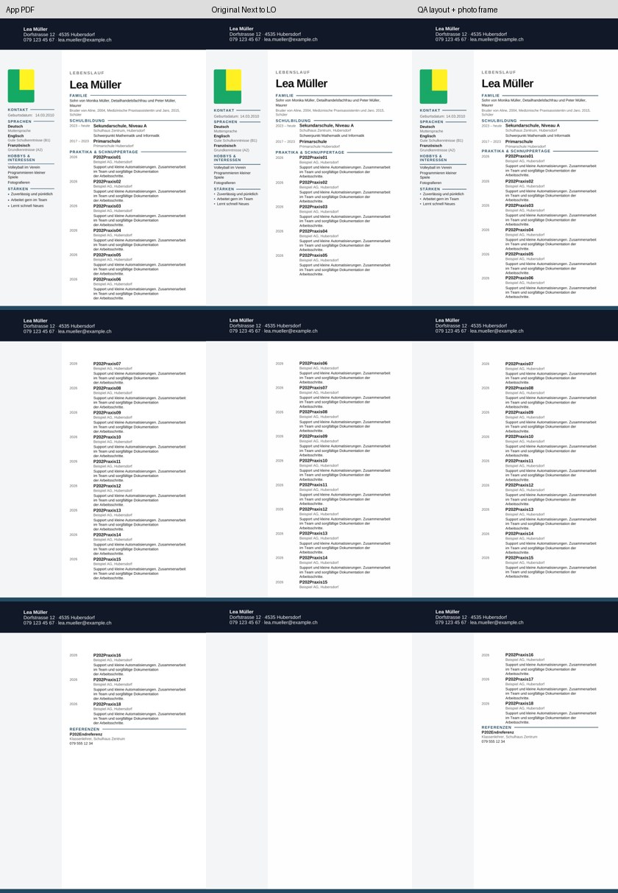
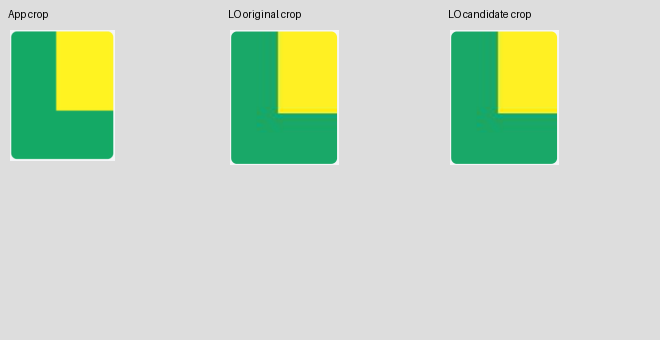
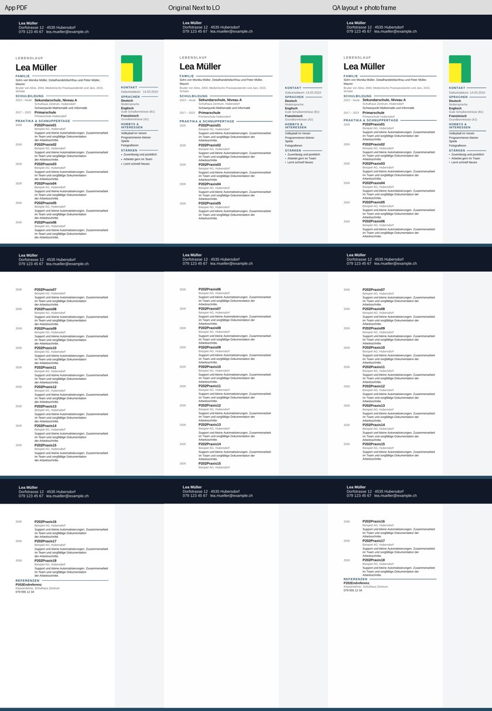
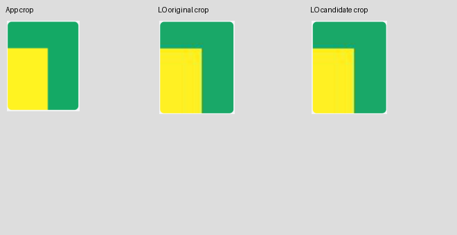

# P2-21 — frische verschobene Fotoausschnitte

**Ausführung PASS; beide Diagnosekopien bestehen den begrenzten Trial.**
Die seitenabhängige Fotoankeränderung funktioniert auch bei den beiden frisch
exportierten Zoom-/Ausschnittfällen. Der rechte Mustervergleich ist mit **90,62 %**
allerdings nur knapp über dem unveränderten 90-%-Gate. Kein pixelgenauer Bildgleichstand
und keine allgemeine Freigabe für beliebige Fotos, Vorlagen oder Originalexporte.

## Provenienz

Basis `068c804396f628aac0ae01318883d6e3118ca35f`, Branch
`work/02nov-p2-21-photo-crops`. Tatsächlich nativ getesteter Implementierungs- und
Quell-Export-Commit **`887706640dba19aac621b13a7817e7efad6d8902`**.

[Actions 41410023444](https://github.com/modebrecht/cv-cover-charm/actions/runs/41410023444),
Job `125160701348`; **02.11.2026 09:01:05–09:07:14 MEZ**, 6:09.
Artefakt `dossier-semantic-parity`, ID `13125765686`, 6.359.295 Bytes, 14 Tage;
ZIP-SHA256 `621c779404a5ef477bb98471f33ad04e670deb1c16c488792613bb3f0b16a4ad`.

[Rohdaten einschließlich sämtlicher neuer App-Messungen und Download-Manifeste](p2-21-native-results.json),
SHA256 `e1fec5a7a3e4275989f9f035827ec52f71e349962d1495b9a1c2c5cc3b70f193`.
[Auditbeleg](p2-21-audit-proof.json): alle vier Falldatensätze und sämtliche frischen
App-Messungen bei erneuter Prüfung identisch; alle Download-/PDF-Hashes und
wiederaufgebauten Kopien geprüft, **0 neue native Konvertierungen**.

## Tatsächlicher Versuch

Zwei frische echte App-/Next-Downloadpaare mit 18 normalen Beschreibungen:
links Zoom **1,8 / Ausschnitt x20 y80**, rechts **2,2 / x75 y30**.
Ausschließlich synthetisches Canvas-Kalibrierbild; keine privaten Fotos.
Je Quelle unveränderter DOCX-Download und Diagnosekopie. Die Kopie verwendet
die bewährte normale P2-17-Struktur `fixed-5-14`, links unveränderten Seitenanker,
rechts die rechnerisch gleichwertige Randkoordinate. Keine zusätzlichen
Leerabsatzänderungen und keine Anpassung an neue erwartete Messwerte.

Beide Paare entstanden im selben Implementierungs-Commit über echte Download-Menüs.
Gemischte SHAs, veränderte Download-Dateien und fehlende Formate werden vor
Konvertierung verworfen. Auf vorhandenen Kontrollen reproduziert der Kandidaten-
Builder die P2-19-Eingaben bytegenau. Der gemeinsame Runner erlaubt nun einen
expliziten frischen Referenzhash; alle 16 P2-20-Standardfälle wurden nach dieser
Erweiterung ohne neue Konvertierung identisch reproduziert.

**68 Python-Kontrolltests und 3 Browsertests PASS** (zwei Downloadfälle plus
39er-Verfügbarkeitsguard). **4 Konvertierungen PASS, 12 native PDF-Seiten, 0 BLOCKED.**
Die beiden App-PDFs haben jeweils 3 Seiten und alle 18 Beschreibungen.

## Einzelbefunde

| Dokument | Import | Trial | Vollständige Einträge | App/LO Seiten | Hauptlayout | Foto | Musterübereinstimmung |
|---|---|---|---:|---:|---|---|---:|
| cv-crop-left | original-source | FAIL | 14/18 | 3/3 | FAIL | PASS | 98.44% |
| cv-crop-left | side-aware-photo | PASS | 18/18 | 3/3 | PASS | PASS | 98.44% |
| cv-crop-right | original-source | FAIL | 14/18 | 3/3 | FAIL | FAIL | 90.62% |
| cv-crop-right | side-aware-photo | PASS | 18/18 | 3/3 | PASS | PASS | 90.62% |

Bei den Original-Importen fehlen weiterhin vollständige Einträge und Referenzen;
der rechte Fotoanker ist zusätzlich um **+19,844 mm** verschoben.
Beide Diagnosekopien erhalten alle Inhalte und die korrekte Seitenbelegung ohne
Eintragsteilung; Referenzüberschrift und -text bleiben gemeinsam auf Seite 3.
Maximale Titelabweichung **1,984 mm** bei 2 mm Grenzwert, weiterhin nur 0,016 mm Reserve.

Foto-x-Abweichung: links **0 mm**, rechts **0,258 mm**. Größenabweichung
**1,059/1,058 mm**, damit innerhalb des bestehenden 2-mm-Gates. Das rechte Muster
liegt **0,62 Prozentpunkte** über der 90-%-Schwelle. Die vergrößerten Details zeigen
eine kleine Abweichung an den Farbgrenzen; sie wird nicht als perfekte Crop-Fidelity
ausgegeben. Es gab keine Lockerung des Gates. Weitere Ausschnitte/Bildformen sind
mit diesen zwei Fällen nicht abgedeckt.

Alle Seiten der Kontaktbögen und beide vergrößerten Ausschnittvergleiche wurden
visuell geprüft. Beide tatsächlichen DOCX-Quellen, Download-Manifeste sowie rechte
Diagnosekopie und nativer PDF sind mit Hash-Manifest unter
`tests/fixtures/lo-import-p2-21/` dauerhaft gespeichert. Die vollständigen App-PDFs,
alle vier nativen PDFs und Messbilder liegen im 14-Tage-Artefakt. Die großen
App-Raster-PDFs werden nicht zusätzlich in Git gespeichert; Originalhashes,
vollständige App-Messungen und die visuellen Nachweise bleiben erhalten.

## Ressourcen und Abschluss

LibreOffice 24.2.7.2 auf Ubuntu 24.04. Konverter-Wandzeiten summiert **45,083 s**,
maximales Konverter-RSS **244.236 KiB (238,51 MiB)**. Gesamtlauf 6:09 mit App,
Chromium, OCR, Installation und Tests; der RSS-Wert misst nur die Konverterprozesse.

[Zusammengeführter Arbeitsblock P2-18 bis P2-21](p2-18-21-workblock.md):
Fotoanker rechts und lange Einträge/Referenzgruppe haben belastbare begrenzte
Diagnosekandidaten. Eine einheitliche Umbruchstruktur für kurze und lange Texte
bleibt offen. Die verkleinerten Leerabsätze aus P2-20 werden nicht übernommen.
Die ursprünglichen DOCX-Stresstestimporte bleiben FAIL und werden nicht durch
einen PASS der veränderten Kopie ersetzt.

LibreOffice beibehalten; ONLYOFFICE-Wasserzeichenentscheidung aus P2-01 unverändert.
39er-Gesamtfreigabe weiterhin BLOCKED. Es gab keinen Zugriff auf einen Benutzer-PC,
keine privaten Dateien, keine manuelle Word-Abnahme, keine Änderung von `src`,
Produktexport oder Paketdateien und keine Änderung an `dev`, `render`, `main`.
Nur der bestehende semantische Job im vorhandenen Workflow lief. Kein Merge.
Abschlusscommit ausschließlich Evidenz/Dokumentation `[skip ci]`; nativ getesteter
Commit bleibt `88770664…`.
