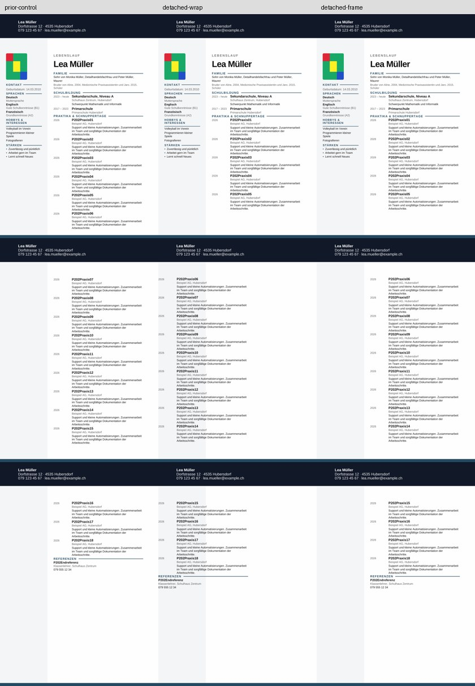
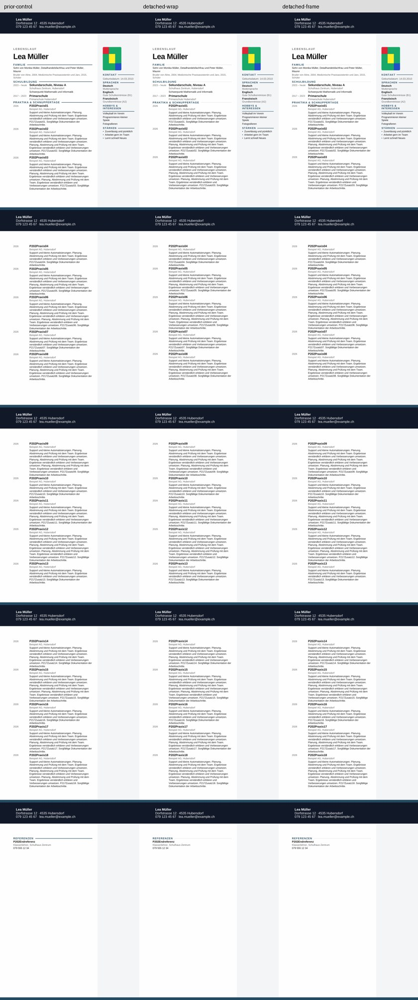

# P2-22 — Sidebar und Hauptfluss getrennt

**Ausführung PASS; Trennung allein löst die allgemeine Umbruchabweichung nicht.**
Alle Inhalte bleiben erhalten, aber kurze Einträge wechseln weiterhin zu spät
die Seite. Der begrenzte Textbereich besteht links mit langen Texten. Rechts
ist die Haupttextgeometrie passend, die Referenzlinie am Messort jedoch zu blass.

## Provenienz

Basis `d1ba99a3bb44aea4a733551bf80f35f8f3d50dc6`, Branch
`work/02nov-p2-22-detached-main`. Nativ getesteter Commit:
`e79480aed22c6e5d3b8fd33bd47b29fa3b867841`.

[Actions 41425693219](https://github.com/modebrecht/cv-cover-charm/actions/runs/41425693219),
Job `125211631873`; **02.11.2026 11:03:44–11:08:03 MEZ**, 4:19.
Artefakt `dossier-detached-main`, ID `13132955267`, 7.955.362 Bytes, 14 Tage;
ZIP-SHA256 `5e2675aa63bda5040e379429bf54b3c110fc7494cc2fa8afd003552affa0e7be`.
[Rohdaten](p2-22-native-results.json), SHA256
`2ac502e50ad0109cf4ec54e3cedddf039e2f20311dd0ef9d372c227f816a066a`.
[Auditbeleg](p2-22-audit-proof.json): alle zwölf Fälle nach Kopien-Wiederaufbau
und PDF-Neuvermessung identisch, **0 neue native Konvertierungen**.
Vier P2-19-Kontrollen einschließlich Seitenpixel exakt reproduziert.

## Begrenzter Aufbau

Vier tatsächliche eingefrorene P2-17-Next-Quellen (18 normale/längere Einträge,
links/rechts) aus `42bab2e13572145b201d1e9deabfa3baa8dab426`, passende eingefrorene
App-Messwerte; keine neuen App-Exporte. Drei Profile je Quelle:

- `prior-control`: bereits nachgewiesene P2-19-Layout-/Fotokontrolle; explizite
  Auswahl pro Testfamilie, keine Produktregel.
- `detached-wrap`: Sidebar als unabhängige schwebende Tabelle, einspaltige
  Haupttabelle mit seitlichem Umflussabstand.
- `detached-frame`: gleicher Aufbau, jedoch Sektions-Textbereich exakt auf die
  ursprüngliche Hauptspalte begrenzt. Nur die zwei horizontalen Seitenränder ändern
  sich; Kopf-/Fußdateien bleiben gleich.

Neue Hauptzeilen: Vorlauf bis Eintrag 01, dann pro Eintrag 02–18 eine geschützte
Zeile und eine gemeinsame Referenzzeile. Dieselbe Regel für beide Textlängen,
keine festen 5/14-Grenzen. Originale Sidebarposition bleibt seitenbezogen. Ein
neuer leerer 1-Twip-Absatz nach der schwebenden Sidebar hält ihren logischen Anker
vor dem Hauptfluss. Die gespiegelte Quelle hat tatsächlich 6746/454/3572 statt
3572/453/6747 Twips; es werden ihre tatsächlichen Breiten übernommen.

Alle ursprünglichen Hauptblöcke, 19 inneren Eintragstabellen, 107 Inhaltssteuerungen,
Sidebar- und Grafikpayloads bleiben gegenüber der Foto-Kontrolle erhalten.
Die äußere Dreispaltentabelle und leere Abstandszelle entfallen. Alle anderen
ZIP-Teile bleiben bytegleich. Globale XML-Lesereihenfolge kann sich ändern;
keine Word-/Barrierefreiheits- oder Produktfreigabe.

Normale Inhalts-/2-mm-Geometrie-/Foto-/Referenzgruppen-Gates bleiben gleich.
Zusätzlich werden Kopfregion bis 45 mm und unterer Rand ab 292 mm auf jeder
PDF-Seite pixelgenau mit dem nativen Kontrollimport verglichen. Ein neuer
Trial-PASS darf dort keine Regression verbergen.

## Ergebnisse

| Fall | Trial | Vollständig | Seiten | Hauptlayout | Foto | Ref-Linie | Kopf/Rand |
|---|---|---:|---:|---|---|---|---|
| cv-18-left-prior-control | PASS | 18/18 | 3 | PASS | PASS | PASS | PASS |
| cv-18-left-detached-wrap | FAIL | 18/18 | 3 | FAIL | PASS | PASS | PASS |
| cv-18-left-detached-frame | FAIL | 18/18 | 3 | FAIL | PASS | PASS | PASS |
| cv-18-varied-left-prior-control | PASS | 18/18 | 5 | PASS | PASS | PASS | PASS |
| cv-18-varied-left-detached-wrap | FAIL | 18/18 | 5 | FAIL | PASS | PASS | PASS |
| cv-18-varied-left-detached-frame | PASS | 18/18 | 5 | PASS | PASS | PASS | PASS |
| cv-18-right-prior-control | PASS | 18/18 | 3 | PASS | PASS | PASS | PASS |
| cv-18-right-detached-wrap | FAIL | 18/18 | 3 | FAIL | PASS | FAIL | PASS |
| cv-18-right-detached-frame | FAIL | 18/18 | 3 | FAIL | PASS | FAIL | PASS |
| cv-18-varied-right-prior-control | PASS | 18/18 | 5 | PASS | PASS | PASS | PASS |
| cv-18-varied-right-detached-wrap | FAIL | 18/18 | 5 | PASS | PASS | FAIL | PASS |
| cv-18-varied-right-detached-frame | FAIL | 18/18 | 5 | PASS | PASS | FAIL | PASS |

**12 Konvertierungen PASS, 48 PDF-Seiten, 0 BLOCKED, 151 Kontrolltests PASS.**
Trial 5 PASS / 7 FAIL; davon vier vorherige Kontrollen und eine neue linke lange
Rahmenkopie PASS. Alle zwölf Inhalte vollständig, keine geteilten Einträge,
Referenzüberschrift/-text jeweils gemeinsam. Kopf-/Randregionen in allen zwölf
Fällen identisch zur Kontrolle.

Der Umfluss allein positioniert die linke Hauptspalte falsch (bis 70,938 mm).
Der begrenzte Sektionsrahmen korrigiert dies. Normale Texte verlegen Eintrag 06/15
aber weiterhin auf spätere Seiten, bis 26,044 mm Titelabweichung. Lange Texte
passen innerhalb 1,631 mm; rechts bleibt die Referenzlinienprüfung FAIL.
Der Messstreifen dort liefert 0 dunklen Lauf statt 0,888889 der Kontrolle. Die
Sichtprüfung zeigt nur eine blasse Linie; daraus folgt keine Behauptung, das
Grafikpayload sei aus dem DOCX entfernt. Es bleibt nachweislich enthalten.
Rechte neue Fotomuster 0,9688 statt 1,0, weiterhin oberhalb 0,9; maximale
Größenabweichung 1,587 mm. Zentrierte synthetische Fotos, keine Übertragung der
früheren Crop-Freigabe auf diese neue Struktur.

Alle Seiten dieser Kontaktbögen visuell geprüft. Linke lange Rahmenkopie und
nativer PDF dauerhaft unter `tests/fixtures/lo-import-p2-22/`; Hashes im Audit.
Vollständige zwölf Testkopien/PDFs im 14-Tage-Artefakt. App-Referenz sind die
unveränderten P2-17-Messungen; die Kontaktbögen zeigen native Kontrollen/Kopien.

## Folgerung

Nächster begrenzter Versuch: den Hauptinhalt direkt in den Dokumentfluss verschieben,
auch die neue einspaltige äußere Haupttabelle entfernen. Teilungsschutz dann als
explizite Gegenprobe unmittelbar an den inneren Eintragszeilen, mit formatneutralem
Inhaltsvergleich. Die blasse rechte Liniengrafik rechtfertigt eine gesonderte
Vordergrund-Gegenprobe; keine Lockerung des bisherigen Liniengates.

LibreOffice 24.2.7.2 / Ubuntu 24.04. Konverter-Wandzeit summiert **19,756 s**,
maximales Konverter-RSS **245.688 KiB (239,93 MiB)**, vollständige CI 4:19.
Konverter-RSS ist kein Gesamt-RSS des Jobs. Kein neuer Konverter-Installationsversuch.

Nur bestehender Kompatibilitätsjob/Workflow. `src`, normaler Export, Paketdateien,
`dev`, `render`, `main` unverändert, kein Merge. Keine privaten Dateien, kein
Benutzer-PC, keine manuelle Word-Abnahme. 39er-Freigabe weiterhin BLOCKED.
Abschluss ausschließlich Dokumentation/Evidenz `[skip ci]`; nativer Code-SHA bleibt
`e79480ae…`.
