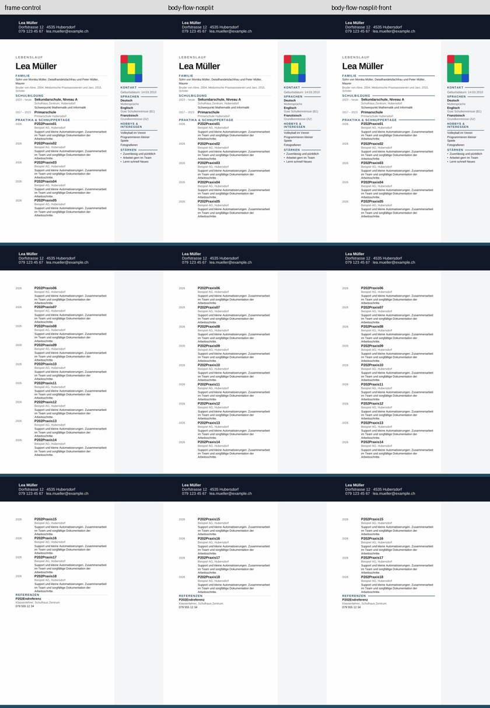
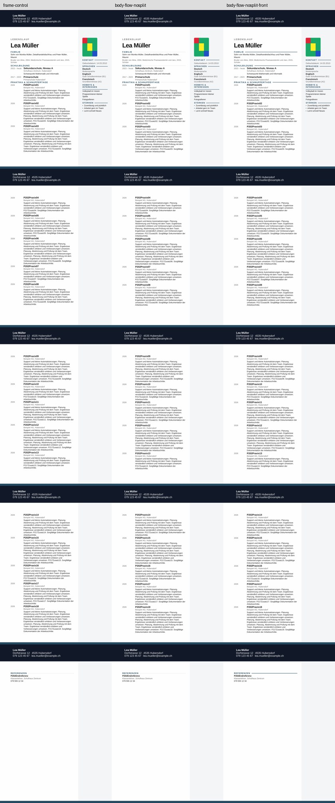

# P2-23 — Hauptinhalt direkt im Dokumentfluss

**Ausführung PASS; lange Texte beidseitig PASS in Diagnosekopien, kurze Texte weiterhin FAIL.**
Das Entfernen auch der einspaltigen äußeren Haupttabelle löst die allgemeinen
Seitenwechsel nicht. Fehlender Zeilenteilungsschutz erklärt dagegen den geteilten
langen Eintrag 09. Vier reine Vordergrund-Flags stellen rechts die dunklen
Abschnittslinien wieder her, ohne Textgeometrie oder Foto-Messwerte zu verändern.

## Getesteter Stand und ursprünglicher Kontrollfehler

Basis `1eadc7d079e49204ed65b4768111099ca2eb62b2`, Branch
`work/02nov-p2-23-body-flow`. Tatsächlich nativ getesteter korrigierter Commit:
**`9b37e77b36bd66011f5a7479f06ca744f1975774`**.

[Actions 41428995677](https://github.com/modebrecht/cv-cover-charm/actions/runs/41428995677),
Job `125222523523`; **02.11.2026 11:27:46–11:33:27 MEZ**, 5:41.
Artefakt `dossier-body-flow`, ID `13132773606`, 10.485.908 Bytes, 14 Tage;
ZIP-SHA256 `3812f0558592b0d4f128004f412f18c7ed55edb0a50717e98d8d80df89501870`.
[Rohdaten](p2-23-native-results.json), SHA256
`a55793da0a3349f88f46b221324460fa33e74c592f407993952a699a2cd01a58`.
[Auditbeleg](p2-23-audit-proof.json): sämtliche 16 Fälle nach erneutem Kopienaufbau
und PDF-Vermessen identisch, **0 zusätzliche native Konvertierungen**.
Vier P2-22-Rahmenkontrollen und ihre Seitenpixel exakt reproduziert.

Der erste veröffentlichte Stand `c4d051c775b9f4f8b51b1ef2e01cd3bcd6973097`
war trotz drei fehlgeschlagener lokaler Tests veröffentlicht worden. Ursache war
die falsche Annahme, sämtliche inneren Zeilen hätten noch keinen Split-Schutz.
[CI 41428504053](https://github.com/modebrecht/cv-cover-charm/actions/runs/41428504053)
scheiterte am Kontrollschritt; der native Schritt ist nachweislich **SKIPPED,
0 native Konvertierungen**. Die Korrektur ist ein Folgecommit ohne Umschreiben
der Historie. Erst nach sieben bestandenen lokalen Tests wurde der korrigierte
Stand veröffentlicht. Sein gesamter nativer Lauf besteht mit **158 Kontrolltests**.
Der Kontrollfehler wird nicht aus der Provenienz entfernt oder als Renderer-Fail gezählt.

## Vier begrenzte Profile

Vier tatsächliche eingefrorene P2-17-Next-Quellen (18 normale/längere Beschreibungen,
links/rechts), Quell-Export-SHA `42bab2e13572145b201d1e9deabfa3baa8dab426`, passende
unveränderte App-Messwerte. Keine neuen App-Exporte oder privaten Dateien.

- `frame-control`: P2-22-Rahmenkopie mit schwebender Sidebar und Haupttabelle.
- `body-flow`: Hauptblöcke direkt im Dokumentfluss, ohne äußere Haupttabelle.
- `body-flow-nosplit`: zusätzlich nur fehlenden Teilungsschutz an inneren Zeilen ergänzen.
- `body-flow-nosplit-front`: zusätzlich vier Hauptlinien über statt hinter dem Dokument.

Gleiche Regel für beide Textlängen. Die normalen Quellen besitzen bereits 18
Split-Guards an den 18 Einträgen; der Referenzzeile fehlt einer. Die längeren
Quellen besitzen 12 Guards; sechs lange Einträge und die Referenzzeile besitzen
keinen. Ergänzt werden daher **1 bzw. 7**, nicht 19. Vorhandene Guards bleiben gleich.
Die geschützte Variante hat danach alle 19 inneren Zielzeilen geschützt.

Im ungeschützten direkten Fluss bleiben alle 19 inneren Tabellen kanonisch gleich.
Bei den Guards ändern sich ausschließlich die fehlenden `cantSplit`-Elemente;
nach Neutralisierung dieses Formats sind sämtliche 19 Tabellen wieder gleich.
107 Inhaltssteuerelemente, Text und übrige Absatz-/Tabellenformatierung bleiben
enthalten. Die Vordergrund-Gegenprobe ändert genau vier `behindDoc`-Flags; keine
Bild-/Crop-Payloads, Bildkoordinaten oder Texte. Die PNGs sind transparent und
enthalten nur Striche im jeweiligen Linienbereich. Die Sidebar und der auf die
ursprüngliche Hauptspalte begrenzte Sektionsrahmen bleiben aus P2-22 erhalten.
Alle anderen ZIP-Teile inklusive Kopf-/Fußdateien bleiben bytegleich.
Globale XML-Lesereihenfolge bleibt eine bekannte Einschränkung der Strukturkopie.

## Grafik-Gate mit echten Positiv-/Negativbelegen

Die neue Prüfung liest alle vier Hauptabschnittslinien: Familie, Schulbildung,
Praktika/Schnuppertage und Referenzen. Messstreifen 15 mm breit ab 5 mm rechts vom
tatsächlichen Text-Boundingbox-Ende; unveränderte Dunkellaufgrenze **0,85**.
Die erhaltenen echten linken/rechten P2-18/P2-19-Positiv-PDFs liefern je viermal
**1,0**. Der erhaltene tatsächliche blasse rechte P2-22-PDF liefert je viermal **0**.
Das ist kein an einen neuen Kandidaten angepasstes Gate.
Vorhandene Referenzlinie, Referenzgruppe, Inhalt, Eintragsteilung, 2-mm-Geometrie,
Foto-/Muster- und Kopf-/Randpixel-Gates gelten zusätzlich unverändert.

## Tatsächliche Ergebnisse

| Fall | Trial | Vollständig | Seiten | Hauptlayout | 4 Linien | Kopf/Rand |
|---|---|---:|---:|---|---|---|
| cv-18-left-frame-control | FAIL | 18/18 | 3 | FAIL | PASS | PASS |
| cv-18-left-body-flow | FAIL | 18/18 | 3 | FAIL | PASS | PASS |
| cv-18-left-body-flow-nosplit | FAIL | 18/18 | 3 | FAIL | PASS | PASS |
| cv-18-left-body-flow-nosplit-front | FAIL | 18/18 | 3 | FAIL | PASS | PASS |
| cv-18-varied-left-frame-control | PASS | 18/18 | 5 | PASS | PASS | PASS |
| cv-18-varied-left-body-flow | FAIL | 18/18 | 5 | FAIL | PASS | PASS |
| cv-18-varied-left-body-flow-nosplit | PASS | 18/18 | 5 | PASS | PASS | PASS |
| cv-18-varied-left-body-flow-nosplit-front | PASS | 18/18 | 5 | PASS | PASS | PASS |
| cv-18-right-frame-control | FAIL | 18/18 | 3 | FAIL | FAIL | PASS |
| cv-18-right-body-flow | FAIL | 18/18 | 3 | FAIL | FAIL | PASS |
| cv-18-right-body-flow-nosplit | FAIL | 18/18 | 3 | FAIL | FAIL | PASS |
| cv-18-right-body-flow-nosplit-front | FAIL | 18/18 | 3 | FAIL | PASS | PASS |
| cv-18-varied-right-frame-control | FAIL | 18/18 | 5 | PASS | FAIL | PASS |
| cv-18-varied-right-body-flow | FAIL | 18/18 | 5 | FAIL | FAIL | PASS |
| cv-18-varied-right-body-flow-nosplit | FAIL | 18/18 | 5 | PASS | FAIL | PASS |
| cv-18-varied-right-body-flow-nosplit-front | PASS | 18/18 | 5 | PASS | PASS | PASS |

**16 native Konvertierungen PASS, 64 PDF-Seiten, 0 BLOCKED; 158 Kontrolltests PASS.**
Trial 4 PASS / 12 FAIL. Alle 16 Fälle haben vollständige Inhalte und passende
Seitenanzahl 3/5. Ohne ergänzte Guards wird der lange Eintrag 09 zwischen Seite 2/3
geteilt; mit Guards ist er vollständig auf der erwarteten Seite. Die Referenzgruppe
bleibt jeweils auf einer Seite. Alle Fotos bestehen das bisherige Gate.

Kurze Beschreibungen verschieben Eintrag 06/15 auch ohne äußere Haupttabelle
weiterhin auf spätere Seiten, bis **26,379 mm** vergleichbare Titelabweichung
(Rahmenkontrolle 26,044 mm). Die Trennung allein ist damit keine Lösung.
Lange geschützte Texte entsprechen den App-Seiten ohne geteilte Einträge,
maximale Titelabweichung **1,631 mm**. Links bestehen sie bereits ohne die
Vordergrundänderung, rechts erst damit auch alle vier Linienprüfungen.

Die vier Vordergrund-Flags liefern in allen vier Quellen exakt gleiche
Seiten-/Inhalts-/Titelpositions- und Fotomesswerte wie die jeweils vorherige
`body-flow-nosplit`-Variante. Sie beheben das Linienproblem, nicht die Umbrüche.
Alle 16 Kopfregionen/unteren Ränder stimmen pixelgenau mit ihrer Kontrolle überein.

Alle Seiten beider Kontaktbögen visuell geprüft. Die Kopie mit langen rechten
Texten und ihr tatsächlich erzeugter PDF sind dauerhaft in
`tests/fixtures/lo-import-p2-23/` gespeichert; Hashes im Auditbeleg. Dort liegt
außerdem der echte blasse P2-22-PDF als negativer Linienbeleg. Alle 16 PDFs/Kopien
und Messbilder liegen im 14-Tage-Artefakt. App-Referenz: eingefrorene P2-17-Messungen;
die Kontaktbögen zeigen native Kontrollen/Kopien.

## Ressourcen und Empfehlung

LibreOffice 24.2.7.2 / Ubuntu 24.04. Summierte Konverter-Wandzeit **29,038 s**,
maximales Konverter-RSS **245.236 KiB (239,49 MiB)**; vollständiger erfolgreicher
Lauf 5:41 inklusive Einrichtung und 158 Tests. Der vorherige Kontrollfehlerlauf
hat keine nativen Ergebnisse erzeugt. RSS ist kein Gesamt-RSS des CI-Jobs.

Nächster sinnvoller Prüfpunkt ist die tatsächliche Zeilen-/Seitenflächenbelegung
bei den kurzen Einträgen 06/15. Weitere äußere Tabellenaufteilungen oder Leerabsatz-
Rastersuchen werden aus diesen Ergebnissen nicht empfohlen. Die Ursache der
verbleibenden 26-mm-Abweichung ist hier nicht als gelöst ausgegeben.

[Zusammengeführter Arbeitsblock P2-22/P2-23](p2-22-23-workblock.md).
LibreOffice beibehalten; ONLYOFFICE-Wasserzeichenentscheidung unverändert,
kein neuer Installationsversuch. 39er-/Word-/Produktfreigabe weiterhin nicht
nachgewiesen. Normale Exporte/`src`, Paketdateien und `dev`/`render`/`main`
unverändert; bestehender Workflow mit fünf Jobs, nur Kompatibilitätsjob, kein Merge.
Abschlusscommit nur Dokumentation/Evidenz `[skip ci]`; nativer Code-SHA bleibt
`9b37e77b…`.
