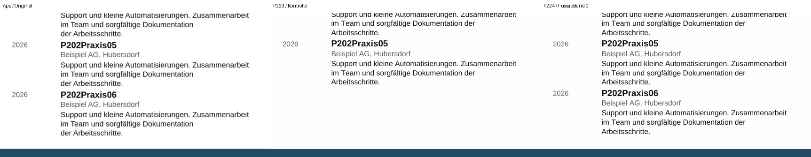

# P2-24 — leere Fusszeile und nutzbare Seitenfläche

Ausgangspunkt: P2-23 `840f6be1eac99a6e5057ba71948a7568c57a389c`.
Separater Branch `work/02nov-p2-24-row-metrics`; keine Produktänderung.

## Fragestellung und begrenzter Test

P2-23 erhält alle 18 Einträge, lässt aber bei normaler Textlänge 06/15 eine Seite zu spät beginnen. Folgende Titel liegen dadurch bis 26.379 mm zu tief. Bei längeren Texten besteht diese Abweichung nicht.

Die vier eingefrorenen echten Next-Exporte (normal/variabel, Sidebar links/rechts) bleiben unverändert. Basis jeder Diagnosekopie ist `body-flow-nosplit-front`. Die Quell-DOCX haben A4, 2948 Twips oberen Rand, 283 Twips unteren Rand (~5 mm) und 680 Twips Fusszeilenabstand (~12 mm). Beide referenzierten Fusszeilen bestehen nur aus einem leeren Absatz; das wird vor jedem Eingriff geprüft.

| Profil | Einziger neuer Eingriff gegenüber P2-23-Kontrolle |
|---|---|
| prior-control | keiner; identischer DOCX-Hash und native Seitenpixel erforderlich |
| footer-distance-zero | `pgMar.footer`: 680 → 0 |
| footer-references-off | zwei leere Fusszeilenverweise aus `sectPr` entfernen; ZIP-Teile und Beziehungen bleiben erhalten |
| bottom-margin-zero | `pgMar.bottom`: 283 → 0 als Gegenprobe |

Geplant: genau 16 native LibreOffice-Konvertierungen im bestehenden Kompatibilitätsjob. Kein neuer Workflow/Job, keine neue ONLYOFFICE-Installation. Anschliessende Audits verwenden gespeicherte PDFs und starten keine Konvertierung.

Die unveränderten Gates prüfen 18 vollständige Einträge, identische App-Seitenbelegung, keine geteilten Einträge, Titel innerhalb 2 mm, Foto innerhalb 2 mm mit Musterkorrelation ≥0.90, Referenzüberschrift/-inhalt auf derselben Seite, Referenzlinie und alle vier Hauptlinien mit dunklem Linienlauf ≥0.85. Kopfbereich 0–45 mm und unterer Streifen ab 292 mm müssen seitenweise zur Kontrolle identisch sein.

Gemessen werden ausdrücklich **sichtbare Text-Bounding-Boxes**, keine effektiven Writer-Zeilenboxen. Titeloberkante und letzte Beschreibungszeile `Arbeitsschritte` werden pro Eintrag gespeichert; OOXML-Zeilen-/Absatzregeln werden separat protokolliert. Eine tatsächlich durch Writer reservierte Fusszeilenhöhe wird nicht aus Textpixeln behauptet.

19 kritische Tabellen sind gegenüber der P2-23-Kontrolle identisch. Gegenüber dem ursprünglichen Export bleiben die bereits dokumentierten P2-23-Änderungen bestehen: fehlende `cantSplit`-Guards (1 normal/7 variabel), entkoppelte Sidebar, aufgelöste Haupttabelle und vier Vordergrundflags. Nicht-Dokument-ZIP-Teile, 107 SDTs, Texte und Bilder werden geprüft.

## Tatsächliche Ausführung und Ergebnis

**Execution PASS; erstmals dieselbe Diagnose-Regel mit PASS für beide Textlängen und beide Sidebar-Seiten.** Keine Produktfreigabe: Die Regel wird auf die bereits umgebauten P2-23-Diagnosekopien angewandt.

Getesteter Implementierungscommit: `dac54d958277c8120ee935975230cf3ad436e542`, Tree `a189327e6eb7f12e9ba45b930e72ee0a5d9ca3cd`.
[CI 41453661190](https://github.com/modebrecht/cv-cover-charm/actions/runs/41453661190), Job `125304822500`: 02.11.2026, **14:31:08–14:36:01 MEZ** (Run-Zeitstempel, 4:53). LibreOffice **24.2.7.2 420(Build:2)** auf Ubuntu 24.04.

- **163/163** bestehende und neue Paket-/Konverterprüfungen lokal und in CI bestanden.
- **16 native Konvertierungen, 64 Seiten**. Alle 16 vollständig, je 18/18 Einträge; keine geteilten Einträge, Referenzinhalt vorhanden.
- Vier P2-23-Kontrollen reproduzieren den DOCX-Hash und sämtliche nativen Seitenpixel.
- Nachgelagerter lokaler Audit: **PASS**, 16 DOCX-Kopien neu aufgebaut, gespeicherte DOCX-/PDF-Hashes und Messwerte identisch, **0 neue Konvertierungen**.

| Testdokument | Seiten | Kontrolle | Fussabstand 0 | Leere Verweise entfernt | Nur unterer Rand 0 | Max. Titelabweichung bei Fussabstand 0 |
|---|---:|---|---|---|---|---:|
| 18 normal, Sidebar links | 3 | FAIL | **PASS** | **PASS** | FAIL | 1.665 mm |
| 18 normal, Sidebar rechts | 3 | FAIL | **PASS** | **PASS** | FAIL | 1.665 mm |
| 18 variabel, Sidebar links | 5 | PASS | **PASS** | **PASS** | PASS | 1.631 mm |
| 18 variabel, Sidebar rechts | 5 | PASS | **PASS** | **PASS** | PASS | 1.631 mm |

Insgesamt 12/16 Trial-PASS; die vier erwarteten FAILs sind die normalen Kontrollen und die wirkungslose Rand-Gegenprobe. Kein BLOCKED in dieser begrenzten Matrix.

Bei beiden normalen Dokumenten liegen 06/15 jetzt auf App-Seite 1/2; 07 und 16 beginnen korrekt auf Seite 2/3. Die vorherige maximale Verschiebung 26.379 mm sinkt auf 1.665 mm, ohne die 2-mm-Grenze zu lockern. Beim normalen Eintrag 06 liegt die letzte Beschreibungs-BBox jetzt bei 286.179 mm, im archivierten App-PDF bei 286.674 mm. Das sind Text-BBox-Messwerte, keine exakten Glyphenkanten oder Tabellenzeilenhöhen.

**Kausale Eingrenzung:** Beide Fusszeilen-Eingriffe erzeugen für jede der vier Quellen untereinander identische vollständige Seitenpixel. `bottom-margin-zero` bleibt für jede Quelle pixelgleich zur Kontrolle. Bei variabler Textlänge bleiben auch die beiden Fusszeilen-Eingriffe vollständig pixelgleich zur Kontrolle. Damit ist die aktive leere Fusszeile in diesen Fixtures der ausschlaggebende Unterschied für den frühen Umbruch; eine universelle Writer-Fusszeilenhöhenformel wurde nicht gemessen.

Foto-Gates bei beiden Textlängen: links Muster 1.0000, maximale BBox-Abweichung 1.323 mm; rechts Muster 0.9688, maximale Abweichung 1.587 mm, x-Abweichung 0.258 mm. Foto nur auf Seite 1. Alle vier Hauptlinien haben in den Kandidaten dunklen Linienlauf 1.0; Referenzlinie/-gruppe PASS. Kopfbereich und unterer Seitenstreifen sind gegenüber der Kontrolle auf allen Seiten identisch.

Alle **16 Seiten der vier `footer-distance-zero`-PDFs** wurden als Raster visuell geprüft, zusätzlich App-Paarvergleiche und der vergrösserte untere Seitenbereich mit Eintrag 06. Keine abgeschnittenen Einträge oder fehlenden Fotos/Linien festgestellt. Zeilenumbrüche und Schriftmetriken bleiben sichtbar anders als im App-PDF; PASS bedeutet Einhaltung der dokumentierten Gates, keine Pixelidentität zur App.

## Ressourcen und Belege

Summierte Konverterlaufzeit **24.064 s**, maximaler gemessener Konverter-RSS **245312 KiB = 239.56 MiB**. Das ist kein gemessener Spitzenbedarf des gesamten CI-Jobs. Der vollständige Run einschliesslich Installation, 163 Tests, PDF-Analyse und Upload dauert 4:53. Gegenüber P2-23 (29.038 s / 245236 KiB) ergibt sich aus je einem Lauf kein belastbarer Geschwindigkeitsvorteil; der Speicherbedarf liegt praktisch gleich.

Artefakt `13146297495`, **10,561,249 Bytes**, SHA256 `acde7a96cd4e6178a47e5a661886b295d7bd839f0e3936a45e0e5475a91cccdd`, bis 16.11.2026 nach CI-Retention. Es enthält alle 16 DOCX/PDF-Kopien, Raster und Messungen. Vier bestandene PDFs und ein reproduzierbares DOCX sind zusätzlich dauerhaft unter [lo-import-p2-24](../../tests/fixtures/lo-import-p2-24/README.md) versioniert.

- [Native Rohdaten](p2-24-native-results.json), SHA256 `46df7c8b4ddc556e392b18c80a0f33dfedeb09d10cedd21e805888da95d19719`.
- [Audit](p2-24-audit-results.json), SHA256 `aac15762d8a6196a9b112f1b024658de250e9fe5ae23e198c604cdfc1117a204`.
- [Archivierte App-BBox-Werte](p2-24-app-ink.json): vier tatsächliche App-PDFs aus P2-17-Artefakt `13106249318`, PDF-Hashes gegen den eingefrorenen Report geprüft.
- [CSV-Vergleich](p2-24-comparison.csv), [CI-/Integritätsnachweis](p2-24-proof.json), [Seitenpaarvergleich](p2-24-page-comparison.png).

Nur Workflow-Auswahl, Forschungsskripte, Tests und QA-Belege wurden ergänzt. Es bleiben fünf Jobs und zehn Dispatch-Eingaben; `src`, normaler Produktexport, Abhängigkeiten und Lockfiles wurden nicht geändert. Geschützte Branches bleiben auf den in `p2-24-proof.json` dokumentierten SHAs.

## Entscheidung und nächster Schritt

**Kandidat für die weitere Forschung:** Auf P2-23-Diagnosekopien den Abstand ausschliesslich nach überprüfter leerer erster/default Fusszeile auf 0 setzen. Das ist kleiner als das Entfernen beider Verweise und in dieser Matrix gleich wirksam. Sichtbare oder Feld-Fusszeilen sind durch die Prüffunktion ausgeschlossen. Kein generelles Löschen oder Nullsetzen beliebiger Fusszeilen.

**Nächste begrenzte Prüfung (P2-25):** Dieselbe Regel an den benachbarten Umbruchfällen 17/19 und mit neuen Fotoausschnitten auf genau diesem Strukturkandidaten prüfen. P2-21-Crop-Ergebnisse gelten nicht automatisch für diesen Aufbau. Erst danach über einen separat beauftragten Produktentwurf entscheiden. Weiterer Tabellenumbau ist für diese Matrix nicht nötig.

Der ursprüngliche Konverterentscheid aus [P2-01](p2-01-onlyoffice.md) bleibt bestehen: Titelblatt, Motivationsschreiben und kurzer Sidebar-CV sind mit App-PDF/LibreOffice PASS; ONLYOFFICE konvertierte alle drei wiederholt stabil, lieferte aber überall `Unregistered Version` und bleibt als saubere visuelle Referenz für jedes der drei Dokumente **FAIL**. In P2-24 wurde ONLYOFFICE nicht neu ausgeführt. **LibreOffice behalten**, bestehende Prüfung ausbauen; 39-Next-Vorlagen weiterhin **BLOCKED**, da 38 Designs am Produktionsguard scheitern. Weder diese vier Modern-Diagnosekopien noch die frühere Legacy-Abdeckung ersetzen die 39-Next-Abnahme. Keine manuelle Word-Abnahme oder Benutzer-PC erforderlich.
