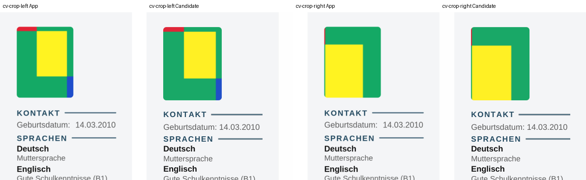

# P2-26 — letzter geplanter Foto-Lauf

Basis `c5d854a8a9853fec9dcb71cae9fe381a03803372`, separater Branch
`work/02nov-p2-26-final-crops`. Zweiter und letzter geplanter CI-Lauf des
[festen Restpakets](cloud-proof-progress.md). Danach Abschlussauswertung;
keine automatische neue Forschungsphase.

## Methode

Zwei neue tatsächliche App-PDF-/DOCX-Next-Downloads über die bestehenden
Browser-E2E-Tests im bestehenden Semantic-Parity-Job. Synthetisches Farbfoto,
Modern, normale Beschreibungen mit 18 Einträgen:

| Quelle | Sidebar | Zoom | x | y |
|---|---|---:|---:|---:|
| cv-crop-left | links | 1.6 | 30 | 70 |
| cv-crop-right | rechts | 2.0 | 65 | 35 |

Andere Einstellungen als P2-21 (1.8/20/80 und 2.2/75/30). Der neue QA-Schalter
ändert ausschliesslich die Browser-Testdaten. Produktcode bleibt unverändert.
Source-Catalog und beide Manifest-SHAs müssen zum getesteten CI-Commit gehören;
PDF-/DOCX-Hashes, Crop-Absicht, Seite und Modern-Intent werden geprüft.
Der bestehende Browser-Test protokolliert separat 1/39 ELIGIBLE und 38 BLOCKED.

Pro Quelle ein unverändertes Original als Negativkontrolle und derselbe
P2-24/P2-25-Kandidat (`footer-distance-zero` auf guarded body flow). Genau vier
native Konvertierungen, zusätzlich zwei echte App-PDF-Downloads. Erwartete
Inhaltsverluste der Originalkontrolle werden als Trial-FAIL protokolliert und
dürfen die Ausführung der Kandidaten nicht abbrechen.

Unveränderte Gates: vollständige 18 Beschreibungen, App-Seitenbelegung und
keine geteilten Einträge, Titel ≤2 mm, Foto-BBox ≤2 mm/Muster ≥0.90, alle vier
Hauptlinien und Referenzlinie ≥0.85, Referenzgruppe sowie Kopf-/Bodenpixel.
Kandidat-Kopf-/Bodenpixel müssen zusätzlich zu den eingefrorenen P2-24-Werten
passen. Paket-/ZIP-Invarianten bleiben erhalten.

## Tatsächliche Ausführung

**PASS: 2/2 neue Crop-Kandidaten. Execution PASS.**

Getesteter Commit `2226e220eeddfa3f12cc589da45ad250ae5fb667`, Tree
`c5e87a705545ddb00834403a6044e8767138d68b`.
[CI 41479670289](https://github.com/modebrecht/cv-cover-charm/actions/runs/41479670289),
Job `125394307437`, 02.11.2026 **17:15:23–17:20:05 MEZ** (4:42).
LibreOffice 24.2.7.2, Ubuntu 24.04. **73/73 Python-Prüfungen** lokal und in CI;
**3/3 echte Browser-E2E-Tests** bestanden (24.2 s): zwei Downloadfälle und
separater 39-Design-Guard-Test.

| Dokument/Profil | Vollständig | Seiten App/LO | Layout | Foto | Hauptlinien | Trial |
|---|---:|---:|---|---|---|---|
| Neuer Crop links, unverändertes Original | 14/18 | 3/3 | FAIL | PASS | FAIL | FAIL |
| Neuer Crop links, gemeinsamer Kandidat | 18/18 | 3/3 | PASS | PASS | PASS | **PASS** |
| Neuer Crop rechts, unverändertes Original | 14/18 | 3/3 | FAIL | FAIL | FAIL | FAIL |
| Neuer Crop rechts, gemeinsamer Kandidat | 18/18 | 3/3 | PASS | PASS | PASS | **PASS** |

Die Original-DOCX enthalten vor der Konvertierung alle 18 Beschreibungen;
LibreOffice verliert im unveränderten Importpfad sichtbaren Inhalt. Das
bleibt ein dokumentierter FAIL der Originalbaseline. Es wird nicht durch
die Diagnosekopie als Produkt-PASS umetikettiert. Rechts verschiebt der
Originalimport das Foto um 19.843 mm; der Kandidat reduziert x auf 0.258 mm.

Bei beiden Kandidaten: maximale Titelabweichung **1.665 mm**, kein geteilter
Eintrag, Foto nur auf Seite 1, Referenzgruppe/-linie PASS. Foto-Muster jeweils
**1.0000**; maximale BBox-Abweichung links **1.059 mm**, rechts **1.322 mm**.
Alle vier Hauptlinien erreichen dunklen Linienlauf 1.0. Kopf-/Bodenpixel
passen exakt zur eigenen Originalkontrolle und zur eingefrorenen P2-24-Basis.
Alle Grenzwerte unverändert.

Alle sechs neuen App-Seiten und sechs Kandidatenseiten wurden gerastert
visuell verglichen, zusätzlich die Fotos vergrössert. Inhalte, Referenzgruppe,
Fotos und Linien sichtbar; keine abgeschnittenen Einträge festgestellt.
Schriftmetriken, Zeilenumbrüche, BBox-Grösse und feine Bildrandpixel bleiben
teilweise verschieden. Die Musterzahl prüft ein normalisiertes Raster;
sie bedeutet keine vollständige Foto-/App-Pixelidentität.

Nachgelagerter Audit: **PASS**, beide Quellen und alle vier DOCX-/PDF-Kopien
anhand von Hashes geprüft, Kopien neu aufgebaut, Messwerte identisch,
**0 neue Konvertierungen**. Erwartet unvollständige Originalkontrollen bleiben
Trial-FAIL und brechen die Matrix nicht ab.

## Ressourcen und dauerhaft gespeicherte Belege

Vier native Konvertierungen mit **12 Seiten**, zusätzlich zwei neue App-PDFs
mit sechs Seiten. Summierte Konverterzeit **44.417 s**, davon unveränderte
Originale **41.107 s**, Kandidaten zusammen **3.310 s**. Das sind die Werte
dieses einen Vergleichslaufs, kein allgemeiner Geschwindigkeitsnachweis.
Maximaler Konverter-RSS **244176 KiB / 238.45 MiB**; Spitzenbedarf des gesamten
Browser-/CI-Jobs nicht gemessen. Gesamter CI-Run 4:42 einschliesslich Setup,
Tests, Browser, Analyse und Upload.

- [Native Rohdaten](p2-26-native-results.json), SHA256
  `24fdf64bb6784e408b17728ca16cf741651ab82b2d79aaa1b98b1822ca0fc3a1`.
- [Audit](p2-26-audit-results.json), SHA256
  `6d9e3dd7ffff28860b439c94c56e354c36fb07d40c9762c94f96997e736a3d26`.
- [Frische App-Messwerte/Manifeste](p2-26-fresh-inputs.json),
  [CSV](p2-26-comparison.csv), [CI-/Hashnachweis](p2-26-proof.json).
- [Originalquellen, App-PDFs und Kandidaten](../../tests/fixtures/lo-import-p2-26/README.md)
  dauerhaft versioniert. Vollständiges CI-Artefakt `13158248988`,
  6,341,665 Bytes, SHA256
  `5d03128b498ee04cb6917caabe14b0919c020dcb86fdfcf484e4789ae94b80fb`,
  Retention bis 16.11.2026.

## Abschluss des festgelegten Cloud-Prüfpakets

**6/6 Prüfpakete abgeschlossen. 2/2 geplante CI-Läufe ausgeführt. Keine
Zusatzrunde benötigt. Verbleibende Runs: 0.** Audits starten keine Konverter.

Die gemeinsame Diagnose-Regel besteht **10/10 abgegrenzte CV-Fälle**:
17/18/19 normale Beschreibungen auf beiden Seiten (6), 18 variable
Beschreibungen auf beiden Seiten (2), neue Fotoausschnitte auf beiden Seiten
(2). [P2-25](p2-25-boundary-check.md) und P2-26 zusammen: **20 native
Konvertierungen, 68 Seiten**, Audit-Konvertierungen 0. Acht Negativkontrollen
bleiben FAIL, zwei Langtextkontrollen PASS. Diese Kontrollen werden separat
von den zehn Kandidaten bewertet; daraus folgt keine Produktfreigabe.

Der ursprüngliche [ONLYOFFICE-Auftrag](p2-01-onlyoffice.md) ist ebenfalls
abgeschlossen: Titelblatt, Motivationsschreiben und kurzer Sidebar-CV waren
für App-PDF/LibreOffice jeweils PASS. ONLYOFFICE Builder 10.0.0.170 führte
alle drei wiederholt stabil aus, ist aber wegen `Unregistered Version` bei
jedem Dokument als saubere visuelle Referenz **FAIL**. Kein neuer
ONLYOFFICE-Versuch in diesem Restpaket.

**Empfehlung für P2-02:** LibreOffice behalten; Originalbaseline, semantische
Prüfung und explizit benannte Diagnosekopie getrennt ausweisen. Der gefundene
Kandidat ist ein belegter Forschungspfad für diese Modern-Matrix. Eine
spätere Übernahme als zusätzlicher QA-Konvertierungspfad wäre eine eigene
Implementierungsaufgabe; die normalen Produkt-DOCX werden nicht verändert.

**39-Next-Abnahme bleibt BLOCKED:** Der frische Browser-Test bestätigt
1/39 ELIGIBLE (Modern) und 38 BLOCKED am unveränderten Exportguard. Das sind
keine 39 erfolgreichen Exporte. Beliebige Fotos, lange 17er/19er, weitere
Vorlagen und Word-Fidelität wurden nicht pauschal freigegeben.

`src`, Produkt-/Downloadexport, Abhängigkeiten, `dev`, `render`, `main` sind
unverändert; kein Merge, kein neuer Workflow/Job, keine privaten Dateien,
kein Benutzer-PC und keine manuelle Word-Abnahme. Dieses Forschungspaket
endet hier; keine weiteren Phasen werden automatisch angehängt.
