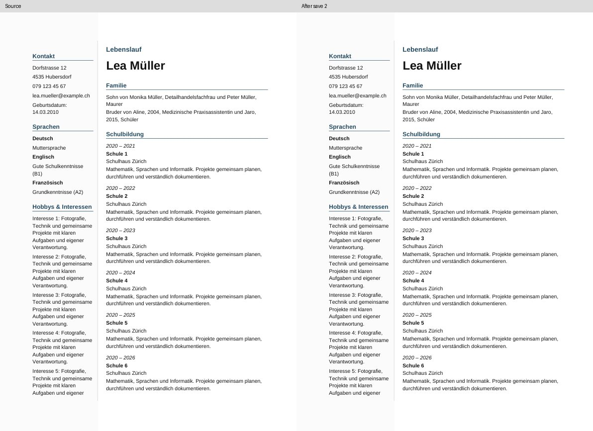
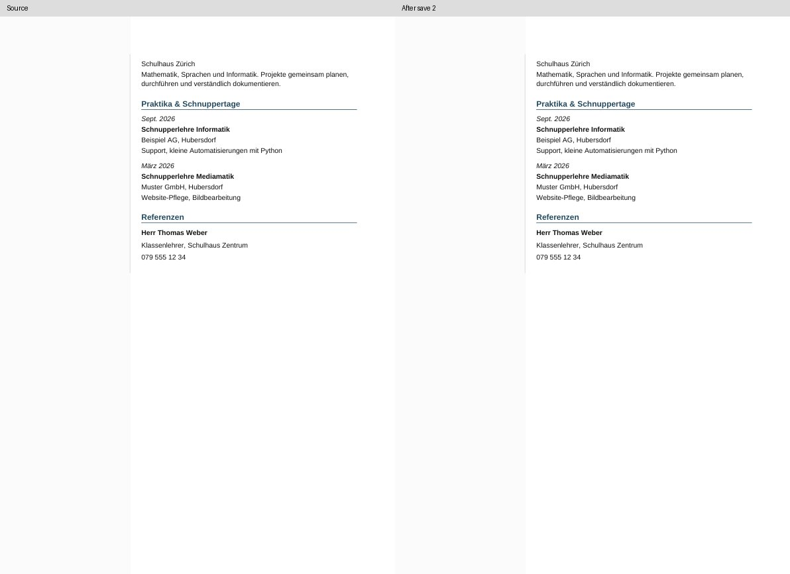
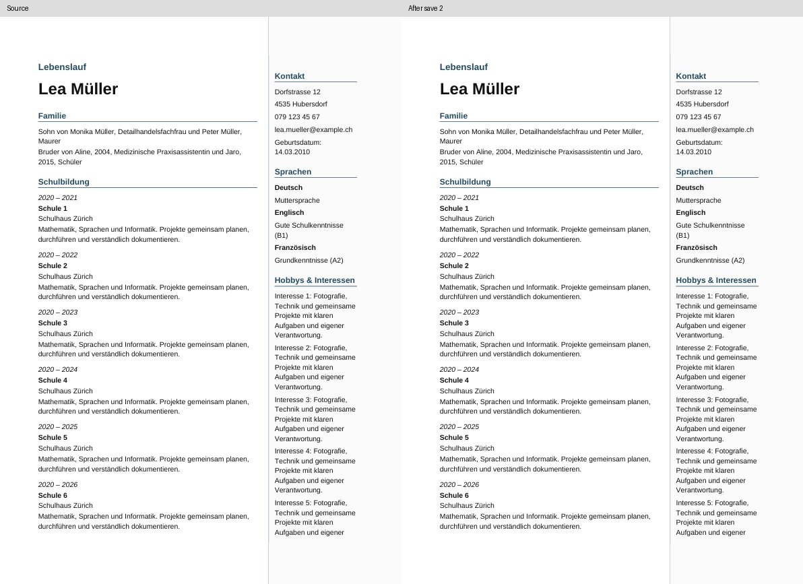
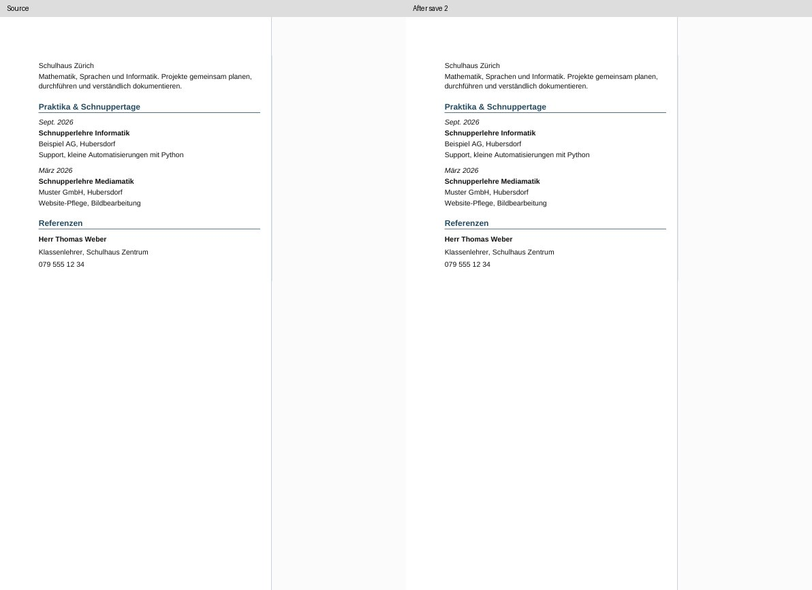

# Word research consolidation on dev — 2026-11-02

This integrates the useful guarded mechanics, tests and closing evidence from
one work chain: body boundary `94d9021` → practical Word `c685bf4` → earlier
ONLYOFFICE/Word proof `f485405`. It is a selection, not a merge of the 24 commits.
The current dev baseline was freshly verified as
`9e84088855dddb5992a6ba7ec768adbe9153fe12`.

## Selected implementation

Six renderer/model files and three unit-test files are copied byte-exactly from
`f4854051595a0a5a51a6a9adc97003dd51e2d929`:

* The already guarded `body-stories` lowering detaches only the two empty cell
  start anchors (`keepNext=false`). Semantic paragraph policies stay unchanged.
* Direct typed-picture and rich-text/tiled-picture variants remain explicit
  diagnostic options requiring `allowUnacceptedModelIssues`. No product entry
  enables these options, and no source/39-template guard is loosened.
* The strengthened picture-owner reader, negative controls and read-only Word
  return inspection are reusable QA, with the immutable synthetic input fixture.

[The selection manifest](word-consolidation-selection-2026-11-02.json) records
all 30 copied files, their immutable source commit, Git blobs and SHA256 hashes.
The existing P2 QA component and its fixture hashes are preserved. Product
entry points, menus, dependencies and lockfile are unchanged.

## New bounded verification

`docx-next-word-consolidation-probe.ts` checks eight deterministic normal
shared-body/ordinary-picture packages against the pre-integration dev baseline,
including left/right short, long, inline-photo and free-photo states. The fixed
1-pixel PNG adapter checks package-byte stability; it is not a browser decoder
or a Microsoft Word acceptance test. Baseline capture was executed against the
actual old commit in a detached checkout, not against the candidate. The real
product UI downloads are separately exercised by the existing Modern smoke.

The probe also produces two new long non-photo body-story candidate packages,
one per side, through the actual guarded snapshot/model/export functions. Both
must still be rejected without the diagnostic opt-in. Input snapshots remain
unchanged. Source manifests bind the generated DOCX hashes and implementation
SHA.

The existing two-job `dossier-visual-parity.yml` generates these sources with its
ordinary smoke batch, then checks two native DOCX saves and source/save1/save2
PDFs using the already hash-pinned LibreOfficeKit 25.8.7.3 contract engine.
The ordinary Modern parity path retains LibreOffice 24.2.
It requires all serialized field texts/identities/order, complete visible
field text (including column-aware reading across page breaks), no blank pages,
stable page count and unchanged sources. Failures
remain nonzero and produce reports. This adds ten conversions; the existing
Modern smoke remains eight conversions. Converter time/RSS and native overview
rasters are retained in the same QA artifact.

The full 22-case body/photo investigation in `docx-next-stable-sidebar.yml`
requires manual `full_body_diagnostics=true`. Its command explicitly declares
`--detached-cell-starts --require-picture-ownership`; known photo failures are
not converted into PASS. Other existing stable-sidebar jobs are unchanged.
No new workflow or working branch was created.

## Historical evidence and remaining boundaries

The copied body, practical Word, commit-review and ONLYOFFICE-return reports are
historical immutable evidence. References to local raw Word files are not newly
reverified or newly uploaded files. Their old "next steps" are not new work
orders. ONLYOFFICE research is already closed; its installer, experimental CI
switches and unbuilt engine patches are not imported here.

The practical Word main case passed two save/reopen cycles with its visible
photo and no repair prompt. The Writer-to-Word return had an empty photo. The
body candidate previously preserved 13 complete native cases, then correctly
stopped at duplicated photo identity. These bounded historical outcomes remain
separate. The fresh two-case smoke cannot grant photo fidelity, exact saved
geometry, the full 22-case matrix, arbitrary CV support or general Word/39-Next
product acceptance. Those gates remain BLOCKED.

The three work refs remain preserved as archive anchors; this task neither
renames nor deletes branches. `render` and `main` are not promoted.

## Validation

Local: 1495 unit tests passed, 0 failed, 283 files. Fifteen focused TypeScript
tests and 81 retained Python negative/contract tests passed; six new bounded
source/visibility negative tests passed. Typecheck, changed-file lint and format
passed. Eight normal packages match the old dev baseline byte-for-byte.

### Completed native CI

Checked implementation: `d26b61c78e0303f51c7edfeb8c7dbe983365b46f`.
[The complete two-job native run passed](https://github.com/modebrecht/cv-cover-charm/actions/runs/41515754421).
Five real UI browser tests, eight normal-package hash comparisons and the bounded
Python contracts passed. Both new body cases passed on the existing pinned
LibreOfficeKit 25.8.7.3 engine.

| Long diagnostic dossier | Source | Save 1 | Save 2 |
|---|---|---|---|
| Sidebar left | 383 fields, 11 pages | 383 fields, 11 pages | 383 fields, 11 pages |
| Sidebar right | 383 fields, 11 pages | 383 fields, 11 pages | 383 fields, 11 pages |

Every phase retained complete visible field text, package identities and field
order; originals remained unchanged. The eight Modern conversions also passed
their bounded suite, preserving original-CV FAIL and QA-candidate PASS as separate
results. Ten body conversions produced 66 PDF pages, and the Modern smoke added
20 PDF pages: **18 conversions, 86 native PDF pages** in this final run. These
are render observations, not 86 distinct source cases or a general photo matrix.

The body converter's highest measured RSS was 206292 KiB (201.5 MiB). Total
runner/browser memory was not measured. Source and second-save first/last CV
pages were visually inspected on both sides. Automated complete-field checks
covered all 66 body PDF pages. No full pixel identity or exact saved-geometry
approval is claimed.

#### Diagnoses retained without weakening gates

The first new text extractor falsely flagged five complete hobby fields split
across pages because the opposite column interrupted whole-page reading order.
The corrected extractor uses the declared source grid and still requires each
complete field's text. A negative control confirms that a truly missing ending
fails. The six bounded Python tests pass.

The first two diagnostic runs used the ordinary Modern renderer (LibreOffice
24.2.7.2). It drops the empty letter controls `letter.body.paragraph:1` and `:3`
during saves. This remains a field-preservation failure of that full-dossier
roundtrip; the controls were not ignored or deleted from the fixtures. The
historical body contract is now tested on its original already pinned 25.8.7.3
engine, where all 383 fields survive both saves. There was no new converter
version search, engine patch or ONLYOFFICE installation.

The broader pre-existing stable-sidebar workflow still fails its old hard-coded
picture precision DOCX hash. The very same actual CI PNG was passed through the
real fixture and renderer on old dev `9e84088` and the integration. Both produce
`61444b4077529c8eff3ec14013f744c63066995947ec51f3613551e3dc821032`;
the legacy pin expects `8dfabf25...`. This proves no new package change for that
control. The old pin remains unchanged and failing; it has not been silently
rebaselined. This native smoke PASS is not a claim that every existing workflow
is green.

The [durable evidence](word-consolidation-proof-2026-11-02.json) contains source
and result hashes, both engine identities, conversion resources, before/after
pin diagnosis, initial counterexamples and visual-review hashes. The larger
ordinary browser regression runs separately; its fast checks passed on the
checked implementation.

#### Reviewed raster samples

Source versus the second native save, first and last CV pages of each long
synthetic dossier. These are samples alongside the complete automated field
check, not a manual examination of every raster page.

### Preserved refs

No history was rewritten and no branch was created or deleted. The selected
mechanics/tests and closing evidence are now on dev; the complete historical
work remains reachable through the existing final Word ref.

| Ref | Preserved head | History/archive decision |
|---|---|---|
| `work/30okt-body-boundary-candidate` | `94d9021956734b39045c4aa3891c08fe6ae0e116` | Ancestor of final Word ref; no deletion performed |
| `work/31okt-word-practical` | `c685bf4308235ac5fcc38957d45d9c9bf508eb21` | Ancestor of final Word ref; no deletion performed |
| `work/word-verified-onlyoffice-poc-31okt` | `f4854051595a0a5a51a6a9adc97003dd51e2d929` | Keep as the existing full historical archive |

The old ONLYOFFICE implementation, discarded prototypes, historical native
workers and unbuilt upstream patches were not wholesale imported. Their source
history is preserved by the final Word ref. Product entry points and normal
export defaults remain unchanged; broad Word/39-Next release remains BLOCKED.
`render` stays at `1fe6dbe59184a759d97f9c393353a8a3d9e1f89a`, and `main` stays at
`44d7eb950b4fe972d6e890a72b6d3256ce365bc9`.
